# Contribution Guide and Workflow

This document defines the technical standards and development process to ensure a clean Git history, automatic versioning, and a robust architecture.

## 1. Branching Strategy (GitHub Flow)

To protect the stability of the project, the `main` branch is protected and does not accept direct changes.

* **`main`**: Contains exclusively stable and production-ready code.
* **Feature branches (`feat/story-X`)**: For new features based on User Stories.
* **Fix branches (`fix/error-description`)**: To solve specific bugs.

### Golden Rules:

* Every change must go through a **Pull Request (PR)** before being integrated into `main`.
* The use of **Squash Merge** is recommended to maintain a linear and clean history in `main`.

---

## 2. Commit Standard (Conventional Commits)

We use the *Conventional Commits* standard to facilitate automatic generation of changelogs and version calculation.

### Structure: `<type>(scope): <description>`

* **`feat`**: A new feature (e.g., `feat(ui): add folder selector`).
* **`fix`**: A bug fix (e.g., `fix(db): solve unexpected closure`).
* **`docs`**: Changes in documentation.
* **`chore`**: Maintenance or configuration tasks (e.g., `chore: update dependencies`).
* **`refactor`**: Code changes that do not add features or fix bugs.
* **`test`**: Add or fix unit tests.

> **Note:** If a change breaks backward compatibility, add a `!` after the type (e.g., `feat!: change in save format`).

---

## 3. Step-by-Step Development Process

### Step 1: Branch Creation

```bash
git checkout -b feat/story-X
```

### Step 2: Development and Commits

Make your changes following the commit standard:
```bash
git add .
git commit -m "feat(module): descriptive message"
```

### Step 3: Pull Request and Automated Checks

1. Upload your branch to GitHub:
   ```bash
   git push origin feat/story-X
   ```
2. Open a Pull Request targeting `main`.
3. The CI/CD pipeline will automatically run the **Lint, Test & Quality Scan** job (ESLint, Vitest unit tests with coverage, TypeScript build check, and SonarQube quality analysis).

### Step 4: Review and Merge

1. Review and resolve any comments or test failures.
2. Once approved and with all CI checks passing, perform a **Squash Merge** into `main`.
3. Merging into `main` automatically triggers the **Deploy to Firebase** job.

---

## 4. CI/CD Pipeline Workflow

The repository uses a streamlined GitHub Actions workflow with two distinct triggers:

```mermaid
flowchart TD
    subgraph Flow1["1. PR Verification (Pull Request -> main)"]
        A[Open / Update PR] --> B[Lint: npm run lint]
        B --> C[Tests: npm run test with coverage]
        C --> D[Build: npm run build]
        D --> E[SonarQube Quality Scan]
        E --> F[PR Checks Pass]
    end

    subgraph Flow2["2. Production Deployment (Merge to main)"]
        G[PR Merged to main] --> H[Setup Node & Dependencies]
        H --> I[Build Frontend: npm run build]
        I --> J[Deploy to Firebase Hosting & Cloud Functions]
    end
```



### Flow 1: Verification on Pull Request (`verify`)
* **Trigger:** Any Pull Request targeting `main`.
* **Actions:**
  - `npm run lint` (ESLint code standards)
  - `npm run test -- --run --coverage` (Vitest unit tests & coverage)
  - `npm run build` (TypeScript compilation & Vite bundle validation)
  - **SonarQube Scan** (code quality, security, and coverage reporting)

### Flow 2: Continuous Deployment on Merge (`deploy`)
* **Trigger:** Push / Merge into `main`.
* **Actions:**
  - Installs root and `functions/` dependencies.
  - Builds the production frontend bundle (`npm run build`).
  - Deploys the application directly to **Firebase Hosting** and **Firebase Cloud Functions** via `firebase-tools`.
