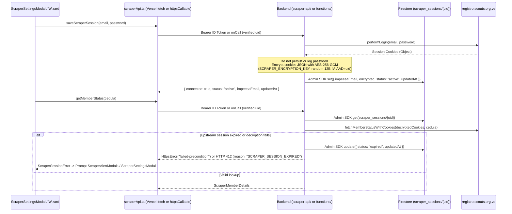

# Batch Wizard UI Cleanup & Server-Encrypted Scraper Session

*   **Author:** Miguel Ciavato
*   **Status:** Implemented
*   **Date:** 2026-11-12

--------------------------------------------------------------------------------

## Overview

This design covers two targeted changes in the `batches` feature and its Impeesa registry scraper integration:

1. **Batch Wizard UI Cleanup**: Fix the header layout of `Step1DataLoad.tsx` so the `Paso 1 de 2` badge sits at the rightmost edge of the card, remove the `(Jóvenes y Adultos)` label suffix and `Nota:` helper paragraph, remove the `Lote / Tipo` subtitle in `Step2ReviewConfirm.tsx`, and remove the `Emitir y Descargar PDF` shortcut button so single-member batches follow the same confirmation flow to `SuccessPage` as multi-member batches.
2. **Server-Encrypted Impeesa Cookie Session**: Replace browser `sessionStorage` credential storage in `scraperApi.ts` with a Firebase-user-scoped (`uid`), server-encrypted Impeesa session cookie stored in Firestore (`scraper_sessions/{uid}`) with client access blocked in `firestore.rules`. The user's Impeesa password is used once during login and discarded immediately—never stored in the browser or database—and the scraper settings modal is unified into a single shared component with clear security copy.
3. **Dual-Transport Workaround for Firebase Spark Plan (`scraper-api/` on Vercel)**: Because project `chil-2d600` cannot deploy Cloud Functions v2 or Secret Manager without Blaze billing, `scraperApi.ts` routes calls via authenticated HTTP `fetch` (`Authorization: Bearer <idToken>`) to Vercel `scraper-api/` when `VITE_SCRAPER_API_URL` is configured, while retaining full parity with Firebase `httpsCallable` (`functions/`) for zero-config rollback once Blaze billing is enabled.

## The Problem

1. **Wizard UI Clutter & Layout Misalignment**:
   - In `Step1DataLoad.tsx`, `Paso 1 de 2` was wrapped inside an inner flex `div` without `w-full` inside `CardHeader`, causing it to sit next to the title instead of at the right edge of the card.
   - `Step1DataLoad.tsx` displayed `(Jóvenes y Adultos)` in the cédulas field label and an unnecessary `Nota:` paragraph below the textarea.
   - `Step2ReviewConfirm.tsx` displayed a redundant `Lote / Tipo` subtitle under `Revisión y Confirmación del Lote` and a separate `Emitir y Descargar PDF` button for single-member batches instead of treating all batches uniformly through `SuccessPage`.
2. **Ephemeral Browser Credentials & Missing Backend Auth**:
   - `scraperApi.ts` stored plaintext Impeesa email and password in `window.sessionStorage`, forcing users on the deployed web app to re-enter credentials every time they closed the browser or tab.
   - `firestore.rules` was in open test mode (`allow read, write: if true;`), `loginScraper.js` and `getMemberStatus.js` did not verify Firebase Auth identity, and `auth.js` used a module-level `cachedCookies` singleton that could leak or overwrite sessions across concurrent users.
   - The scraper settings modal was duplicated across `Sidebar.tsx` and `Navbar.tsx`, lacked a disconnect/clear action, and `ScraperAlertModals.tsx` inaccurately claimed credentials were stored locally.

## Goals

*   Align the `Paso 1 de 2` badge to the rightmost edge of `Step1DataLoad.tsx`'s `CardHeader`, remove `(Jóvenes y Adultos)` from the cédulas label, and remove the `Nota:` helper paragraph.
*   Remove the `Lote / Tipo` subtitle and `Emitir y Descargar PDF` button from `Step2ReviewConfirm.tsx` (retaining `Total`, `Jóvenes`, and `Adultos` badges) so single-member batches complete via `Emitir Lote` -> `SuccessPage`.
*   Eliminate all client-side `sessionStorage`/`localStorage` storage of Impeesa credentials and purge legacy `chil_scraper_credentials` keys.
*   Authenticate users once against Impeesa on the backend, encrypt only the resulting Impeesa session cookies (`AES-256-GCM` with `SCRAPER_ENCRYPTION_KEY`, per-write IV, `uid` AAD, and `keyVersion`), discard the raw password, and store the encrypted envelope in `scraper_sessions/{uid}` with `allow read, write: if false;` in `firestore.rules`.
*   Enforce authenticated Firebase `uid` verification in all backend scraper endpoints (both `functions/handlers/*` via `request.auth?.uid` and `scraper-api/api/*` via `Authorization: Bearer` ID token verification), support dual transport in `scraperApi.ts`, and remove the global `cachedCookies` singleton in `functions/scraper/auth.js` and `scraper-api/lib/auth.js`.
*   Consolidate the duplicated `Sidebar.tsx` and `Navbar.tsx` modals into a single shared `ScraperSettingsModal` with a disconnect button, status badge/indicator, and plain-language security copy, and update `ScraperAlertModals.tsx` copy.

## Non-Goals

*   Broad structural refactoring of `src/features/batches` outside the wizard UI items and scraper session/modal boundary.
*   Removing `member_type` (`young` / `adult`) inference, persistence, or the `Jóvenes` and `Adultos` count badges in `Step2ReviewConfirm.tsx`.

## Critical User Journeys (CUJs)

### CUJ 1: Connect Impeesa Account & Persist Across Browser Restarts

*   **Given**: A user is signed in with Firebase Auth and opens the shared `ScraperSettingsModal` from the sidebar, navbar, or wizard prompt.
*   **When**: The user enters their Impeesa email and password and submits.
*   **Then**: The backend logs into `registro.scouts.org.ve`, discards the password, encrypts the resulting session cookies (`AES-256-GCM` + `uid` AAD) into `scraper_sessions/{uid}` with `status: "active"`, and returns `{ connected: true, status: "active", impeesaEmail, updatedAt }`. Closing and reopening the browser preserves the connected state without re-prompting.

### CUJ 2: Single-Member & Multi-Member Batch Wizard Flow

*   **Given**: A user has an active Impeesa session and opens `/lotes/nuevo`.
*   **When**: The user sees `Paso 1 de 2` aligned at the right edge of `Step1DataLoad`, enters one or more cédulas under `Cédulas de Identidad *`, submits to `Step2ReviewConfirm` (which shows `Revisión y Confirmación del Lote` without the `Lote / Tipo` subtitle and without `Emitir y Descargar PDF`), and clicks `Emitir Lote`.
*   **Then**: The batch (whether 1 member or N members) is finalized and navigates to `/lotes/exito` (`SuccessPage`) for certificate downloads.

### CUJ 3: Upstream Session Expiry & Explicit Disconnect

*   **Given**: A user's encrypted Impeesa cookie in `scraper_sessions/{uid}` has expired on `registro.scouts.org.ve` (or fails decryption), or the user clicks "Desconectar" in `ScraperSettingsModal`.
*   **When**: `getMemberStatus` detects an upstream auth rejection/login redirect (or decryption error), the backend marks `scraper_sessions/{uid}` as `status: "expired"` (`markSessionExpired(uid)`) and returns a `failed-precondition` (`SCRAPER_SESSION_EXPIRED` / `SCRAPER_NOT_CONFIGURED`) or HTTP `412` error so the wizard opens `ScraperAlertModals` / `ScraperSettingsModal` instead of silently marking members unregistered. When the user clicks "Desconectar", `clearScraperSession` permanently deletes `scraper_sessions/{uid}` (`deleteSession(uid)`) and returns `{ connected: false, status: "none", impeesaEmail: null, updatedAt: null }`.

## Technical Plan (Architecture)

### 1. System Architecture & Data Flow

All scraper operations execute server-side behind Firebase Auth verification—either via authenticated HTTP `fetch` (`Authorization: Bearer <idToken>`) against Vercel `scraper-api/` when `VITE_SCRAPER_API_URL` is configured, or via Firebase `onCall` Cloud Functions (`httpsCallable`) when unset. The browser never holds Impeesa cookies or passwords after submission, and `firestore.rules` blocks all client SDK access to `scraper_sessions/{uid}`.

### 2. Backend Security, Encryption & Dual Backends (`functions/`, `scraper-api/`, & `firestore.rules`)

*   **Firestore Security Boundary (`firestore.rules`)**: Explicitly denies all client SDK reads and writes on `match /scraper_sessions/{uid} { allow read, write: if false; }` while preserving existing client rules for `batches`, `scout_members`, `regions`, `districts`, `groups`, and `recognition_types`. Only `firebase-admin` bypasses this rule.
*   **Cryptographic Envelope (`functions/scraper/crypto.js` & `scraper-api/lib/crypto.js`)**:
    *   Decodes `SCRAPER_ENCRYPTION_KEY` (loaded via `defineSecret("SCRAPER_ENCRYPTION_KEY")` in Firebase Functions, or `process.env.SCRAPER_ENCRYPTION_KEY` in Vercel) as 32-byte base64 (`Buffer.from(raw.trim(), "base64")`, `length === 32`), throwing an `Error` if missing or invalid.
    *   Serializes cookie maps with `JSON.stringify` and encrypts with `crypto.createCipheriv("aes-256-gcm", key, iv)` using a fresh 12-byte IV (`crypto.randomBytes(12)`) per write, binding `Buffer.from(uid, "utf8")` as Additional Authenticated Data (`setAAD`), encoding `iv`, `authTag`, and `ciphertext` in base64 with `keyVersion: 1`.
    *   `decryptSessionPayload(uid, envelope)` validates `keyVersion`, `iv` (12 bytes), and `authTag` (16 bytes), verifies AAD against `uid`, and throws on tampering or failure so `getMemberStatus` marks the session expired and signals `SCRAPER_SESSION_EXPIRED`.
*   **Stateless Auth & Enriched Member Lookup (`functions/scraper/` & `scraper-api/lib/`)**:
    *   `auth.js`: Removed module-level `cachedCookies` and `cachedCredentialsKey` singletons; exports only `performLogin(email, password)` returning `finalCookies` as a plain `Object`.
    *   `lookup.js`: Enriched `#content .card` + `[data-sortable-id^='member-status-p']` Cheerio parser returning `region`, `distrito`, `grupo`, `unidad`, `cargo_grupo`, `cargo_institucional`, `tipo_miembro`, `solvente_hasta`, `member_uuid`, `avatar_url`, and fallback `p.mb-1` support.
*   **Firestore Session Store (`functions/scraper/sessionStore.js` & `scraper-api/lib/sessionStore.js`)**:
    *   Stores `{ impeesaEmail, encrypted, status: "active", updatedAt: serverTimestamp() }` at `scraper_sessions/{uid}`.
    *   Exports `saveSession`, `getSessionMetadata` (returns `{ connected, status, impeesaEmail, updatedAt }`), `getSessionEnvelope`, `markSessionExpired`, and `deleteSession`.
*   **Authenticated Endpoints (`functions/handlers/*` & `scraper-api/api/*`)**:
    *   `functions/handlers/*`: Configures `saveScraperSession` (`timeoutSeconds: 60`, `secrets: [SCRAPER_ENCRYPTION_KEY]`), `getMemberStatus` (`timeoutSeconds: 60`, `secrets: [SCRAPER_ENCRYPTION_KEY]`), `getScraperSessionStatus` (`timeoutSeconds: 30`), and `clearScraperSession` (`timeoutSeconds: 30`) with `{ cors: true, maxInstances: 10 }`. Enforces `request.auth?.uid` (`HttpsError("unauthenticated")`) and passes `{ reason: "SCRAPER_NOT_CONFIGURED" | "SCRAPER_SESSION_EXPIRED" }` in `HttpsError("failed-precondition", ..., details)`.
    *   `scraper-api/`: Uses `lib/firebaseAdmin.js` (`FIREBASE_SERVICE_ACCOUNT_JSON` raw/base64 or `FIREBASE_PROJECT_ID` / `FIREBASE_CLIENT_EMAIL` / `FIREBASE_PRIVATE_KEY`) + `lib/httpHelper.js` to verify `Authorization: Bearer <Firebase ID token>`, returning HTTP `401` (`UNAUTHENTICATED` or `IMPEESA_INVALID_CREDENTIALS`), HTTP `412` (`SCRAPER_NOT_CONFIGURED` / `SCRAPER_SESSION_EXPIRED`), and HTTP `200` / `404` / `500`. `vercel.json` includes `Authorization` in `Access-Control-Allow-Headers`.

### 3. Client API Dual Transport (`src/features/batches/api/scraperApi.ts`)

*   Removed `sessionStorage`/`localStorage` credential persistence (`getScraperCredentials`, `SCRAPER_CREDENTIALS_KEY` writes) and added `purgeLegacyScraperStorage()` to clear legacy `chil_scraper_credentials` from both storages on every call, context mount/auth change, and sign-out.
*   Retained dual transport: when `getScraperApiUrl()` (`VITE_SCRAPER_API_URL`, trailing slashes stripped) is non-empty, `callHttpEndpoint` invokes `fetchScraperApi` (`fetch` with `Authorization: Bearer ${await auth.currentUser.getIdToken()}`) and re-throws errors already mapped by `mapHttpError` without re-passing them through `mapCallableError`. Otherwise, invokes `httpsCallable(functions, ...)` and normalizes errors through `mapCallableError`.
*   Exports `ScraperSessionStatus` (`{ connected: boolean; status: 'active' | 'expired' | 'none'; impeesaEmail: string | null; updatedAt: string | null }`), `ScraperSessionError`, `isScraperSessionError`, `purgeLegacyScraperStorage`, `getScraperApiUrl`, `getScraperSessionStatus`, `saveScraperSession`, `clearScraperSession`, and `getMemberStatus`.

### 4. Shared Settings Modal, Quick Recognition & Batch Wizard UI

*   **Shared `ScraperSettingsContext` & `ScraperSettingsModal`**:
    *   `src/context/ScraperSettingsContext.tsx` exposes `{ isOpen, sessionStatus, isLoadingStatus, openModal, closeModal, refreshSessionStatus, setSessionStatus }`, resets `sessionStatus` to `null` on sign-out or UID change, and calls `purgeLegacyScraperStorage()` + `getScraperSessionStatus()` when signed in.
    *   `src/App.tsx` wraps `<HashRouter>` and `<MainLayout>` inside `<AuthProvider>` -> `<ScraperSettingsProvider>` and renders `<ScraperSettingsModal />` once globally.
    *   `src/components/navigation/ScraperSettingsModal.tsx` calls `saveScraperSession` / `clearScraperSession` directly, updates `setSessionStatus`, resets local password/message state on close/save/disconnect, displays active/expired/none banners with `impeesaEmail` and "Desconectar" action, and presents security copy explaining passwordless server-encrypted cookie storage.
    *   `Sidebar.tsx` and `Navbar.tsx` open the shared modal via `openModal()`; `Sidebar.tsx` also shows an active emerald indicator dot when `sessionStatus?.status === 'active'`.
    *   `ScraperAlertModals.tsx` opens the modal via `openModal()` from `useScraperSettings()` instead of `document.querySelector`, with updated server-cookie security copy.
*   **Wizard UI Cleanup (`Step1DataLoad.tsx`, `Step2ReviewConfirm.tsx`, `NewBatchWizard.tsx`)**:
    *   `Step1DataLoad.tsx` places the title block and `Paso 1 de 2` (`shrink-0`) as direct children of `<CardHeader>`, renames the cédulas label to `Cédulas de Identidad *`, and removes the `Nota:` helper paragraph.
    *   `Step2ReviewConfirm.tsx` removes the `Lote / Tipo` subtitle, removes `Emitir y Descargar PDF` and unused `batchMetadata`/`recognitionTypeName` props/imports, and routes all batches through `Emitir Lote` -> `SuccessPage`.
    *   `NewBatchWizard.tsx` checks `getScraperSessionStatus()` before creating/scraping a batch and inspects `isScraperSessionError(scrapeErr)` so `SCRAPER_NOT_CONFIGURED` opens `showAuthAlert` and `SCRAPER_SESSION_EXPIRED` opens `setAuthError`.
*   **Quick Recognition Error Copy (`quickRecognitionHelpers.ts`, `useQuickRecognition.ts`)**:
    *   `getScraperErrorMessage(err)` maps `SCRAPER_NOT_CONFIGURED` to `'No hay una sesión de Impeesa configurada en Ajustes del Scraper.'` and `SCRAPER_SESSION_EXPIRED` (or `failed-precondition` / expired strings) to `'Tu sesión de Impeesa expiró. Reconéctate en Ajustes del Scraper.'`.

## Alternatives Considered

### Alternative A: Storing Encrypted `{ email, password }` in Firestore

*   **Pros**: Enables silent backend re-login to `registro.scouts.org.ve` whenever Impeesa's upstream session expires.
*   **Cons**: Turns Firestore into a decryptable password vault under `SCRAPER_ENCRYPTION_KEY`.
*   **Reason for Rejection**: Rejected by author: storing only encrypted Impeesa session cookies and discarding passwords after login minimizes credential risk.

### Alternative B: Encrypted Cookie Token in Browser `sessionStorage` (Zero Firestore)

*   **Pros**: Avoids Firestore storage, encryption keys, and security rules changes.
*   **Cons**: Wiped whenever the user closes the browser tab/window.
*   **Reason for Rejection**: Rejected by author: fails persistence across browser restarts.

### Alternative C: Dropping `VITE_SCRAPER_API_URL` Completely

*   **Pros**: Eliminates dual transport (`fetch` + `httpsCallable`) and `scraper-api/`.
*   **Cons**: Firebase Cloud Functions v2 and Secret Manager require Blaze billing on project `chil-2d600`, blocking Spark-plan deployments.
*   **Reason for Outcome (Temporary Dual Transport Adopted)**: `scraperApi.ts` keeps `VITE_SCRAPER_API_URL` authenticated HTTP `fetch` to Vercel `scraper-api/` alongside `httpsCallable` to `functions/` so the feature deploys immediately on Spark while remaining one `.env.production` line away from pure Firebase Cloud Functions later.

--------------------------------------------------------------------------------

## Non-Functional Requirements

*   **Security & Privacy**:
    *   `scraper_sessions/{uid}` in `firestore.rules` denies all client reads and writes (`allow read, write: if false;`).
    *   `SCRAPER_ENCRYPTION_KEY` is provisioned as a secret (`SCRAPER_ENCRYPTION_KEY` env var on Vercel `chil-scraper-api`, `defineSecret("SCRAPER_ENCRYPTION_KEY")` in Firebase Functions) and never stored in Git or frontend `.env` files.
    *   Backend handlers never log plaintext passwords, cookies, or encryption keys.
*   **Backward Compatibility & Rollout**:
    *   `purgeLegacyScraperStorage()` clears any legacy `chil_scraper_credentials` keys from `sessionStorage` and `localStorage`.

## Detailed Implementation Plan

### Files Created, Modified, or Removed

1. **`firestore.rules`** *(Modified)*: Blocks all client reads/writes on `/scraper_sessions/{uid}`.
2. **`functions/scraper/crypto.js`** *(Created)*: `AES-256-GCM` encryption/decryption bound to `uid` AAD using `defineSecret("SCRAPER_ENCRYPTION_KEY")`.
3. **`functions/scraper/sessionStore.js`** *(Created)*: Firestore Admin SDK CRUD (`saveSession`, `getSessionMetadata`, `getSessionEnvelope`, `markSessionExpired`, `deleteSession`).
4. **`functions/scraper/auth.js`** *(Modified)*: Removed global cookie cache singletons.
5. **`functions/handlers/{saveScraperSession,getScraperSessionStatus,clearScraperSession,getMemberStatus}.js`** & **`functions/index.js`** *(Created / Modified; deleted `loginScraper.js`)*: Authenticated v2 `onCall` handlers exported from `index.js`.
6. **`scraper-api/`** *(Created / Modified; deleted `api/loginScraper.js`)*: Vercel port (`package.json`, `vercel.json`, `lib/{firebaseAdmin,crypto,sessionStore,httpHelper,auth,lookup}.js`, `api/{saveScraperSession,getScraperSessionStatus,clearScraperSession,getMemberStatus}.js`) mirroring Firebase behavior with Bearer ID token auth and full enriched `lookup.js` extraction.
7. **`src/features/batches/api/scraperApi.ts`** *(Modified)*: Dual-transport client (`callHttpEndpoint` + `httpsCallable`), `ScraperSessionStatus`, `ScraperSessionError`, `isScraperSessionError`, `purgeLegacyScraperStorage`.
8. **`src/context/ScraperSettingsContext.tsx`** & **`src/App.tsx`** *(Created / Modified)*: Global modal state and UID-scoped session status lifecycle.
9. **`src/components/navigation/{ScraperSettingsModal.tsx,Sidebar.tsx,Navbar.tsx,index.ts}`** *(Created / Modified)*: Shared modal, disconnect flow, security copy, and sidebar active indicator dot.
10. **`src/features/batches/components/wizard/{ScraperAlertModals.tsx,Step1DataLoad.tsx,Step2ReviewConfirm.tsx}`** & **`src/features/batches/components/NewBatchWizard.tsx`** *(Modified)*: Wizard UI cleanup, uniform `SuccessPage` completion, `openModal()` integration, and session preflight/error handling.
11. **`src/features/batches/hooks/quickRecognitionHelpers.ts`** & **`useQuickRecognition.ts`** *(Modified)*: Mapped `SCRAPER_NOT_CONFIGURED` and `SCRAPER_SESSION_EXPIRED` errors to settings-reconnect copy.
12. **Tests & Documentation** *(Created / Modified)*:
    *   Backend tests: `functions/__tests__/{auth,cookieHelper,crypto,handlers,index,lookup,sessionStore}.test.js` and `scraper-api/__tests__/{handlers,lookup}.test.js`.
    *   Frontend tests: `src/features/batches/api/__tests__/scraperApi.test.ts`, `api.test.ts`, `src/components/navigation/__tests__/{Navbar,Sidebar,ScraperSettingsModal}.test.tsx`, `src/features/batches/components/__tests__/{Step1DataLoad,Step2ReviewConfirm,NewBatchWizardFull,NewBatchWizardErrors}.test.tsx`, and `src/features/batches/hooks/__tests__/useQuickRecognition.test.ts`.
    *   Updated EGM contracts in `src/features/batches/README.md` and `src/features/batches/{api,hooks,components,components/wizard}/README.md`.

### Verification Plan & Current Status

*   **Lint**: `npm run lint` (`eslint .`)
*   **Build**: `npm run build` (`tsc && vite build`)
*   **Unit Tests**: `npm test -- --run` (Vitest suite covering `src/`, `functions/__tests__/`, and `scraper-api/__tests__/`)
*   **Vercel Deployment (`chil-scraper-api`)**: `SCRAPER_ENCRYPTION_KEY` and `FIREBASE_SERVICE_ACCOUNT_JSON` configured for `production`; `scraper-api/` deployed via `npx vercel --prod`.
*   **Firebase Rules & Hosting**: Deployed via `npx firebase deploy --only firestore:rules` and `npm run build && npx firebase deploy --only hosting`.

--------------------------------------------------------------------------------

*Drafted and synced with EGM*
