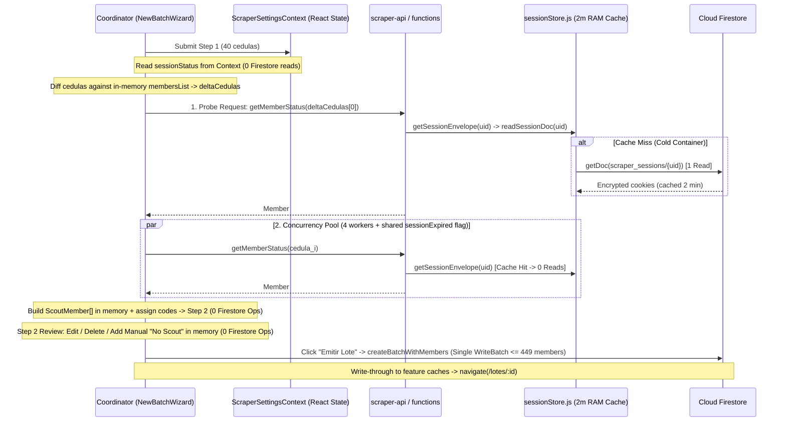

# Cloud Firestore Read/Write and Bandwidth Optimization Across Chil

*   **Author:** Miguel Ciavato
*   **Status:** Draft
*   **Date:** 2026-11-22

--------------------------------------------------------------------------------

## Overview

Chil is a single-page application for managing Scout recognition batches and generating printable PDF certificates, backed by Cloud Firestore, Firebase Authentication, and a dual-backend Impeesa scraper (`functions/` on Firebase Cloud Functions and `scraper-api/` on Vercel).

Under normal daily usage by a single coordinator, Chil currently exceeds the Firebase Spark free tier limit of 50,000 document reads per day—recording 156,000 document reads against only 22 document writes in a single 24-hour quota period—and transfers hundreds of megabytes of redundant Base64 certificate template images. When the daily 50,000-read ceiling is reached, Firestore returns `8 RESOURCE_EXHAUSTED: Quota exceeded`, blocking both client views and backend scraper session lookups (`scraper_sessions/{uid}`) and preventing users from verifying cedulas or creating new batches.

This design reduces daily Firestore document reads and network bandwidth by over 97% for single-user account operation while preserving 1:1 certificate print resolution, existing dual-backend scraper endpoints, and all feature workflows.

## The Problem

Four structural behaviors in the current data access layer drive the 7,090:1 read-to-write ratio and bandwidth exhaustion:

1.  **Repeated Full-Database Queries on Every Route Switch**:
    The three primary workspace views—`/lotes` (`BatchList`), `/resumen` (`SummaryView`), and `/estadisticas` (`StatisticsDashboard`)—store fetched data only in local component state (`useState`). Every time a user switches tabs in the sidebar, the unmounted view discards its state and the newly mounted view executes six `getDocs` queries in parallel:
    *   `getAllBatches(uid)`: reads all $B$ historical batch documents for the user.
    *   `getAllMembers(uid)`: reads all $M$ historical member documents across all batches for the user.
    *   `getHierarchyData()`: reads all three territorial collections (`12` regions + `71` districts + `199` groups = **282 documents**), even though the exact same 282 static records are already bundled locally in `src/data/hierarchy.json`.
    *   `getAllRecognitionTypes(uid)`: reads all $R$ recognition type documents.
    For an account with 4,500 historical members and 200 batches, a single tab switch costs **4,994 document reads**. Just 31 tab switches in a workday consume **154,814 reads** with zero writes.

2.  **Embedded Base64 Certificate Templates Downloaded on Every Catalog Read**:
    Each document in `recognition_types/{id}` embeds a `CertificateTemplate` object containing a Base64-encoded `background_url` image of up to 750–950 KB. Because the Firebase Web SDK does not support partial field projections on `getDocs`, every view that calls `getAllRecognitionTypes(uid)` merely to populate a `{ id, name }` dropdown (`/lotes`, `/lotes/nuevo`, `/lotes/:id`, `/resumen`, `/estadisticas`, `/reconocimientos`) downloads 5–9 MB of Base64 images that are never rendered on those screens.

3.  **Premature Draft Writes, Re-Reads, and $N + 1$ Session Reads in `NewBatchWizard`**:
    *   In Step 1 (`onSubmitStep1`), `NewBatchWizard` calls `getScraperSessionStatus()` directly (1 Firestore read on `scraper_sessions/{uid}`), creates a batch document in Firestore immediately (`createBatch`), and fires $N$ concurrent `getMemberStatus(cedula)` requests via `Promise.all`.
    *   Each `getMemberStatus` invocation in `functions/` and `scraper-api/` reads `scraper_sessions/{uid}` from Firestore ($N$ additional reads), and firing all $N$ requests at the same millisecond causes serverless cold-start fan-out on Vercel.
    *   As each cedula resolves in Step 1, `saveScrapedMemberToDb` / `saveUnregisteredMemberToDb` immediately writes an individual draft member document to `scout_members` ($N$ writes), and Step 1 then calls `getMembersByBatchId(batchId)` ($N$ reads) to read back the records it just created.
    *   In Step 2 (`Step2ReviewConfirm`), editing a member calls `updateMember` + `getMembersByBatchId` ($N$ reads), deleting a member calls `deleteMember` (up to 3 `deleteDoc` operations), adding a manual "No Scout" member calls `getMembersByBatchId` without having saved the manual member (causing the manual member to be lost), and clicking "Emitir Lote" calls `batchUpdateMembers` to overwrite all $N$ members a second time ($N$ writes). If the user abandons the wizard before Step 2 finalization, orphaned batch and member documents remain permanently in Firestore.

4.  **Redundant Detail and Post-Mutation Re-Queries**:
    Navigating from `/lotes` to `/lotes/:id` (`BatchDetail`) re-fetches `getBatchById`, `getMembersByBatchId`, `getHierarchyData`, and `getAllRecognitionTypes` from Firestore even when the user's batches and members are already in memory. Similarly, merging batches in `BatchList` (`handleMergeSuccess`) re-invokes `getAllMembers(uid)`, reading all $M$ historical members again.

### Proposed Solution Summary

1.  **Static Territorial Hierarchy (Pillar 1)**: Serve normalized `regions`, `districts`, and `groups` directly from `src/data/hierarchy.json` in `getHierarchyData()` with 0 Firestore reads and 0 Firestore writes, and document the territorial update procedure (`src/data/hierarchy.json` + `npm run seed-hierarchy`) in `docs/HIERARCHY_MAINTENANCE.md`.
2.  **Generic UID-Scoped In-Memory Session Cache with Write-Through Updates (Pillar 2)**: Introduce a generic `src/lib/sessionCache.ts` utility (with in-flight Promise deduplication and a central `clearAllSessionCaches()` registry) consumed by each feature API (`batchesCrud.ts`, `membersCrud.ts`, `recognitions/api/index.ts`) for write-through mutation updates, cache-first point lookups (`getBatchById`, `getMembersByBatchId`), and automatic eviction on auth logout/UID change.
3.  **Deferred Wizard Persistence, Probe-First Pool of 4 with Circuit Breaker, and Backend Session TTL Cache (Pillar 3)**: Keep `NewBatchWizard` Step 1 and Step 2 drafts in memory (writing `batches/{batchId}` and `scout_members` atomically via `createBatchWithMembers` only when clicking "Emitir Lote"), scrape only delta cedulas when navigating back from Step 2 to Step 1, execute 1 probe request followed by a 4-worker concurrency pool with a shared mid-batch `sessionExpired` circuit breaker, read `sessionStatus` from `ScraperSettingsContext` (with StrictMode in-flight deduplication), and cache `scraper_sessions/{uid}` in memory (2-minute TTL + in-flight deduplication) in both `functions/scraper/sessionStore.js` and `scraper-api/lib/sessionStore.js`.
4.  **Decoupled `recognition_templates/{id}` Collection with Atomic Lazy Migration (Pillar 4)**: Store heavy `CertificateTemplate` objects in `recognition_templates/{id}` (updating `firestore.rules`) while keeping `recognition_types/{id}` as lightweight catalog metadata (~200 bytes), and migrate legacy embedded `recognition_types/{id}.template` fields atomically via a 2-operation `WriteBatch` (`set` + `deleteField()`) with non-fatal error handling on reads.

## Goals

*   **Zero Firestore reads and writes for territorial hierarchy**: Reduce `getHierarchyData()` Firestore operations from 282 reads per view mount (and 282 writes on empty seed) to **0 reads and 0 writes**.
*   **Zero redundant collection re-reads across SPA route switches**: Ensure navigating between `/lotes`, `/resumen`, `/estadisticas`, `/lotes/nuevo`, `/lotes/:id`, and `/reconocimientos` performs at most **1 initial read per collection per user session**, with subsequent views and point lookups (`getBatchById`, `getMembersByBatchId`) served from the write-through in-memory cache.
*   **Zero Firestore writes prior to Step 2 batch emission**: Eliminate all Firestore writes and `getMembersByBatchId` reads during `NewBatchWizard` Step 1 verification and Step 2 draft editing, persisting the batch and its members atomically (for batches `<= 449` members) when clicking "Emitir Lote" and fixing manual "No Scout" member addition in Step 2.
*   **Delta-only cedula scraping on wizard back-navigation**: When returning from Step 2 to Step 1 and modifying the cedula list, retain already-verified members in memory and query `getMemberStatus` only for newly added cedulas.
*   **Bounded Firestore session reads per scraper batch**: Reduce `scraper_sessions/{uid}` reads during batch verification from $N + 1$ per batch to **1 read per warm serverless container** (bounded to `1..4` reads on cold scale-out across the 4-worker pool) via probe-first verification, mid-batch circuit breaking, context reuse in `ScraperSettingsContext`, and a 2-minute in-memory TTL cache in `functions/scraper/sessionStore.js` and `scraper-api/lib/sessionStore.js`.
*   **>99% catalog bandwidth reduction via template decoupling**: Reduce `getAllRecognitionTypes(uid)` payload size from ~5–9 MB to **< 5 KB** once templates are stored in or lazily migrated to `recognition_templates/{id}`, without altering certificate image resolution or print dimensions.
*   **Deterministic unit test isolation**: Reset frontend caches in `src/test/setup.ts` and backend session caches in backend test `beforeEach` hooks so all existing and new Vitest suites remain isolated.

## Non-Goals

*   **Multi-device or multi-tab real-time synchronization (`onSnapshot`)**: Each Chil account is operated by a single user at a time; real-time listeners are excluded to avoid listener reconnect read billing.
*   **Server-side pre-aggregation Cloud Functions for `/estadisticas`**: In-memory aggregation over the cached session dataset is sufficient once redundant per-route re-fetching is removed.
*   **Browser `sessionStorage` persistence for `ScraperSettingsContext` or F5 wizard recovery**: `ScraperSettingsProvider` already wraps `HashRouter` at the app root so React state persists across all SPA transitions without `sessionStorage` coupling; F5 wizard draft recovery is a separate UX enhancement out of scope for Firestore quota reduction.
*   **Re-compressing or downscaling certificate template backgrounds**: Existing image quality thresholds (`MAX_FIRESTORE_BACKGROUND_BASE64_LENGTH = 750_000` and `MAX_FIRESTORE_TEMPLATE_BYTES = 950_000`) and 1:1 millimeter rendering remain unchanged.
*   **Altering the 4-endpoint dual-backend scraper contract**: `saveScraperSession`, `getScraperSessionStatus`, `clearScraperSession`, and `getMemberStatus` retain their existing HTTP and Firebase Callable request/response shapes.

## Open Questions

*   None. All architectural decisions (static hierarchy + maintenance guide, generic session cache with feature-owned write-through updates, deferred atomic Step 2 batch emission, probe-first + pool-of-4 scraper concurrency with mid-batch circuit breaker and backend TTL cache, and `recognition_templates/{id}` decoupling with atomic lazy `WriteBatch` migration) are resolved.

## Critical User Journeys (CUJs)

### CUJ 1: Cross-View Navigation and Filtering Without Re-Querying Firestore

*   **Given**: An authenticated coordinator opens Chil at `/lotes`, which loads the user's `batches` ($B$ reads), `scout_members` ($M$ reads), lightweight `recognition_types` ($R$ reads), and static hierarchy from `src/data/hierarchy.json` (0 reads).
*   **When**: The coordinator navigates across `/resumen`, `/estadisticas`, `/reconocimientos`, and into a specific batch `/lotes/:id`, applies filters, and exports an Excel summary and a statistics PDF.
*   **Then**: All route transitions, table renders, filter updates, and Excel/PDF exports resolve from the warm UID-scoped session caches with **0 additional Firestore document reads**.

### CUJ 2: Creating a Batch with Delta Back-Navigation, Manual Member Addition, and Deferred Emission

*   **Given**: An authenticated coordinator with an active Impeesa scraper session opens `/lotes/nuevo` (`NewBatchWizard`).
*   **When**:
    1.  The coordinator enters 40 cedulas in Step 1 and clicks "Verificar y Continuar".
    2.  In Step 2 (`Step2ReviewConfirm`), the coordinator edits 1 member's territorial data, adds 1 manual "No Scout" member via `ManualMemberModal`, then clicks "Atrás (Modificar Cédulas)" to return to Step 1, appends 2 new cedulas (total 42 cedulas), returns to Step 2, and clicks "Emitir Lote".
*   **Then**:
    1.  During Step 1 initial verification, the first cedula runs as a probe request (warming `sessionStore.js` cache with 1 Firestore read of `scraper_sessions/{uid}`), followed by the remaining 39 cedulas in a pool of 4 concurrent workers (`1..4` Firestore session reads total across warm containers, 0 Firestore writes).
    2.  During Step 2 editing, the manual "No Scout" member and the edited member are updated in memory (0 Firestore reads or writes).
    3.  When returning to Step 1 and adding 2 new cedulas, only the 2 new delta cedulas are queried via `getMemberStatus`; the 40 already-verified members (and the manual "No Scout" member/edits) are preserved from in-memory state.
    4.  Clicking "Emitir Lote" commits the `Batch` document and all 43 `ScoutMember` documents together in a single Firestore `WriteBatch` (44 writes), updates the in-memory session caches via write-through, and opens `/lotes/:id` with **0 additional Firestore reads**.

### CUJ 3: Designing a Certificate Template and Lazy Migration of Legacy Templates

*   **Given**: A user has legacy `recognition_types/{id}` documents in Firestore that still contain an embedded `template` field (~600 KB Base64 `background_url`).
*   **When**: The user loads the recognition catalog (or any workspace view calling `getAllRecognitionTypes`) and later opens `/reconocimientos/:id/plantilla` (`CertificateDesigner`) or downloads a batch certificate ZIP.
*   **Then**:
    1.  On the first read that encounters a legacy embedded `template` on `recognition_types/{id}`, the client caches the template in memory and triggers an atomic 2-operation `WriteBatch` that writes `{ template, updated_at }` to `recognition_templates/{id}` and deletes `template` from `recognition_types/{id}` via `deleteField()`.
    2.  Subsequent `getAllRecognitionTypes` queries download only the ~200-byte catalog metadata documents.
    3.  Opening `CertificateDesigner` or generating a PDF/ZIP via `getRecognitionTypeById(id)` hydrates `recognition.template` from `recognition_templates/{id}` (or the warm template cache) with identical image resolution and print dimensions.

## Technical Plan (Architecture)

The architecture is organized into four pillars operating behind the existing feature API boundaries (`src/features/batches/api/` and `src/features/recognitions/api/`) and dual-backend session stores (`functions/scraper/sessionStore.js` and `scraper-api/lib/sessionStore.js`), preserving all dependency rules in `AGENTS.md`.

```text
+-----------------------------------------------------------------------------------+
|                               Frontend SPA (React 19)                             |
|                                                                                   |
|  Views: BatchList | BatchDetail | NewBatchWizard | SummaryView | Statistics | Rec |
|            |             |              |               |            |         |  |
|            +-------------+--------------+---------------+------------+---------+  |
|                                         |                                         |
|                                         v                                         |
|  Feature APIs:  hierarchyApi.ts   batchesCrud.ts   membersCrud.ts   recognitions  |
|                       |                 |                |               |        |
|        (0 Firestore)  |                 +--------+-------+---------------+        |
|                       v                          | (Feature-owned typed caches)   |
|            src/data/hierarchy.json               v                                |
|            (Normalized in Memory)      src/lib/sessionCache.ts                    |
|                                        (Generic KeyedSessionCache<K, V> +         |
|                                         in-flight Promise deduplication +         |
|                                         clearAllSessionCaches() registry)         |
+--------------------------------------------------+--------------------------------+
                                                   |
                    (Cold Cache Read / Write-Through Mutations Only)
                                                   |
                                                   v
+-----------------------------------------------------------------------------------+
|                                   Cloud Firestore                                 |
|  - batches/{batchId}                (Committed with members on Step 2 emit)       |
|  - scout_members/{docId}            (Committed with batch on Step 2 emit)         |
|  - recognition_types/{id}           (Lightweight metadata ~200B; template stripped)|
|  - recognition_templates/{id}       (Heavy Base64 template loaded on demand only) |
|  - scraper_sessions/{uid}           (Locked to Admin SDK; cached 2m in backend)   |
+-----------------------------------------------------------------------------------+
                                                   ^
                             (1 Read per Warm Container; 1..4 on Cold Scale-Out)
                                                   |
+--------------------------------------------------+--------------------------------+
|               Dual Scraper Backends (functions/ & scraper-api/)                   |
|  - sessionStore.js: In-memory Map<uid, { data, expiresAt }> (TTL 2 min)           |
|                     + in-flight Promise deduplication + ref.update on expiry      |
|  - Client Verification: 1 Probe Request -> 4-Worker Pool + Circuit Breaker        |
+-----------------------------------------------------------------------------------+
```

### 1. Pillar 1: Static Territorial Hierarchy (`src/features/batches/api/hierarchyApi.ts`)

*   Remove all Firestore reads and client-side seeding writes from `getHierarchyData()`.
*   Build a normalized module-level dataset once from `src/data/hierarchy.json` (ensuring sentinel `{ id: 0, name: "No aplica" }` is at index 0 and arrays are sorted by ascending `id`).
*   Keep `getHierarchyData()` `async` with its existing return type (`Promise<{ regions: Region[]; districts: District[]; groups: ScoutGroup[] }>`) and return **shallow copies** of the three normalized arrays on every call so callers cannot mutate the module singleton.
*   New Scout groups, districts, or regions are maintained in `src/data/hierarchy.json` and optionally synced to Firestore via `npm run seed-hierarchy` (`scripts/seed-hierarchy.mjs`), as documented in [docs/HIERARCHY_MAINTENANCE.md](file:///home/miguel-ciavato/Documents/github-repos/chil/docs/HIERARCHY_MAINTENANCE.md).

### 2. Pillar 2: Generic Session Cache & Feature-Owned Write-Through Sync (`src/lib/sessionCache.ts`)

*   **Generic Infrastructure (`src/lib/sessionCache.ts`)**:
    *   Expose a domain-agnostic `createKeyedSessionCache<K, V>()` factory providing `get`, `set`, `delete`, `getOrLoad(key, loader)` (with in-flight Promise deduplication so concurrent mounts or React 19 StrictMode double-effects issue 1 query), `values`, `entries`, and `clear`, plus a central `clearAllSessionCaches()` registry.
    *   Keep `src/lib/sessionCache.ts` free of feature-domain type imports so `src/lib/` remains infrastructure-only.
*   **Feature-Owned Caches & Single Source of Truth**:
    *   `batchesCrud.ts` owns `batchesByUserCache` (`uid -> Batch[]`). `getBatchById(id)` and `updateBatch(id, ...)` check warm user caches before falling back to `getDoc`. Mutations (`createBatch`, `createBatchWithMembers`, `updateBatch`, `deleteBatch`, `mergeBatches`) update warm caches via write-through.
    *   `membersCrud.ts` owns `membersByUserCache` (`uid -> ScoutMember[]`) as the sole mutable source of truth when warm, plus a cold-only `coldMembersByBatchCache` (`batchId -> ScoutMember[]`) used exclusively for direct `/lotes/:id` deep-link loads before `getAllMembers(uid)` has run. When `membersByUserCache` is warm, `getMembersByBatchId(batchId)` filters the user's cached array in memory (no dual mutable index synchronization). Mutations (`createMember`, `updateMember`, `batchUpdateMembers`, `deleteMember`) update warm caches via write-through.
    *   `recognitions/api/index.ts` owns `recognitionTypesByUserCache` (`uid -> RecognitionType[]`) and `recognitionTemplatesByIdCache` (`id -> CertificateTemplate | null`).
*   **Production Eviction & Test Isolation**:
    *   In `src/features/auth/context/AuthContext.tsx`, call `clearAllSessionCaches()` whenever `onAuthStateChangedListener` detects a UID change or sign-out (`user === null`) and inside `logout()`, preventing cross-account cache leakage in the same browser tab.
    *   In `src/test/setup.ts`, call `clearAllSessionCaches()` inside `afterEach` so every frontend Vitest test starts with empty caches.

### 3. Pillar 3: Deferred Atomic Wizard Persistence, Probe-First Pool of 4, and Backend Session TTL Cache



*   **Frontend Scraper Context (`src/context/ScraperSettingsContext.tsx`)**:
    *   `ScraperSettingsProvider` already wraps `HashRouter` at the root of `src/App.tsx`, keeping `sessionStatus` alive across all SPA route transitions with 0 Firestore reads.
    *   Add module-level in-flight Promise deduplication per `uid` for `getScraperSessionStatus()` to prevent duplicate reads under React 19 StrictMode mounts, and have `NewBatchWizard` read `sessionStatus` from `useScraperSettings()` instead of calling `getScraperSessionStatus()` directly.
*   **Backend `sessionStore.js` In-Memory TTL Cache (`functions/scraper/sessionStore.js` & `scraper-api/lib/sessionStore.js`)**:
    *   Back both `getSessionMetadata(uid)` and `getSessionEnvelope(uid)` with a shared internal `readSessionDoc(uid)` helper using a 2-minute TTL `Map` (`120_000` ms) and an `inFlightReads` deduplication `Map`.
    *   `saveSession(uid, payload)` updates the cache immediately with `status: 'active'`.
    *   `markSessionExpired(uid)` executes `ref.update({ status: 'expired', updatedAt: getServerTimestamp() })` directly without a preceding `ref.get()` (catching `NOT_FOUND` code `5` / `'not-found'` gracefully so missing docs are never created as corrupt stubs) and updates the cached entry if present.
    *   `deleteSession(uid)` deletes the Firestore doc and evicts `uid` from cache and `inFlightReads`.
    *   Export `clearSessionCache()` in both files for backend unit test `beforeEach` isolation.
*   **Probe-First + Pool-of-4 Verification with Mid-Batch Circuit Breaker (`NewBatchWizard.tsx` & `wizardHelpers.ts`)**:
    *   Construct verified and unregistered `ScoutMember` objects in memory via pure builders (`buildScrapedMemberRecord`, `buildUnregisteredMemberRecord`) in `wizardHelpers.ts`.
    *   On Step 1 submit (`onSubmitStep1`), reuse `sessionStatus` from `useScraperSettings()` (calling `refreshSessionStatus()` only if `null`). Diff parsed cedulas against already-verified members in `membersList` to compute `deltaCedulas` while retaining existing edits and manual "No Scout" members.
    *   Verify `deltaCedulas[0]` as a single probe request first. If it throws `ScraperSessionError`, update `setSessionStatus` in memory, open the auth alert modal, and return immediately without dispatching the remaining cedulas.
    *   Verify `deltaCedulas.slice(1)` with a 4-worker concurrency pool sharing a `sessionExpired` boolean circuit-breaker flag checked before each worker dequeues the next cedula. If any worker catches `ScraperSessionError` mid-batch, set `sessionExpired = true`, retain already-verified members in `membersList`, update `setSessionStatus`, and open the re-auth modal.
*   **Pure In-Memory Step 2 Review and Atomic Finalization (`NewBatchWizard.tsx` & `Step2ReviewConfirm.tsx`)**:
    *   `Step2ReviewConfirm` stays a pure in-memory review/edit component: `handleDeleteMember`, `handleSaveEditedMember`, and `handleSaveManualMember(newMember)` mutate `membersList` in memory via `onMembersUpdated` (applying `assignBatchRecognitionCodes` when `codeMode === 'auto'`), removing all Step 2 Firestore reads/writes and fixing manual "No Scout" member loss.
    *   Remove the `'mock' in updateMember` test-spy production workaround from `Step2ReviewConfirm`.
    *   `NewBatchWizard` owns batch metadata (`comment`, `recognitionType`), Step 2 rendering (removing the `&& batchId !== null` guard), finalization (`handleFinalizeBatch`), and routing (`navigate('/lotes/${finalBatchId}')`). On "Emitir Lote", `NewBatchWizard` calls `createBatchWithMembers(batchMetadata, stampedMembers, userId)` (in `batchesCrud.ts`), which pre-generates `batchId` via `generateSecureBatchId()` and commits `batches/{batchId}` + all `scout_members` in a single Firestore `WriteBatch` for batches `<= 449` members (chunked via `commitChunkedBatches` if `> 449`), updates feature caches via write-through, and navigates to `/lotes/${finalBatchId}`.

### 4. Pillar 4: Decoupled `recognition_templates/{id}` Collection with Atomic Lazy Migration

*   **Firestore Security Rules (`firestore.rules`)**:
    *   Add `match /recognition_templates/{document=**} { allow read, write: if true; }` adjacent to `/recognition_types/{document=**}`.
*   **Collection Split & Atomic Lazy Migration (`src/features/recognitions/api/index.ts`)**:
    *   Introduce a shared `migrateLegacyTemplateIfNeeded(recognitionId, template)` helper that commits `recognition_templates/{id}` (`{ template, updated_at }`) and strips `recognition_types/{id}.template` (`deleteField()`) inside **one atomic 2-operation Firestore `WriteBatch`**. Background migration calls on read paths catch and log errors without failing the foreground read.
    *   `getAllRecognitionTypes(userId)` resolves through `recognitionTypesByUserCache`. If a fetched `recognition_types` doc still contains a legacy `template`, seed `recognitionTemplatesByIdCache` and fire `migrateLegacyTemplateIfNeeded` asynchronously.
    *   `getRecognitionTypeById(id)` resolves catalog metadata from warm cache (or `doc(db, 'recognition_types', id)`) and hydrates `template` from `recognitionTemplatesByIdCache` (or `doc(db, 'recognition_templates', id)`), falling back to legacy `recognition_types/{id}.template` + atomic migration if the template doc does not yet exist.
    *   `saveCertificateTemplate(recognitionId, template)` validates `MAX_FIRESTORE_TEMPLATE_BYTES`, commits `recognition_templates/{recognitionId}` + `deleteField()` on `recognition_types/{recognitionId}` in one `WriteBatch`, and updates both recognition caches.
    *   `updateRecognitionType(id, data, userId)` updates only catalog metadata via `setDoc(..., { merge: true })` (0 Firestore reads) and updates the cache.
    *   `deleteRecognitionType(id)` deletes both `recognition_types/{id}` and `recognition_templates/{id}` (ignoring missing template doc errors) and evicts `id` from both caches.
*   **View Consumers (`BatchDetail.tsx` & `BatchList.tsx`)**:
    *   In `BatchDetail.tsx`, resolve `b = await getBatchById(batchId)` first, then resolve the recognition type via `getRecognitionTypeById(b.recognition_type)`, falling back to matching `getAllRecognitionTypes(user?.uid)` by case-insensitive name for legacy name-based batches (and hydrating its template via `getRecognitionTypeById(matched.id)`).
    *   In `BatchList.tsx`, `handleMergeSuccess` refreshes `members` via `getAllMembers(user?.uid)`, which resolves from `membersByUserCache` with 0 Firestore reads after `mergeBatches` write-through.

## Non-Functional Requirements

*   **Performance & Latency**:
    *   `getHierarchyData()` resolves from the in-memory `hierarchy.json` dataset in $<1\text{ ms}$ with 0 network round-trips.
    *   Route transitions between `/lotes`, `/resumen`, `/estadisticas`, `/lotes/nuevo`, `/lotes/:id`, and `/reconocimientos` after initial load resolve from in-memory caches in $<5\text{ ms}$ with 0 Firestore reads.
    *   Cold loads of `getAllRecognitionTypes(uid)` transfer $\approx 2\text{ KB}$ of JSON catalog metadata once legacy documents have been migrated (down from $5\text{--}9\text{ MB}$).
*   **Scalability & Quota Safety**:
    *   A single cold session load consumes $B + M + R$ reads (e.g., $\approx 1,600$ reads for a 1,500-member account, or $\approx 4,700$ reads for the 4,500-member / 200-batch account in *The Problem*), with **0 additional reads** across all subsequent tab switches, filter updates, detail views, and exports in that session—staying well within Firebase Spark's 50,000 daily read limit.
    *   Scraping a 40-cedula batch executes 1 probe request followed by a 4-worker concurrency pool, bounding `scraper_sessions/{uid}` reads to `1..4` per batch (1 read per warm serverless container instance per 2-minute TTL window, up to the pool size of 4 on cold scale-out).
*   **Reliability & Fault Recovery**:
    *   If the probe cedula or any worker in the 4-worker pool encounters `ScraperSessionError`, the shared `sessionExpired` circuit breaker halts remaining queued cedulas, retains already-verified members in memory, updates `ScraperSettingsContext`, and opens the re-auth modal.
    *   "Emitir Lote" commits `batches/{batchId}` and all `scout_members` (`<= 449` members) in a single atomic Firestore `WriteBatch`, preventing orphaned empty batch documents on write failure.
    *   Lazy template migration executes inside a single atomic 2-operation `WriteBatch` (`set` on `recognition_templates/{id}` + `deleteField()` on `recognition_types/{id}`), and read-path background migration errors are caught and logged without failing the foreground read.
*   **Security & Access Control**:
    *   `scraper_sessions/{uid}` remains locked in `firestore.rules` (`allow read, write: if false;`) and accessible only via Admin SDK in `functions/` and `scraper-api/` using AES-256-GCM encryption (`SCRAPER_ENCRYPTION_KEY`).
    *   `AuthContext` invokes `clearAllSessionCaches()` on sign-out and UID change so cached Firestore entities are never exposed across accounts in the same tab.
    *   `firestore.rules` explicitly authorizes `/recognition_templates/{document=**}` alongside `/recognition_types/{document=**}`.
*   **Test Isolation & Dual-Backend Parity**:
    *   Frontend `src/test/setup.ts` invokes `clearAllSessionCaches()` in `afterEach`, and backend test files (`functions/__tests__/sessionStore.test.js`, `scraper-api/__tests__/sessionStore.test.js`) invoke `sessionStore.clearSessionCache()` in `beforeEach`, keeping all existing and new Vitest test suites isolated without cross-test cache leakage.
    *   All `sessionStore.js` changes are mirrored identically between `functions/scraper/sessionStore.js` and `scraper-api/lib/sessionStore.js`, preserving the 4-endpoint scraper contract in `AGENTS.md`.

### Additional Resources

*   [AGENTS.md](file:///home/miguel-ciavato/Documents/github-repos/chil/AGENTS.md) — Architectural layer boundaries and dual-backend scraper parity rules.
*   [docs/HIERARCHY_MAINTENANCE.md](file:///home/miguel-ciavato/Documents/github-repos/chil/docs/HIERARCHY_MAINTENANCE.md) — Operational guide for updating `src/data/hierarchy.json` and running `npm run seed-hierarchy`.
*   [docs/ROLLBACK_FIREBASE_FUNCTIONS.md](file:///home/miguel-ciavato/Documents/github-repos/chil/docs/ROLLBACK_FIREBASE_FUNCTIONS.md) — Rollback guide between `scraper-api/` and `functions/`.

## Alternatives Considered

### Alternative 1: Bulk Array Endpoint `getBatchMemberStatus({ cedulas: string[] })` in `scraper-api/` and `functions/`
*   **Description**: Add a new endpoint (or extend `getMemberStatus`) to accept an array of 20–40 cedulas in a single HTTP request, read `scraper_sessions/{uid}` once from Firestore, scrape `registro.scouts.org.ve` for all cedulas inside that single serverless invocation, and return the full array of results.
*   **Pros**:
    *   Guarantees 1 HTTP request and 1 Firestore `scraper_sessions/{uid}` read per batch regardless of container routing.
*   **Cons**:
    *   Scraping 20–40 cedulas sequentially against `registro.scouts.org.ve` inside one HTTP request takes 15–45 seconds, risking HTTP 504 gateway timeouts on Vercel Hobby when Impeesa responds slowly.
    *   Degrades the real-time `Verificando X de N...` progress counter in `NewBatchWizard` into coarse batch jumps.
    *   Requires changing the 4-endpoint dual-backend contract (`saveScraperSession`, `getScraperSessionStatus`, `clearScraperSession`, `getMemberStatus`) across `scraperApi.ts`, `functions/`, and `scraper-api/`.
*   **Rejection Rationale**: Probe-first + concurrency pool of 4 + 2-minute backend TTL cache in `sessionStore.js` bounds session reads to `1..4` per batch while keeping each HTTP invocation under 2 seconds, preserving granular progress feedback, and failing fast on session expiry.

### Alternative 2: Keep `template` Embedded Inside `recognition_types/{id}` and Only Cache in RAM
*   **Description**: Keep the `CertificateTemplate` Base64 payload embedded inside each `recognition_types/{id}` document in Firestore and rely solely on caching `getAllRecognitionTypes(uid)` in browser RAM after the first fetch.
*   **Pros**:
    *   Requires no new Firestore collection (`recognition_templates/{id}`), no `firestore.rules` change, and no lazy migration logic.
*   **Cons**:
    *   Every initial page load or F5 browser refresh on `/lotes`, `/lotes/nuevo`, `/resumen`, or `/reconocimientos` still downloads 5–9 MB of Base64 images from Firestore even when the user never opens the certificate designer or exports a PDF.
*   **Rejection Rationale**: Separating `CertificateTemplate` into `recognition_templates/{id}` with atomic lazy `WriteBatch` migration reduces cold catalog reads from 5–9 MB to ~2 KB while preserving 100% of original image resolution and PDF print quality.

### Alternative 3: Rely Solely on Firebase SDK `persistentLocalCache` (IndexedDB Offline Persistence)
*   **Description**: Enable `initializeFirestore(app, { localCache: persistentLocalCache() })` in `src/lib/firebase.ts` without adding an application-level session cache (`src/lib/sessionCache.ts`).
*   **Pros**:
    *   Single-line configuration change in `src/lib/firebase.ts`.
*   **Cons**:
    *   In the Firebase JS SDK, standard `getDocs(query)` calls against an online client still contact the Firestore backend and re-bill document reads for every matched document unless every query is rewritten to use `getDocsFromCache` or incremental `updated_at` cursors.
    *   Does not prevent `recognition_types` queries from downloading embedded Base64 templates, does not prevent `NewBatchWizard` from writing draft batches/members in Step 1, and does not reduce backend `scraper_sessions/{uid}` reads in `functions/` and `scraper-api/`.
*   **Rejection Rationale**: Application-level UID-scoped caching in `src/lib/sessionCache.ts` with feature-owned write-through mutation updates deterministically yields 0 repeat Firestore reads across route switches while keeping unit tests fast and isolated in `jsdom`.

### Future Improvements

*   **Cross-Session `updated_at` Delta Sync**: If single-user accounts grow beyond 5,000+ historical members across years of usage, `src/lib/sessionCache.ts` can persist the member snapshot in IndexedDB and query only `where('updated_at', '>', lastSyncTimestamp)` on initial cold login.
*   **Firebase Storage for Certificate Backgrounds**: If Chil migrates from Firebase Spark to the Blaze plan in the future, `CertificateTemplate.background_url` can optionally store an immutable Firebase Storage URL with `Cache-Control: public, max-age=31536000` alongside Base64 fallback support.

## Detailed Implementation Plan

Each phase below leaves the codebase in a buildable, lint-clean, and test-passing state. Run `npm run lint && npm run build && npm test -- --run` at the end of every phase.

### Phase 1: Static Territorial Hierarchy (Pillar 1)

1.  **`Modify` `src/features/batches/api/hierarchyApi.ts`**:
    *   **What changes**: Remove `firebase/firestore` (`collection`, `doc`, `getDocs`, `writeBatch`) and `db` imports and the `seedHierarchy` helpers. Normalize `hierarchyData.regions`, `hierarchyData.districts`, and `hierarchyData.groups` from `src/data/hierarchy.json` once at module load (ensuring sentinel `{ id: 0, name: "No aplica" }` is at index 0 and sorted by ascending `id`). Return shallow copies (`{ regions: [...], districts: [...], groups: [...] }`) from `getHierarchyData()`.
    *   **Why**: Eliminates 282 Firestore document reads per screen mount across `BatchList`, `NewBatchWizard`, `BatchDetail`, `SummaryView`, and `StatisticsDashboard` and prevents accidental client-side seeding writes.
2.  **`Modify` `src/features/batches/api/__tests__/api.test.ts`**:
    *   **What changes**: Update the `getHierarchyData` test cases to assert that `getHierarchyData()` returns normalized `regions` (12), `districts` (71), and `groups` (199) directly from `src/data/hierarchy.json` without invoking Firestore `getDocs` or `writeBatch`, and returns shallow copies (`toEqual` succeeds; mutating a returned array does not mutate subsequent calls).
    *   **Why**: Aligns the hierarchy unit tests with zero-Firestore-read static serving and shallow-copy immutability.

*Phase 1 Checkpoint*: `npm run lint && npm run build && npm test -- --run`

### Phase 2: Generic Session Cache, Auth Eviction, and Batches/Members Write-Through (Pillar 2)

3.  **`Create` `src/lib/sessionCache.ts`**:
    *   **What changes**: Create a domain-agnostic `createKeyedSessionCache<K, V>()` utility exposing `{ get, set, delete, has, getOrLoad(key, loader), entries, values, clear }` with in-flight Promise deduplication per key (cleaning up the in-flight entry in `finally` so rejected promises are not cached), plus a central `clearAllSessionCaches()` registry.
    *   **Why**: Provides reusable caching and in-flight deduplication without coupling `src/lib/` to feature-domain types.
4.  **`Create` `src/lib/__tests__/sessionCache.test.ts`**:
    *   **What changes**: Add unit tests covering cold loads, cache hits, concurrent `getOrLoad` Promise deduplication, rejected-promise non-caching, `set`/`delete`/`clear`, and `clearAllSessionCaches()`.
    *   **Why**: Verifies cache lifecycle and deduplication semantics in isolation.
5.  **`Modify` `src/test/setup.ts`**:
    *   **What changes**: Import `{ afterEach } from 'vitest'` and `clearAllSessionCaches` from `../lib/sessionCache`. Register `afterEach(() => { clearAllSessionCaches(); if (typeof window !== 'undefined' && window.sessionStorage) { window.sessionStorage.clear(); } })`.
    *   **Why**: Resets frontend caches and `sessionStorage` after each Vitest test to prevent cross-test state leakage while remaining safe in `@vitest-environment node` backend test suites.
6.  **`Modify` `src/features/auth/context/AuthContext.tsx`**:
    *   **What changes**: Call `clearAllSessionCaches()` inside `onAuthStateChangedListener` whenever the active `uid` changes or becomes `null`, and inside `logout()`.
    *   **Why**: Prevents cross-account cache leakage when a user signs out or switches accounts in the same browser tab.
7.  **`Modify` `src/features/batches/api/membersCrud.ts`**:
    *   **What changes**:
        *   Instantiate `membersByUserCache = createKeyedSessionCache<string, ScoutMember[]>()` and `coldMembersByBatchCache = createKeyedSessionCache<number, ScoutMember[]>()`.
        *   Wire `getAllMembers(userId)` through `membersByUserCache.getOrLoad(targetUserId, ...)`.
        *   In `getMembersByBatchId(batchId)`: if any warm `membersByUserCache` entry exists, filter its array by `m.batch_id === Number(batchId)` and run `deduplicateBatchMembers` (0 Firestore reads); otherwise resolve through `coldMembersByBatchCache.getOrLoad(Number(batchId), ...)`.
        *   Add write-through helpers (`upsertMembersInCache`, `removeMemberFromCache`, `removeMembersByBatchIdFromCache`) exported for sibling `batchesCrud.ts` coordination, and invoke them in `createMember(member, userId)`, `updateMember(member, userId)`, `batchUpdateMembers(members, userId)` (reusing existing `commitChunkedBatches`), and `deleteMember(identityOrCode, alternativeKey?, batchId?)`. `removeMemberFromCache` sweeps all warm UID buckets and `coldMembersByBatchCache` matching `getMemberDocId(m)` / `identity` / `recognition_code` / `batch_id` (no `uid` parameter required).
    *   **Why**: Eliminates repeated $M$-member collection scans across views and detail pages while keeping in-memory data synchronized after every member mutation.
8.  **`Modify` `src/features/batches/api/batchesCrud.ts`**:
    *   **What changes**:
        *   Instantiate `batchesByUserCache = createKeyedSessionCache<string, Batch[]>()`.
        *   Wire `getAllBatches(userId)` through `batchesByUserCache.getOrLoad(targetUserId, ...)`.
        *   In `getBatchById(id)` and `updateBatch(id: number, params: BatchCreationParams, userId?: string)`, check warm `batchesByUserCache` entries before falling back to `getDoc(doc(db, 'batches', String(id)))`.
        *   In `createBatch(params, userId)` and `updateBatch(id, params, userId)`, upsert the saved `Batch` into warm `batchesByUserCache` (sorted descending by `created_at`).
        *   Add `createBatchWithMembers(params: BatchCreationParams, members: ScoutMember[], userId?: string): Promise<{ batch: Batch; members: ScoutMember[] }>` reusing `generateSecureBatchId()`, `getMemberDocId()`, and `commitChunkedBatches()` to commit `batches/{batchId}` and all stamped `scout_members` in a single `WriteBatch` (for `<= 449` members; chunked if `> 449`), then write-through into `batchesByUserCache` and `upsertMembersInCache`.
        *   In `deleteBatch(batchId: number)`, after deleting the batch and its members in Firestore (preserving the existing `where('batch_id', '==', batchId)` query), sweep warm `batchesByUserCache` to remove `batchId` and call `removeMembersByBatchIdFromCache(batchId)`.
        *   In `mergeBatches(params: MergeBatchesParams, userId?: string)`, resolve source batch members via cache-backed `getMembersByBatchId`, commit the existing chunked batch operations, and write-through: remove source `batchIds` from `batchesByUserCache` and `removeMembersByBatchIdFromCache`, prepend `mergedBatch`, and call `upsertMembersInCache` with the reassigned members.
    *   **Why**: Eliminates redundant `batches` reads across route transitions and provides atomic single-`WriteBatch` batch+member emission for Pillar 3.
9.  **`Modify` `src/features/batches/api/index.ts`**:
    *   **What changes**: Re-export `createBatchWithMembers` alongside `createBatch`.
    *   **Why**: Exposes the combined batch+member write helper through the feature API barrel.
10. **`Modify` `src/features/batches/api/__tests__/api.test.ts`**:
    *   **What changes**: Add unit tests verifying cache hits, in-flight deduplication, cache-first `getBatchById` / `getMembersByBatchId` / `updateBatch`, write-through sync for `createBatch`, `createBatchWithMembers`, `updateBatch`, `deleteBatch`, `mergeBatches`, `createMember`, `updateMember`, `batchUpdateMembers`, and `deleteMember`.
    *   **Why**: Verifies all Pillar 2 read-reduction and write-through invariants.

*Phase 2 Checkpoint*: `npm run lint && npm run build && npm test -- --run`

### Phase 3: Decoupled `recognition_templates/{id}` & Consumer Optimization (Pillar 4)

11. **`Modify` `firestore.rules`**:
    *   **What changes**: Add `match /recognition_templates/{document=**} { allow read, write: if true; }` adjacent to `match /recognition_types/{document=**}`.
    *   **Why**: Authorizes decoupled `CertificateTemplate` storage while keeping `/scraper_sessions/{uid}` locked (`allow read, write: if false;`).
12. **`Modify` `src/features/recognitions/api/index.ts`**:
    *   **What changes**:
        *   Instantiate `recognitionTypesByUserCache = createKeyedSessionCache<string, RecognitionType[]>()` and `recognitionTemplatesByIdCache = createKeyedSessionCache<string, CertificateTemplate | null>()`.
        *   Add internal helper `migrateLegacyTemplateIfNeeded(recognitionId: string, template: CertificateTemplate): Promise<void>` executing one atomic 2-operation `WriteBatch` (`batch.set(doc(db, 'recognition_templates', recognitionId), { template, updated_at }, { merge: true })` + `batch.set(doc(db, 'recognition_types', recognitionId), { template: deleteField() }, { merge: true })`).
        *   In `getAllRecognitionTypes(userId)`: resolve via `recognitionTypesByUserCache.getOrLoad(targetUserId, ...)`. For any legacy document containing `data.template`, seed `recognitionTemplatesByIdCache.set(d.id, data.template)` and invoke `migrateLegacyTemplateIfNeeded(d.id, data.template).catch((err) => console.warn(...))` without failing the read.
        *   In `getRecognitionTypeById(id)`: resolve catalog metadata from warm `recognitionTypesByUserCache` (or `doc(db, 'recognition_types', id)`), and resolve `template` via `recognitionTemplatesByIdCache.getOrLoad(id, ...)` querying `doc(db, 'recognition_templates', id)`. If `recognition_templates/{id}` does not exist and `recognition_types/{id}` has a legacy `template`, return it, cache it, and invoke `migrateLegacyTemplateIfNeeded(...).catch(...)`.
        *   In `createRecognitionType(data, userId)` and `updateRecognitionType(id, data, userId)`: write catalog metadata via `setDoc(..., { merge: true })` (0 Firestore reads on update) and update `recognitionTypesByUserCache`.
        *   In `saveCertificateTemplate(recognitionId, template)`: validate `MAX_FIRESTORE_TEMPLATE_BYTES`, commit `recognition_templates/{recognitionId}` + `deleteField()` on `recognition_types/{recognitionId}` in one `WriteBatch`, and update both recognition caches.
        *   In `deleteRecognitionType(id)`: delete `recognition_types/{id}` and `recognition_templates/{id}` (catching/ignoring missing template doc errors) and evict `id` from both caches.
    *   **Why**: Separates the ~550–750 KB Base64 `CertificateTemplate` payload from the catalog while lazily migrating legacy documents atomically on first read or save.
13. **`Modify` `src/features/recognitions/api/__tests__/api.test.ts`**:
    *   **What changes**: Update existing tests and add unit tests covering `recognition_templates/{id}` reads/writes, catalog caching in `getAllRecognitionTypes`, atomic `WriteBatch` lazy migration with `deleteField()`, non-fatal read behavior when background migration rejects, and `deleteRecognitionType` when `recognition_templates/{id}` is absent.
    *   **Why**: Verifies both the decoupled collection path and safe lazy migration of legacy documents.
14. **`Modify` `src/features/batches/components/BatchDetail.tsx` and `src/features/batches/components/BatchList.tsx`**:
    *   **What changes**:
        *   In `BatchDetail.tsx`, resolve `b = await getBatchById(batchId)` first, then call `getRecognitionTypeById(b.recognition_type)`. If `null` (legacy batch storing a display name instead of an ID), match against `getAllRecognitionTypes(user?.uid)` (cache hit) by case-insensitive name and hydrate its template via `getRecognitionTypeById(matched.id)`.
        *   In `BatchList.tsx`, keep `handleMergeSuccess` refreshing `members` (`setMembers`) via `getAllMembers(user?.uid)` (now a 0-read cache hit after `mergeBatches` write-through) without importing cache internals into the view.
    *   **Why**: Avoids redundant template downloads on detail mount while preserving backward compatibility with legacy name-based batches.

*Phase 3 Checkpoint*: `npm run lint && npm run build && npm test -- --run`

### Phase 4: Dual-Backend Session TTL Cache & Deferred Wizard Emission (Pillar 3)

15. **`Modify` `functions/scraper/sessionStore.js` and `scraper-api/lib/sessionStore.js`**:
    *   **What changes**:
        *   Add `sessionCache` (`Map<uid, { data, expiresAt }>`, `TTL = 120_000` ms) and `inFlightReads` (`Map<uid, Promise>`).
        *   Add shared internal `readSessionDoc(uid)` used by both `getSessionMetadata(uid)` and `getSessionEnvelope(uid)`: return cached data on TTL hit, coalesce concurrent misses via `inFlightReads`, and populate `sessionCache` on Firestore read.
        *   In `saveSession(uid, payload)`, populate `sessionCache` with `{ ...record, status: 'active' }`.
        *   In `markSessionExpired(uid)`, remove the preceding `await ref.get()` and execute `await ref.update({ status: 'expired', updatedAt: getServerTimestamp() })`, catching `NOT_FOUND` (code `5` / `'not-found'`) gracefully without creating a stub document; update `sessionCache` in place if cached.
        *   In `deleteSession(uid)`, evict `uid` from `sessionCache` and `inFlightReads`.
        *   Export `clearSessionCache()` on `module.exports`.
    *   **Why**: Bounds backend `scraper_sessions/{uid}` reads to `1..4` per batch (1 per warm container) and eliminates the redundant read in `markSessionExpired(uid)`.
16. **`Modify` `functions/__tests__/sessionStore.test.js` and `Create` `scraper-api/__tests__/sessionStore.test.js`**:
    *   **What changes**: Call `sessionStore.clearSessionCache()` in `beforeEach`, update `markSessionExpired` expectations (`ref.update` + `NOT_FOUND` handling, no `ref.get`), and test 2-minute TTL cache hits, concurrent `readSessionDoc` deduplication across `getSessionMetadata` / `getSessionEnvelope`, and cache updates/evictions on `saveSession`, `markSessionExpired`, and `deleteSession`.
    *   **Why**: Verifies dual-backend parity and cache behavior across `functions/` and `scraper-api/`.
17. **`Modify` `src/context/ScraperSettingsContext.tsx` and `Create` `src/context/__tests__/ScraperSettingsContext.test.tsx`**:
    *   **What changes**:
        *   Deduplicate in-flight `getScraperSessionStatus()` calls per `uid` inside `ScraperSettingsProvider` (preventing React 19 StrictMode duplicate reads on mount).
        *   Add unit tests verifying single-flight mount deduplication, UID reset, and `setSessionStatus` / `refreshSessionStatus` behavior.
    *   **Why**: Prevents duplicate mount reads without adding cross-context `sessionStorage` coupling.
18. **`Modify` `src/features/batches/components/wizard/wizardHelpers.ts`**:
    *   **What changes**: Add pure in-memory builders `buildScrapedMemberRecord(cedula, res, ...)` and `buildUnregisteredMemberRecord(cedula, ...)` returning normalized `ScoutMember` objects without calling `createMember`.
    *   **Why**: Decouples Step 1 member normalization from Firestore writes.
19. **`Modify` `src/features/batches/components/NewBatchWizard.tsx` and `Create` `src/features/batches/components/__tests__/NewBatchWizard.test.tsx`**:
    *   **What changes**:
        *   Remove the `&& batchId !== null` render guard on Step 2 (`NewBatchWizard.tsx:276`). When returning from Step 2 to Step 1, pass only scraped/cedulas entries (excluding manual "No Scout" entries) as `initialCedulas` while retaining manual members in `membersList`.
        *   In `onSubmitStep1`, check `sessionStatus` from `useScraperSettings()` (calling `refreshSessionStatus()` only if `null`) instead of calling `getScraperSessionStatus()` directly.
        *   Diff parsed `cedulas` against already-verified entries in `membersList` to compute `deltaCedulas`.
        *   Verify `deltaCedulas[0]` as a probe request first; on `ScraperSessionError`, update `setSessionStatus`, open the auth alert modal, and return without dispatching `deltaCedulas.slice(1)`.
        *   Verify `deltaCedulas.slice(1)` with a 4-worker pool (`CONCURRENCY = 4`) sharing a `sessionExpired` boolean flag checked before each worker dequeues the next cedula; if any worker catches `ScraperSessionError` mid-batch, halt remaining queued cedulas, retain already-verified members, update `setSessionStatus`, and open the re-auth modal.
        *   Combine retained + newly verified + manual "No Scout" members, run `assignBatchRecognitionCodes(combined, 'auto')`, store in `membersList`, and advance to Step 2 (0 Firestore reads/writes).
        *   Implement `handleFinalizeBatch()` in `NewBatchWizard` (passed as `onFinalizeBatch` to `Step2ReviewConfirm`): call `createBatchWithMembers(batchMetadata, membersList, user?.uid)` and navigate to `/lotes/${batch.id}`.
        *   Add `NewBatchWizard.test.tsx` verifying 0 Firestore writes in Step 1, probe-first abort, mid-batch pool circuit breaker on `ScraperSessionError`, delta-only scraping on Step 2 → Step 1 back-navigation (preserving edits and manual "No Scout" members), and deferred `createBatchWithMembers` emission on "Emitir Lote".
    *   **Why**: Eliminates orphan draft documents, bounds scraper concurrency/expiry storms, and centralizes batch metadata, persistence, and navigation in `NewBatchWizard`.
20. **`Modify` `src/features/batches/components/wizard/Step2ReviewConfirm.tsx` and `Modify` `src/features/batches/components/__tests__/Step2ReviewConfirm.test.tsx`**:
    *   **What changes**:
        *   Make `batchId` optional (`batchId?: number | null`) and remove direct Firestore CRUD imports (`deleteMember`, `updateMember`, `batchUpdateMembers`, `getMembersByBatchId`) and the `'mock' in updateMember` test-spy workaround.
        *   Update `handleDeleteMember`, `handleSaveEditedMember`, and `handleSaveManualMember(newMember)` to mutate `membersList` in memory via `onMembersUpdated` (re-applying `assignBatchRecognitionCodes` when `codeMode === 'auto'`, and preserving manual codes when `codeMode === 'manual'`).
        *   Update `handleFinalizeBatch` to delegate persistence to the async `onFinalizeBatch` prop provided by `NewBatchWizard`.
        *   Update `Step2ReviewConfirm.test.tsx` to cover in-memory edit/delete/manual-add in both `codeMode === 'auto'` and `codeMode === 'manual'` and finalization delegation when `batchId` is `null` or pre-set.
    *   **Why**: Keeps Step 2 strictly in-memory until batch emission and fixes manual "No Scout" member addition.

*Phase 4 Checkpoint*: `npm run lint && npm run build && npm test -- --run`

### Phase 5: Feature & Module Documentation Sync

21. **`Modify` `src/features/batches/README.md`, `src/features/batches/api/README.md`, `src/features/batches/components/README.md`, `src/features/batches/components/wizard/README.md`, `src/features/recognitions/README.md`, and `src/features/recognitions/api/README.md`**:
    *   **What changes**: Update module blueprints to document static `getHierarchyData()`, `src/lib/sessionCache.ts` write-through caching, `createBatchWithMembers`, deferred Step 2 emission in `NewBatchWizard` / `Step2ReviewConfirm` / `wizardHelpers.ts`, and the `recognition_templates/{id}` collection split with atomic lazy migration.
    *   **Why**: Keeps repository `README.md` maps synchronized with public API and workflow changes per `AGENTS.md` Section 6.

### Verification Plan

Run the full verification pipeline from the repository root after Phase 5:

1.  **Static Analysis & TypeScript Build**:
    *   `npm run lint` — Exits 0 with 0 ESLint errors or unused identifier warnings across `src/**/*.{ts,tsx}`.
    *   `npm run build` — Exits 0 with no TypeScript or Vite bundling errors.
2.  **Automated Unit & Integration Test Suite**:
    *   `npm test -- --run` — Exits 0 across all test files in `src/`, `functions/__tests__/`, and `scraper-api/__tests__/`, verifying:
        *   `hierarchyApi` returns 12 regions, 71 districts, and 199 groups as shallow copies with 0 Firestore calls.
        *   `sessionCache` deduplicates concurrent calls, does not cache rejected promises, and clears all registered caches on `clearAllSessionCaches()` (triggered on `AuthContext` logout/UID switch and `src/test/setup.ts` `afterEach`).
        *   `batchesCrud` and `membersCrud` serve warm cache hits with 0 Firestore calls and apply write-through updates on `createBatch`, `createBatchWithMembers`, `updateBatch`, `deleteBatch`, `mergeBatches`, `createMember`, `updateMember`, `batchUpdateMembers`, and `deleteMember`.
        *   `recognitions/api/index.ts` writes templates to `recognition_templates/{id}`, loads catalog items without downloading templates, executes atomic 2-op `WriteBatch` lazy migration with `deleteField()`, handles failed background migration without failing reads, and deletes recognitions safely when `recognition_templates/{id}` is absent.
        *   `NewBatchWizard` and `Step2ReviewConfirm` perform 0 Firestore batch/member writes in Step 1 and during Step 2 edits/deletions/manual-additions (`codeMode === 'auto'` and `'manual'`), abort on the 1st probe cedula and mid-batch pool `ScraperSessionError`, scrape only delta cedulas on Step 2 → Step 1 back-navigation, and persist the batch and members via `createBatchWithMembers` on "Emitir Lote".
        *   Both `functions/scraper/sessionStore.js` and `scraper-api/lib/sessionStore.js` serve repeated `getSessionMetadata` / `getSessionEnvelope` calls within the 2-minute TTL with 1 Firestore read, handle `NOT_FOUND` in `markSessionExpired` without `ref.get` or stub creation, and update/evict cache on `saveSession`, `markSessionExpired`, and `deleteSession`.
3.  **Test Coverage Verification**:
    *   `npx vitest run --coverage` — Exits 0 and reports coverage for all modified files in `src/**/*.{ts,tsx}` and `functions/**/*.js` without regressions against the pre-change baseline.

---

*Drafted with EGM*
