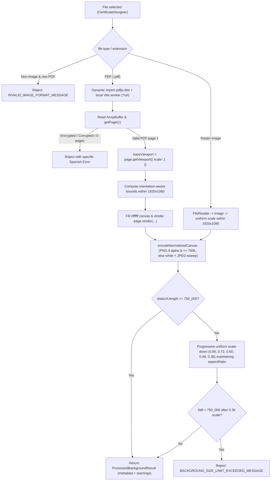

# Recognition Template Designer Enhancements

*   **Author:** Miguel Ciavato
*   **Status:** Implemented
*   **Date:** 2026-11-16

> [!NOTE]
> **Historical Evolution:** The inline amber `'warning'` notification banner originally implemented in `CertificateDesigner.tsx` (Phase 3 Item 1) was subsequently unified into the shared [`Toast`](../../src/components/Toast.tsx) component.

--------------------------------------------------------------------------------

## Overview

This design covers three usability and reliability improvements to Chil's recognition certificate template designer (`CertificateDesigner`):

1. **PDF-to-Image Background Conversion (Primary Focus)**: Enable cooperators to upload `.pdf` certificate files directly as template backgrounds by converting page 1 in the browser onto an opaque white surface and compressing it to fit inline inside Firestore (`<= 750,000` base64 characters), with non-blocking progress feedback and an amber warning notification when a PDF has multiple pages or requires heavy compression.
2. **Keyboard `Delete` / `Backspace` Field Deletion**: Allow users to delete the currently selected field using `Delete` (`Supr`) or `Backspace` without a confirmation dialog, while supporting one-step recovery via `Ctrl+Z` / `Cmd+Z` with automatic re-selection of the restored field.
3. **Interactive Walkthrough Repair**: Fix the `?` help button and first-visit auto-start tour on `CertificateDesigner` so the 6-step guide opens reliably once the template finishes loading.

## The Problem

1. **PDF Backgrounds Are Rejected Instead of Converted**:
   - Cooperators typically receive official diploma designs as `.pdf` files rather than PNG or JPEG images, yet `imageProcessor.ts` explicitly rejects `.pdf` uploads (`PDF_UPLOAD_NOT_SUPPORTED_MESSAGE`), forcing users to manually convert files with external tools before designing a template.
   - Separately, `encodeNormalizedCanvas` in `imageProcessor.ts` stops JPEG quality reduction at `0.5` and returns the resulting data URL even when it still exceeds `MAX_FIRESTORE_BACKGROUND_BASE64_LENGTH` (`750_000`), leaving large or detailed backgrounds at risk of failing Firestore's `950_000`-character (`MAX_FIRESTORE_TEMPLATE_BYTES`) / 1 MiB document cap.
   - `CertificateDesigner` overwrites any image processing exception with a generic `'Error al procesar la imagen de fondo.'` message, hiding actionable errors (such as encrypted or corrupted PDFs), and labels local processing as `'Subiendo...'`.
2. **No Keyboard Shortcut to Delete Selected Fields**:
   - Users can adjust position and undo/redo via keyboard shortcuts, but removing a selected field requires clicking the delete button in the sidebar or field palette. Pressing `Delete` (`Supr`) or `Backspace` does nothing (or risks browser back-navigation on `Backspace`).
3. **Interactive Walkthrough Fails to Open on the Designer View**:
   - Clicking the `?` help button (`WalkthroughHelpButton`) invokes `startTour(mouseEvent)` because `CertificateDesigner` passes `startTour` directly as an `onClick` handler. `useWalkthrough.startTour(stepIndex = 0)` treats the React `MouseEvent` object as `currentStepIndex`, making `steps[currentStepIndex]` `undefined` so `WalkthroughOverlay` renders `null`.
   - On first visit, `CertificateDesigner` sets `autoStart: true` while `isLoading` is `true` during the initial Firestore fetch. If loading takes longer than `400ms`, the tour opens before the target DOM elements or `WalkthroughOverlay` are mounted.

## Goals

* Convert page 1 of uploaded `.pdf` files into white-backed (`#ffffff`) JPEG data URLs in the browser, preserving the source page's exact proportions, visual orientation, and rotation without requiring a backend service or external storage bucket.
* Guarantee that accepted PDF-derived and raster backgrounds never exceed `MAX_FIRESTORE_BACKGROUND_BASE64_LENGTH` (`750_000` characters) through two-stage quality reduction and **uniform, aspect-ratio-locked** dimension downscaling (computing `scaledHeight` directly from the original ratio so images never stretch or clip), rejecting with `BACKGROUND_SIZE_LIMIT_EXCEEDED_MESSAGE` if still above `750_000` after all compression passes.
* Verify and preserve 1:1 field placement parity between the `DesignerCanvas` preview and the generated `certificatePdfGenerator.ts` PDF across arbitrary background aspect ratios (A4, US Letter, 16:9, square, portrait, or downscaled backgrounds) via `getNormalizedPageDimensions`.
* Keep initial page load unchanged for other routes by loading `pdfjs-dist` on demand via dynamic `import()` with a locally bundled Vite worker asset.
* Provide non-blocking processing feedback (`'Procesando...'`), surface real Spanish error messages on failure, and display a longer-lived dismissible amber `'warning'` notification when a multi-page PDF falls back to page 1 or requires heavy compression.
* Support immediate `Delete` / `Backspace` deletion of the selected field when not previewing, dragging, touring, or typing in an editable control, and automatically re-select the restored field on `Ctrl+Z` / `Cmd+Z`.
* Fix both the `?` help button and `autoStart` timing in `CertificateDesigner` and `useWalkthrough` while remaining backward-compatible with `BatchList` and `NewBatchWizard`.

## Non-Goals

* Selecting arbitrary pages from multi-page PDFs (page 1 is always used).
* Storing uploaded backgrounds or raw PDFs in Firebase Storage or adding server-side PDF rendering endpoints.
* Unlocking password-protected PDFs via an interactive password prompt (encrypted PDFs fail with an explicit Spanish error).
* Multi-field selection or batch deletion.

## Critical User Journeys (CUJs)

### CUJ 1: Upload a Single-Page or Multi-Page PDF Diploma as Template Background
* **Given**: A cooperator opens `CertificateDesigner` and clicks `Subir Fondo` (or `Subir Fondo Personalizado`).
* **When**: They select a `.pdf` file (of any page dimensions or orientation, such as A4, Letter, or 16:9). The UI shows `'Procesando...'` and `'Convirtiendo página 1 del PDF a imagen...'` while `pdfjs-dist` loads on demand and renders page 1 (respecting PDF rotation and crop bounds) onto a white `#ffffff` canvas within `1920×1080` bounds, applying uniform aspect-ratio-locked downscaling only if needed to fit `<= 750,000` characters.
* **Then**: The canvas updates with the converted background at its exact original aspect ratio, and fields placed in the editor render at the exact corresponding positions and proportional sizes in exported PDFs. If the PDF had more than 1 page or required heavy compression, an amber warning notification informs the user; if encrypted or invalid, a specific Spanish error message is shown without altering the existing background.

### CUJ 2: Delete a Selected Field with `Delete` / `Backspace` and Undo
* **Given**: A field is selected on the canvas in edit mode (not inside a sidebar input, not dragging, and walkthrough closed).
* **When**: The user presses `Delete` or `Backspace`.
* **Then**: The field is removed immediately without a confirmation dialog, and a toast confirms removal with a `Ctrl+Z` hint. Pressing `Ctrl+Z` (or `Cmd+Z`) restores the field and automatically re-selects it.

### CUJ 3: Launch the Interactive Guide via `?` or First Visit
* **Given**: A user opens `CertificateDesigner` for the first time, or returns later and clicks the `?` help button.
* **When**: The template finishes loading (`!isLoading && Boolean(recognition)`) or `?` is clicked.
* **Then**: The 6-step `WalkthroughOverlay` opens at step 0 (`Diseñador Visual de Plantillas`) and highlights each mounted target element accurately.

## Technical Plan (Architecture)

### 1. Client-Side PDF-to-Image Pipeline & 1:1 WYSIWYG Parity

The background ingestion pipeline in `src/features/recognitions/api/imageProcessor.ts` expands `processBackgroundImageFile` to accept `.pdf` files alongside PNG, JPEG, and WebP images while preserving exact aspect ratios and keeping serialized output within Firestore's inline document limits.



#### Key Architectural Details
1. **Dynamic `pdfjs-dist` Loading & Local Worker**:
   - Add `pdfjs-dist` to `package.json` `dependencies`.
   - Load `pdfjs-dist` inside `renderPdfFirstPageWithPdfJs` via `await import('pdfjs-dist')` and configure `GlobalWorkerOptions.workerSrc` from Vite's static asset URL import (`import('pdfjs-dist/build/pdf.worker.min.mjs?url')`), avoiding CDN requests and keeping the main bundle untouched on routes that do not upload PDFs.
   - Wrap PDF parsing and rendering in `try / finally` so `page?.cleanup()`, `pdfDoc?.cleanup()`, `loadingTask?.destroy()`, and temporary canvas zeroing (`canvas.width = 0; canvas.height = 0`) execute on both success and failure.
2. **Exact Proportion & Orientation Preservation**:
   - Use `page.getViewport({ scale: 1 })` to obtain the visual width and height (automatically respecting PDF `/Rotate` and `CropBox`), preserving exact source proportions (`exactRatio = baseWidth / baseHeight`, `aspectRatio = Math.round(exactRatio * 1000) / 1000`, `orientation = exactRatio >= 1 ? 'landscape' : 'portrait'`).
   - Compute initial render dimensions within orientation-aware bounds (`boundW = portrait ? min(1920, 1080) : 1920`, `boundH = portrait ? max(1920, 1080) : 1080`) using `renderScale = Math.min(boundW / baseWidth, boundH / baseHeight)` so large vector PDFs do not allocate oversized canvases and small PDFs scale cleanly to crisp screen resolution.
   - Paint `#ffffff` across the entire canvas before calling `page.render(...)` so transparent PDF backgrounds never turn black during JPEG encoding.
   - Compute `normalizedWidth` and `normalizedHeight` with the `297` mm long-edge normalization (`landscape`: `297 × round(297 / exactRatio)`, `portrait`: `round(297 * exactRatio) × 297`).
3. **Two-Stage Adaptive `<= 750,000`-Char Compression (PDF & Raster Parity)**:
   - Extend `ProcessedBackgroundResult` with optional diagnostic fields: `sourceType?: 'image' | 'pdf'`, `pageCount?: number`, `wasCompressedHeavily?: boolean`.
   - In `encodeNormalizedCanvas`, after checking PNG alpha eligibility, sweep JPEG qualities `[0.85, 0.72, 0.60, 0.50, 0.40, 0.30]`. If the encoded JPEG still exceeds `MAX_FIRESTORE_BACKGROUND_BASE64_LENGTH` (`750_000`), progressively scale the canvas uniformly along `exactRatio` (`[0.85, 0.72, 0.60, 0.48, 0.36]`, computing `scaledHeight = Math.max(1, Math.round(scaledWidth / exactRatio))`) and re-encode at `[0.60, 0.45, 0.35]` until `<= 750_000`.
   - Set `wasCompressedHeavily = true` whenever quality drops below `0.60` or dimension downscaling is triggered. Because `aspectRatio` and `normalizedWidth`/`normalizedHeight` remain anchored to the original source ratio (not rounded downscaled integer pixel pairs), `DesignerCanvas` (`aspectRatio: template.aspect_ratio`) and `certificatePdfGenerator.ts` (`getNormalizedPageDimensions(template)` + `doc.addImage(..., 0, 0, width, height)`) render the background identically without stretching.
4. **1:1 Field Placement Parity Verification**:
   - Both `useCanvasScale` (editor preview) and `certificatePdfGenerator.ts` (PDF output) derive physical page dimensions through `getNormalizedPageDimensions(template)` (`297` mm long edge + `template.aspect_ratio`).
   - `DraggableField` positions fields at `(field.x%, field.y%)` with `getAlignTransform(field.align)` (`0%`, `-50%`, `-100%` X and `-50%` Y) and `field.font_size * fontScale` px (`0px` padding in preview mode); `drawSingleField` places PDF text at `((field.x / 100) * width, (field.y / 100) * height)` mm with `{ align: field.align, baseline: 'middle' }` and `field.font_size` pt.
   - Automated unit/integration checks will assert that PDF-converted templates across varied ratios (A4 landscape, US Letter, 1:1 square, 9:16 portrait) preserve `aspectRatio`, normalized mm ratio, and exact field percentage-to-millimeter mapping.
5. **Non-Blocking Feedback, Error Surfacing & Amber Warning Notification**:
   - Update `DesignerHeader.tsx` and `BackgroundFormatTab.tsx` loading text from `'Subiendo...'` to `'Procesando...'`.
   - In `CertificateDesigner.tsx`:
     - Extend `toast` state to support `'success' | 'warning' | 'error'` with a manual close button (`X`) and longer auto-dismiss (`8000ms` for `'warning'` / `'error'`, `4000ms` for `'success'`).
     - When processing a `.pdf`, immediately display a non-blocking info/warning status (`'Convirtiendo página 1 del PDF a imagen...'`) while `isUploadingBg` is `true`.
     - After `processBackgroundImageFile` resolves, if `(result.pageCount ?? 1) > 1` or `result.wasCompressedHeavily`, display an amber `'warning'` notification explaining which condition occurred (`"El PDF tiene ${pageCount} páginas; se usó únicamente la página 1 como fondo."` and/or compression notice recommending PNG/JPG if extra sharpness is needed).
     - In `catch (err)`, display `err instanceof Error && err.message ? err.message : 'Error al procesar el archivo de fondo.'` instead of discarding specific PDF/format errors.
6. **Testable PDF Adapter Boundary**:
   - Export an optional `PdfPageRenderer` option/dependency seam in `imageProcessor.ts` (defaulting to the dynamic `pdfjs-dist` loader) so Vitest tests running in `jsdom` can deterministically test multi-page PDFs, rotated/non-A4 PDFs, password-protected (`PasswordException`), corrupted PDFs, and oversized compression fallbacks without needing a real worker thread.

### 2. Keyboard `Delete` / `Backspace` Field Deletion & Undo Re-Selection

* **Context-Gated Keydown Handler (`CertificateDesigner.tsx`)**:
  - Extend the `window` `keydown` handler to listen for `e.key === 'Delete' || e.key === 'Backspace'`.
  - Guard against accidental deletion:
    1. Return early if `selectedFieldId === null`, `isPreviewMode`, `isTourOpen`, or `draggingFieldId !== null`.
    2. Return early if `e.ctrlKey || e.metaKey || e.altKey`.
    3. Return early if `target?.closest?.('input, textarea, select, [contenteditable="true"], [contenteditable=""]')` matches (plus `target.isContentEditable`), covering both direct elements and nested children inside editable regions.
  - Call `e.preventDefault()` only when a valid field deletion proceeds and invoke `deleteFieldById(selectedFieldId, true)` (removing the field, clearing `selectedFieldId`, and showing `"Campo \"${label}\" eliminado (Ctrl+Z para deshacer)."`).
* **Automatic Re-Selection on `Ctrl+Z` / `Cmd+Z`**:
  - Track the current `template.fields` and `past` inside `CertificateDesigner` (or compare `present.fields` before and after `undo()` via a helper `handleUndo()`): when `undo()` restores a field ID that was absent before `undo` (or restores exactly the removed field), call `setSelectedFieldId(restoredField.id)` so the user immediately sees the selection ring and properties panel for the restored field.

### 3. Interactive Walkthrough Repair (`CertificateDesigner.tsx` & `useWalkthrough.ts`)

* **Sanitize `startTour` in `src/components/walkthrough/useWalkthrough.ts`**:
  - Change `startTour` signature/guard to `(stepIndex?: number | unknown) => ...` (keeping `UseWalkthroughReturn.startTour: (stepIndex?: number) => void` API compatibility) and resolve `const safeIndex = typeof stepIndex === 'number' && Number.isFinite(stepIndex) && stepIndex >= 0 && stepIndex < totalSteps ? Math.floor(stepIndex) : 0;`. Even if a caller accidentally passes a `MouseEvent` as `onClick={startTour}`, it safely starts at step `0`.
* **Wrap Callback & Gate `autoStart` in `CertificateDesigner.tsx`**:
  - Pass `onStartTour={() => startTour()}` to `DesignerHeader`.
  - Pass `autoStart: !isLoading && Boolean(recognition)` to `useWalkthrough` so the first-visit timer only starts after Firestore loading completes with a valid `recognition`.
  - Guard `useWalkthrough`'s `autoStart` `useEffect` with a ref (`hasAutoStartedRef`) or `!isOpen` check so switching routes between recognition IDs does not forcibly restart an open tour at step `0`.
  - In `useWalkthrough.ts` step-change effect, also schedule a secondary `setTimeout(..., 150)` or `requestAnimationFrame` recalculation of `targetRect` after `scrollIntoView` so spotlight coordinates settle cleanly after smooth scrolling.

## Alternatives Considered

* **Pre-Upload Blocking Confirmation Alert for `.pdf` Files**
  - *Description*: Show a blocking modal or `window.confirm` warning cooperators before converting a `.pdf` file, recommending a high-quality PNG or JPEG image instead.
  - *Decision*: Rejected by author: interrupts every PDF upload with an extra click even when single-page certificates convert quickly; replaced by non-blocking conversion feedback (`'Procesando...'` + `'Convirtiendo página 1 del PDF a imagen...'`) and an amber `'warning'` toast/banner when multi-page fallback or heavy compression occurs.
* **Server-Side PDF Rendering or External Firebase Storage**
  - *Description*: Convert PDFs in Firebase Cloud Functions / Vercel serverless endpoints or store rendered background images in Firebase Storage instead of inline base64 data URLs in `recognition_types`.
  - *Decision*: Rejected by author: requires maintaining native PDF rendering binaries on serverless backends, adds network latency, requires Storage rules/CORS setup, and breaks the existing self-contained Firestore `CertificateTemplate` model where backgrounds load without extra network requests during PDF diploma generation.
* **Fixed `2.0x` PDF Render Scale**
  - *Description*: Render PDF page 1 at a hardcoded `scale = 2.0` before resizing to `1920×1080`.
  - *Decision*: Rejected: large-format vector PDFs (such as wide banners) would allocate oversized intermediate canvases and risk browser memory exhaustion, while small PDFs would be under-sampled; computing `renderScale = Math.min(boundW / baseWidth, boundH / baseHeight)` against orientation-aware `1920×1080` bounds prevents out-of-memory spikes while preserving sharp text.
* **Applying the `750,000`-Char Downscale Fallback Only to PDFs**
  - *Description*: Leave `encodeNormalizedCanvas` unchanged for PNG/JPEG/WebP uploads (stopping at JPEG quality `0.5`) and enforce progressive dimension downscaling only in the PDF branch.
  - *Decision*: Rejected by author: `encodeNormalizedCanvas` currently violates `MAX_FIRESTORE_BACKGROUND_BASE64_LENGTH` (`750_000`) on dense raster images too; unifying both paths closes the Firestore size-limit gap and keeps compression warnings consistent.
* **Leaving Deleted Fields Unselected After `Ctrl+Z` Undo**
  - *Description*: Keep `selectedFieldId` as `null` when `Ctrl+Z` restores a deleted field, matching the sidebar `"Eliminar del Certificado"` flow.
  - *Decision*: Rejected by author: leaving the restored field unselected forces an extra click to resume nudging or styling; automatically re-selecting the restored field keeps UI focus aligned with the undone action.

## Detailed Implementation

Implementation proceeds across four sequential, independently buildable phases. Each file already exists in the repository (`[Modify]`; no files are created or deleted), and every phase ends with verification commands before moving to the next.

---

### Phase 1: Client-Side PDF Pipeline, Compression & Coordinate Tests

#### File Boundary (`[Modify]`)
* `[Modify]` `package.json` (and `[Modify]` `package-lock.json`)
* `[Modify]` `src/features/recognitions/api/imageProcessor.ts`
* `[Modify]` `src/features/recognitions/api/__tests__/api.test.ts`
* `[Modify]` `src/features/recognitions/services/__tests__/certificatePdfGenerator.test.ts`

#### Changes
1. **`package.json` & `package-lock.json` `[Modify]`**:
   - Add `"pdfjs-dist": "^6.5.438"` to `dependencies` (compatible with Node `>=22.13.0 || >=24` and bundling `pdfjs-dist/build/pdf.worker.min.mjs`).
2. **`src/features/recognitions/api/imageProcessor.ts` `[Modify]`**:
   - Replace `PDF_UPLOAD_NOT_SUPPORTED_MESSAGE` with exported Spanish error constants:
     - `ENCRYPTED_PDF_NOT_SUPPORTED_MESSAGE = 'El archivo PDF está protegido con contraseña. Por favor sube un PDF sin contraseña o una imagen PNG/JPG/WebP.'`
     - `INVALID_PDF_MESSAGE = 'No se pudo procesar el archivo PDF. Asegúrate de que no esté dañado o sube una imagen PNG/JPG/WebP.'`
     - `EMPTY_PDF_MESSAGE = 'El archivo PDF no contiene páginas.'`
     - `BACKGROUND_SIZE_LIMIT_EXCEEDED_MESSAGE = 'El archivo supera el límite de tamaño permitido incluso tras comprimirlo. Usa una imagen PNG o JPG más ligera.'`
   - Extend `ProcessedBackgroundResult` with optional diagnostic fields: `sourceType?: 'image' | 'pdf'`, `pageCount?: number`, and `wasCompressedHeavily?: boolean`.
   - Export adapter types and pass `options?: ProcessBackgroundOptions` to `processBackgroundImageFile(file: File, maxWidth = 1920, maxHeight = 1080, options?: ProcessBackgroundOptions)`:
     ```ts
     export interface PdfPageRenderOutput {
       canvas: HTMLCanvasElement;
       ctx: CanvasRenderingContext2D;
       naturalWidth: number;
       naturalHeight: number;
       exactRatio: number;
       pageCount: number;
     }

     export type PdfPageRenderer = (
       file: File,
       maxWidth: number,
       maxHeight: number
     ) => Promise<PdfPageRenderOutput>;

     export interface ProcessBackgroundOptions {
       pdfRenderer?: PdfPageRenderer;
     }
     ```
   - Implement default `renderPdfFirstPageWithPdfJs`:
     - Guard `if (typeof document === 'undefined')` by throwing `new Error('El entorno actual no soporta la conversión de PDF.')`.
     - Dynamically import `'pdfjs-dist'` and `'pdfjs-dist/build/pdf.worker.min.mjs?url'`, set `GlobalWorkerOptions.workerSrc`, parse `await file.arrayBuffer()`, validate `pdfDoc.numPages >= 1` (else throw `EMPTY_PDF_MESSAGE`), fetch page `1`, compute `baseViewport = page.getViewport({ scale: 1 })`, reject `baseViewport.width <= 0 || baseViewport.height <= 0` with `INVALID_PDF_MESSAGE`, derive `naturalWidth = Math.max(1, Math.round(baseViewport.width))`, `naturalHeight = Math.max(1, Math.round(baseViewport.height))`, and `exactRatio = baseViewport.width / baseViewport.height`.
     - Compute orientation-aware bounds within `(maxWidth, maxHeight)` and `renderScale = Math.min(boundWidth / baseViewport.width, boundHeight / baseViewport.height)`, initialize a canvas of `Math.max(1, Math.round(baseViewport.width * renderScale))` × `Math.max(1, Math.round(baseViewport.height * renderScale))`, throw `new Error('No se pudo inicializar el lienzo 2D para procesar la imagen de fondo.')` if `canvas.getContext('2d')` is `null`, fill with `#ffffff`, and call `await page.render({ canvas, canvasContext: ctx, viewport }).promise`.
     - Map `PasswordException` to `ENCRYPTED_PDF_NOT_SUPPORTED_MESSAGE` and invalid/corrupted PDF errors to `INVALID_PDF_MESSAGE`; execute `page?.cleanup()`, `pdfDoc?.cleanup?.()`, and `loadingTask?.destroy?.()` in `finally` (and zero temporary PDF render canvas dimensions after `encodeNormalizedCanvas` completes).
   - Refactor `encodeNormalizedCanvas` to accept `(sourceCanvas: HTMLCanvasElement, sourceCtx: CanvasRenderingContext2D, width: number, height: number, options: { mimeType: string; allowAlphaPng: boolean; alreadyOpaqueWhite: boolean; exactRatio: number })` returning `{ dataUrl: string; wasCompressedHeavily: boolean }`:
     1. When `allowAlphaPng` is `true` and `hasAlphaTransparency(sourceCtx, width, height)` detects alpha, check `sourceCanvas.toDataURL('image/png')`; return `{ dataUrl, wasCompressedHeavily: false }` if `<= MAX_FIRESTORE_BACKGROUND_BASE64_LENGTH` (`750_000`).
     2. Otherwise obtain an opaque `#ffffff` encoding canvas without erasing `sourceCanvas`: if `alreadyOpaqueWhite` is `true` (PDF render output), encode directly from `sourceCanvas`; if `false` (raster PNG/JPEG/WebP), draw `sourceCanvas` onto a fresh temporary canvas filled with `#ffffff` (checking for `null` 2D context). Sweep JPEG qualities `[0.85, 0.72, 0.60, 0.50, 0.40, 0.30]`, returning immediately when `dataUrl.length <= 750_000` (setting `wasCompressedHeavily = quality < 0.60`).
     3. If still `> 750_000`, iterate uniform scale factors `[0.85, 0.72, 0.60, 0.48, 0.36]` computing `scaledWidth = Math.max(1, Math.round(width * scale))` and `scaledHeight = Math.max(1, Math.round(scaledWidth / exactRatio))`, create a temporary canvas (throwing if `getContext('2d')` is `null`), fill `#ffffff`, draw `sourceCanvas` scaled to `(scaledWidth, scaledHeight)`, sweep JPEG qualities `[0.60, 0.45, 0.35]`, and release temporary canvas dimensions in `finally`. If an output still exceeds `750_000` after `0.36` scale and `0.35` quality, throw `new Error(BACKGROUND_SIZE_LIMIT_EXCEEDED_MESSAGE)` so oversized payloads never reach Firestore.
   - Set `width = naturalWidth`, `height = naturalHeight`, `aspectRatio`, `orientation`, and `normalizedWidth` / `normalizedHeight` from unrounded `exactRatio` (`baseViewport.width / baseViewport.height` for PDFs; `naturalWidth / naturalHeight` for raster images) to maintain exact aspect-ratio and normalized `(x, y)` mm placement parity.
3. **`src/features/recognitions/api/__tests__/api.test.ts` `[Modify]`**:
   - Update existing canvas mocks (`lines 415, 469, 522`) to return independent mock canvas instances per `document.createElement('canvas')` call (including `getImageData` at line `509`) so temporary encoding/downscale canvases do not overwrite shared test state.
   - Replace the old `PDF_UPLOAD_NOT_SUPPORTED_MESSAGE` test with unit tests via mock `pdfRenderer` adapters covering A4 landscape, US Letter, rotated/portrait PDFs, multi-page (`pageCount > 1`), `ENCRYPTED_PDF_NOT_SUPPORTED_MESSAGE`, `INVALID_PDF_MESSAGE`, `EMPTY_PDF_MESSAGE`, progressive uniform downscaling within `<= 750_000` while preserving exact `aspectRatio`, and `BACKGROUND_SIZE_LIMIT_EXCEEDED_MESSAGE` rejection when all downscale passes exceed `750_000`.
4. **`src/features/recognitions/services/__tests__/certificatePdfGenerator.test.ts` `[Modify]`**:
   - Add test cases asserting that `getNormalizedPageDimensions` and `renderCertificatePage` preserve exact `(x, y)` millimeter coordinates and background aspect ratios for PDF-converted templates across A4 landscape, US Letter, 1:1 square, and 9:16 portrait ratios.

#### Phase 1 Checkpoint
```bash
npx vitest run src/features/recognitions/api/__tests__/api.test.ts src/features/recognitions/services/__tests__/certificatePdfGenerator.test.ts
npm run build
```

---

### Phase 2: Interactive Walkthrough Reliability

#### File Boundary (`[Modify]`)
* `[Modify]` `src/components/walkthrough/useWalkthrough.ts`
* `[Modify]` `src/components/walkthrough/__tests__/useWalkthrough.test.ts`

#### Changes
1. **`src/components/walkthrough/useWalkthrough.ts` `[Modify]`**:
   - Update `startTour` (`useCallback` dependencies `[totalSteps]`): coerce non-number, non-finite, negative, or `>= totalSteps` `stepIndex` inputs (including accidental React `MouseEvent` values) to `0`.
   - Track `isOpen` in `isOpenRef = useRef(isOpen)` (kept synced via `useEffect`) and add `hasAutoStartedRef = useRef(false)`. In the `autoStart` `useEffect` (keeping dependency array `[storageKey, totalSteps, autoStartDelay, autoStart]`), return early if `hasAutoStartedRef.current || isOpenRef.current`, and set `hasAutoStartedRef.current = true` inside the timer callback right before opening step `0`.
   - In the `currentStep` measurement `useEffect`, retain the `0ms` measurement timer, schedule a follow-up `150ms` `targetRect` recalculation timer after `scrollIntoView`, and clear both timers in the cleanup function.
2. **`src/components/walkthrough/__tests__/useWalkthrough.test.ts` `[Modify]`**:
   - Add unit tests verifying `startTour(mouseEvent as unknown as number)` opens at step `0`, `autoStart` transitions do not reset an already-open tour, closing with unavailable `localStorage` does not re-trigger `autoStart`, and both `0ms` and `150ms` timers are cleared on cleanup.

#### Phase 2 Checkpoint
```bash
npx vitest run src/components/walkthrough/__tests__/useWalkthrough.test.ts
npm run lint
```

---

### Phase 3: Designer UI, Keyboard Deletion, Notifications & Component Tests

#### File Boundary (`[Modify]`)
* `[Modify]` `src/features/recognitions/components/CertificateDesigner.tsx`
* `[Modify]` `src/features/recognitions/components/designer/DesignerHeader.tsx`
* `[Modify]` `src/features/recognitions/components/designer/sidebar/BackgroundFormatTab.tsx`
* `[Modify]` `src/features/recognitions/components/__tests__/CertificateDesigner.test.tsx`
* `[Modify]` `src/features/recognitions/components/designer/__tests__/DesignerHeader.test.tsx`

#### Changes
1. **`src/features/recognitions/components/CertificateDesigner.tsx` `[Modify]`**:
   - Move `const [recognition, setRecognition] = useState<RecognitionType | null>(null)` and `const [isLoading, setIsLoading] = useState<boolean>(true)` above `useWalkthrough(...)` so `autoStart: !isLoading && Boolean(recognition)` executes without TDZ errors. Pass `onStartTour={() => startTour()}` to `DesignerHeader`. Leave `CERTIFICATE_DESIGNER_TOUR_STEPS` step 3 copy unchanged.
   - Extend `toast` state to `{ message: string; type: 'success' | 'warning' | 'error' }` and `showNotification(message, type = 'success', { persistent = false } = {})`:
     - Skip scheduling `toastTimerRef` when `persistent` is `true`; otherwise auto-dismiss `'warning'` / `'error'` after `8000ms` and `'success'` after `4000ms`.
     - Import `AlertTriangle` and `X` from `lucide-react`; render `'warning'` banners with `bg-amber-900 text-white border-amber-600` + `AlertTriangle` (`w-5 h-5 text-amber-300 flex-shrink-0`), and render a manual close button (`<button type="button" onClick={dismissNotification} aria-label="Cerrar notificación">`) containing `<X className="w-4 h-4" />` on all toast variants.
   - Destructure `past` from `useDesignerReducer`, wrap field deletion cleanly so `handleRemoveField` keeps its sidebar/palette button toast `"Campo \"${fieldToRemove.label}\" eliminado."`, while keyboard `Delete`/`Backspace` removal shows `"Campo \"${selectedField.label}\" eliminado (Ctrl+Z para deshacer)."` and clears `setSelectedFieldId(null)`.
   - Implement `handleUndo = useCallback(...)`: inspect `restoredFields = (past[past.length - 1]?.fields ?? []).filter((f) => !template.fields.some((cur) => cur.id === f.id))`, call `undo()`, and if `restoredFields.length > 0`, call `setSelectedFieldId(restoredFields[0].id)` and `setActiveSidebarTab('properties')`. Wire `handleUndo` to both `<DesignerHeader onUndo={handleUndo} />` and the `Ctrl+Z` / `Cmd+Z` `keydown` handler.
   - Extend the `window` `keydown` listener for `e.key === 'Delete' || e.key === 'Backspace'`: return early when `selectedFieldId === null`, `isPreviewMode`, `isTourOpen`, `draggingFieldId !== null`, `e.ctrlKey || e.metaKey || e.altKey`, `target?.closest?.('input, textarea, select, [contenteditable="true"], [contenteditable=""]')`, or `Boolean(target?.isContentEditable)`; otherwise call `e.preventDefault()`, remove the field, call `setSelectedFieldId(null)`, and show `"Campo \"${selectedField.label}\" eliminado (Ctrl+Z para deshacer)."`
   - Update `handleBackgroundUpload`:
     - If `.pdf`, show `showNotification('Convirtiendo página 1 del PDF a imagen...', 'warning', { persistent: true })` while `isUploadingBg` is `true`.
     - On success (`typeof result !== 'string'`):
       - Both `(result.pageCount ?? 1) > 1 && result.wasCompressedHeavily`: `showNotification(\`El PDF tiene ${result.pageCount} páginas; se usó la página 1 y se comprimió para ajustarla al límite. Si notas pérdida de nitidez, sube una imagen PNG o JPG.\`, 'warning')`
       - Only `(result.pageCount ?? 1) > 1`: `showNotification(\`El PDF tiene ${result.pageCount} páginas; se usó únicamente la página 1 como fondo.\`, 'warning')`
       - Only `result.wasCompressedHeavily`: `showNotification('El fondo se comprimió para cumplir con el tamaño máximo. Si notas pérdida de nitidez, sube una imagen PNG o JPG.', 'warning')`
       - Otherwise: `showNotification('Imagen de fondo cargada y optimizada exitosamente.')`
     - In `catch (err)`: show the propagated `Error.message` text (`err instanceof Error && err.message ? err.message : 'Error al procesar el archivo de fondo.'`).
2. **`src/features/recognitions/components/designer/DesignerHeader.tsx` `[Modify]`**:
   - Update `getUploadButtonText` when `isUploadingBg` is `true` from `'Subiendo...'` to `'Procesando...'`.
3. **`src/features/recognitions/components/designer/sidebar/BackgroundFormatTab.tsx` `[Modify]`**:
   - Update loading copy on both the empty-background `"Subir Fondo Personalizado"` button (`lines 107-117`) and the active-background `"Cambiar"` button (`lines 80-90`, adding `disabled={isUploadingBg}` and `{isUploadingBg ? 'Procesando...' : 'Cambiar'}`).
   - Set exact empty-background helper paragraph (`lines 102-105`): `'Actualmente se usa el diseño predeterminado. Puede subir una plantilla gráfica personalizada en PNG, JPG, WebP o PDF (página 1) para adaptar automáticamente el tamaño y las proporciones.'`
4. **`src/features/recognitions/components/__tests__/CertificateDesigner.test.tsx` `[Modify]`**:
   - Clear `localStorage` in `beforeEach` (`localStorage.clear()`) so tour persistence tests do not leak across cases.
   - Update existing error-handling test (`line 590`) to assert `'Corrupt image'`, and add a non-`Error` / empty rejection case asserting `'Error al procesar el archivo de fondo.'`.
   - Verify designer UI, keyboard deletion (`Delete` / `Backspace`, input/preview/tour guards), `Ctrl+Z` undo re-selection, non-blocking PDF status & amber `'warning'` variants, propagated error banners, `?` button walkthrough launch, and post-load `autoStart` at the component level.
5. **`src/features/recognitions/components/designer/__tests__/DesignerHeader.test.tsx` `[Modify]`**:
   - Update `/Subiendo\.\.\./i` assertion to `/Procesando\.\.\./i`.

#### Phase 3 Checkpoint
```bash
npx vitest run src/features/recognitions/components/__tests__/CertificateDesigner.test.tsx src/features/recognitions/components/designer/__tests__/DesignerHeader.test.tsx
```

---

### Phase 4: Module Documentation Sync & Full Repository Verification

#### File Boundary (`[Modify]`)
* `[Modify]` `src/features/recognitions/README.md`
* `[Modify]` `src/features/recognitions/api/README.md`
* `[Modify]` `src/features/recognitions/components/README.md`
* `[Modify]` `src/features/recognitions/components/designer/README.md`
* `[Modify]` `src/features/recognitions/components/designer/sidebar/README.md`

#### Changes
* Update module `README.md` contracts (`Interfaces`, `Invariants`, and `Side Effects`) in the five files above to document `.pdf` page-1 ingestion, new exported error constants and `ProcessBackgroundOptions`, `encodeNormalizedCanvas` overflow error handling, keyboard `Delete`/`Backspace` removal + `handleUndo` field re-selection, `'warning'` toast variant, `'Procesando...'` copy, and walkthrough `autoStart` / `?` gating.

#### Final Verification Checkpoint
```bash
npm run lint
npm run build
npm test -- --run
```
