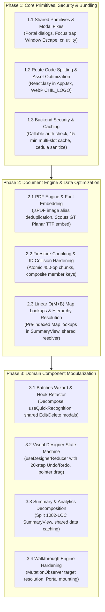

# Chil Master Refactoring Roadmap & Synthesis

This document consolidates the findings of all **6 specialized subagents** deployed to evaluate every domain of the **Chil** project in read-only analysis mode. 

Across all modules, the subagents identified critical bottlenecks in **rendering performance, document memory bloat, security vulnerabilities, accessibility defects, and state architecture**.

---

## 📑 Module Plans Directory

Each module has a dedicated, full-length technical design specification:

| Module Domain | Lead Subagent | Target Scope | Plan Artifact |
| :--- | :--- | :--- | :--- |
| **1. Batches** | Batches Analyst | `src/features/batches/`, `src/types/batch.ts`, `src/types/member.ts` | [refactor_plan_batches.md](./refactor_plan_batches.md) |
| **2. Recognitions & Designer** | Recognitions Analyst | `src/features/recognitions/`, jsPDF, JSZip, canvas | [refactor_plan_recognitions.md](./refactor_plan_recognitions.md) |
| **3. Backend & Scraper** | Scraper Analyst | `functions/`, Cheerio, Axios, session caching | [refactor_plan_backend_scraper.md](./refactor_plan_backend_scraper.md) |
| **4. Statistics & Summary** | Analytics Analyst | `src/features/statistics/`, `src/features/summary/` | [refactor_plan_statistics_summary.md](./refactor_plan_statistics_summary.md) |
| **5. Auth & Public Landing** | Auth & Landing Analyst | `src/features/auth/`, `src/features/landing/`, routing | [refactor_plan_auth_landing.md](./refactor_plan_auth_landing.md) |
| **6. UI Primitives & Navigation** | UI & Design Analyst | `src/components/`, `src/layouts/`, walkthroughs | [refactor_plan_ui_navigation.md](./refactor_plan_ui_navigation.md) |

---

## 🚨 Critical Cross-Cutting Defects (Top P0 Issues)

The subagents identified several severe issues that should be addressed first:

```
+---------------------------------------------------------------------------------------------------------+
|                                    TOP CRITICAL ISSUES (P0)                                             |
+---------------------------------------------------------------------------------------------------------+
| 1. PDF Bloat & OOM (Recognitions)       | jsPDF missing image alias re-embeds Base64 background on       |
|                                         | every page. 100-member batch creates >150 MB PDF!              |
| 2. Font Mismatch (Recognitions)         | Mandatory official font Scouts GT Planar is never embedded in   |
|                                         | PDF, silently falling back to standard Helvetica.               |
| 3. Unbatched Writes (Batches)          | Step 3 review & batch deletion lack 500-op Firestore chunking,  |
|                                         | crashing on large batches (>490 members).                       |
| 4. Quadratic Complexity (Summary)       | O(M * B) un-indexed array lookups on 5,000 members execute      |
|                                         | >2,500,000 operations per render, blocking UI for ~350ms.       |
| 5. Security & Proxy Exposure (Backend)  | Firebase Callables (loginScraper, getMemberStatus) omit auth     |
|                                         | validation, allowing unauthenticated third-party proxy abuse.   |
| 6. Monolithic Bundle (Auth/Landing)     | Static imports in App.tsx force landing visitors to download     |
|                                         | >2 MB of JS (jsPDF, JSZip, TanStack) + 1.3 MB uncompressed PNG. |
| 7. Cross-Domain DOM Hacks (UI)          | Feature code triggers Scraper modal via imperative querySelector |
|                                         | .click(); Modal Escape listener fails in real browsers.         |
+---------------------------------------------------------------------------------------------------------+
```

---

## 🗺️ Execution Dependency Graph

The refactoring should follow this dependency order so shared primitives and security baselines are in place before feature refactoring:



---

## 📋 Recommended Action Plan

### Sprint 1: Security, Bundle & Performance Fast-Wins (P0)
- [ ] **Auth & Bundling**: Split routes in `src/App.tsx` with `React.lazy()` / `Suspense`; compress `CHIL_LOGO.png` from 1.3 MB to ~35 KB WebP.
- [ ] **Document Engine**: Add image alias parameter to `doc.addImage` in `certificatePdfGenerator.ts` (drops multi-page PDF size from ~150 MB to <2 MB); embed `Scouts-GT-Planar-Bold.ttf`.
- [ ] **Cloud Functions**: Add `request.auth` guard to `loginScraper` and `getMemberStatus`; add in-memory session cache TTL.
- [ ] **Summary View**: Replace nested `.find()` loops in `SummaryView.tsx` with `Map<number, Entity>` lookup tables ($O(M \times B) \to O(M + B)$).
- [ ] **Modals & UI**: Add window-level Escape listener and keyboard focus trapping in `Modal.tsx`.

### Sprint 2: Data Integrity & Architectural Decoupling (P1)
- [ ] **Batches**: Implement 450-operation chunking in `batchesCrud.ts` and `Step3Review.tsx` for atomic batch writes.
- [ ] **Batches UI**: Unify duplicate `DeleteBatchModal` and `EditMemberModal`; decompose 700-line `useQuickRecognition.ts`.
- [ ] **Designer**: Implement `useDesignerReducer` with Undo/Redo history stack and window pointer listeners for drag precision.
- [ ] **Summary**: Decompose `SummaryView.tsx` into modular subcomponents (`SummaryFilters`, `SummaryTable`, `SummaryExportMenu`).
- [ ] **UI Navigation**: Deprecate unused `Navbar.tsx`; extract `ScraperSettingsModal` from `Sidebar.tsx` into an explicit context.

### Sprint 3: Resilience, Modernization & Test Hardening (P2)
- [ ] **Backend Modernization**: Upgrade `firebase-functions` and `firebase-admin` dependencies; add Node 20 runtime flags.
- [ ] **Visual Testing**: Replace jsPDF mocked object tests with binary buffer validation tests.
- [ ] **React 19 Hooks**: Transition mutations to `useTransition` and use `useId` for form controls.
- [ ] **Walkthroughs**: Enhance `useWalkthrough` with `MutationObserver` retry logic for asynchronous DOM element targeting.
