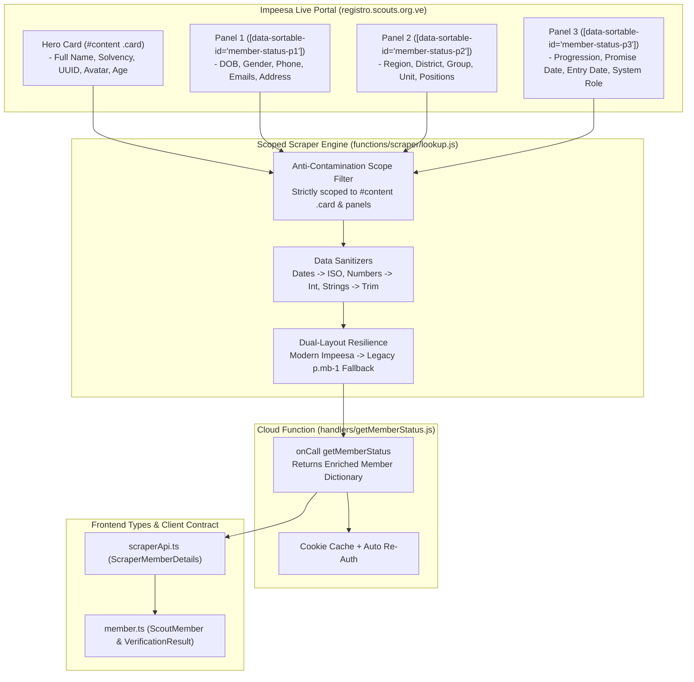
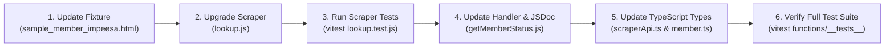

# Implementation Plan: Scraper Engine Upgrade for Impeesa (registro.scouts.org.ve)

> **Document Version:** 1.0.0  
> **Author:** Subagent A - Scraper Engine Upgrade Planner  
> **Date:** November 2026  
> **Target Scope:**  
> - `functions/scraper/lookup.js`  
> - `functions/handlers/getMemberStatus.js`  
> - `functions/__tests__/lookup.test.js`  
> - `functions/__tests__/fixtures/sample_member_impeesa.html`  
> - `src/features/batches/api/scraperApi.ts`  
> - `src/types/member.ts`  
> **Status:** Production-Ready Architecture & Implementation Plan

---

## Table of Contents
1. [Executive Summary & Architectural Goals](#1-executive-summary--architectural-goals)
2. [DOM Reverse-Engineering & Session Pollution Analysis](#2-dom-reverse-engineering--session-pollution-analysis)
3. [Exhaustive Field Catalog & Normalization Rules](#3-exhaustive-field-catalog--normalization-rules)
4. [Scraper Engine Architecture (`functions/scraper/lookup.js`)](#4-scraper-engine-architecture-functionsscraperlookupjs)
5. [Backend Handler Updates (`functions/handlers/getMemberStatus.js`)](#5-backend-handler-updates-functionshandlersgetmemberstatusjs)
6. [Frontend Contract & Type System Evolution](#6-frontend-contract--type-system-evolution)
7. [Testing & Verification Strategy](#7-testing--verification-strategy)
8. [Step-by-Step Implementation Checklist & Roadmap](#8-step-by-step-implementation-checklist--roadmap)

---

## 1. Executive Summary & Architectural Goals

The official registration portal of the *Asociación de Scouts de Venezuela* (ASV), **Impeesa** (`registro.scouts.org.ve`), underwent a comprehensive modernization. Previously, Chil's scraper extracted only 5 fundamental fields (`nombre_completo`, `status`, `telefono`, `correo_electronico`, `fecha_nacimiento`), forcing users to manually select Region, District, Group, Unit, and Member Type across tedious multi-step forms.

Live network research and HTML DOM profiling have confirmed that Impeesa now exposes over **26 structured data fields** in every member search result. This upgrade enables Chil to transform from a manual input tool into an **autonomous auto-discovery platform**.



### Key Objectives of this Upgrade:
1. **Extract 26+ Rich Fields:** Pull complete identity, territorial structure, Scout unit, group positions, solvency dates, and Scout progression.
2. **Eliminate Session Banner Cross-Contamination:** Fix the critical flaw where global selectors inadvertently parse the logged-in administrator's profile banner (`Grupo DON BOSCO 21`, `Unidad Conductor de Grupo`) instead of the searched member.
3. **Dual-Layout Resilience:** Retain 100% backwards-compatible fallback for legacy layout formats (`p.mb-1`).
4. **End-to-End Type Safety:** Align `ScraperMemberDetails` in `scraperApi.ts` and `ScoutMember` in `member.ts` with the enriched schema.
5. **Rock-Solid Test Coverage:** Update fixtures and assertions in `lookup.test.js` to validate all 26 fields, anti-contamination isolation, and error conditions.

---

## 2. DOM Reverse-Engineering & Session Pollution Analysis

### 2.1 The Critical Cross-Contamination Risk
Every authenticated query to `https://registro.scouts.org.ve/members/status_member_submit?cedula={cedula}&commit=Buscar` renders a page containing **two distinct entities**:
1. **The Session Header Banner** (`#content .profile`, lines 184–203 in `sample_member_impeesa.html`):
   - Displays the logged-in user's institutional position and assignment (e.g. `Miguel Angel Angel Ciavato`, `Unidad Conductor de Grupo`, `Grupo DON BOSCO 21 / Distrito AVILA / Región DISTRITO CAPITAL`).
   - Contains an unparameterized carnet button: `<a href="/members/download_card.pdf">Descargar Carnet</a>`.
2. **The Target Member Search Result** (`#content .card` and `#content [data-sortable-id^="member-status-p"]`):
   - Displays the queried member's data (e.g. `Irene del socorro Monsalve Sulbaran`, `Región DISTRITO CAPITAL`, `Distrito AVILA`, `Grupo ARISTIDES ROJAS`, `Unidad Comunidad`, `Adulto de Programa`).

> [!CAUTION]
> If unscoped CSS selectors like `$("table tr")`, `$(".badge")`, `$("a[href*='download_card']")`, or `$("p.mb-1")` are executed, the scraper risks extracting the administrator's assignment or carnet URL rather than the target member's.

### 2.2 Scoping & Isolation Architecture
To guarantee absolute data purity, the extraction engine enforces strict hierarchical boundaries:
- **Hero Card Scope:** Strictly select `#content .card` (or `#content .card.border-0.shadow-sm`).
- **Data Panels Scope:** Strictly select `#content [data-sortable-id^="member-status-p"] table tr`.
- **Legacy Fallback Scope:** Only executes if no member name was resolved from `#content .card`, and searches within `.card-body` or `#content`.

---

## 3. Exhaustive Field Catalog & Normalization Rules

The table below catalogs all 26+ fields extractable from modern Impeesa, their precise DOM selector paths, sample values verified from live queries, and normalization logic.

| # | Field Name | DOM Path / Source | Raw Sample | Normalized Value | Normalization Rule |
|:--|:-----------|:-----------------|:-----------|:-----------------|:-------------------|
| **A** | **Territorial Hierarchy** | | | | |
| 1 | `region` | `[data-sortable-id="member-status-p2"] tr:contains("Región") td:last` | `" DISTRITO CAPITAL "` | `"DISTRITO CAPITAL"` | `cleanText()`, uppercase |
| 2 | `distrito` | `[data-sortable-id="member-status-p2"] tr:contains("Distrito") td:last` | `" AVILA "` | `"AVILA"` | `cleanText()`, uppercase |
| 3 | `grupo` | `[data-sortable-id="member-status-p2"] tr:contains("Grupo Scout") td:last` | `" ARISTIDES ROJAS "` | `"ARISTIDES ROJAS"` | `cleanText()`, uppercase |
| **B** | **Unit & Positions** | | | | |
| 4 | `unidad` | `[data-sortable-id="member-status-p2"] tr:contains("Unidad") td:last` | `" Comunidad "` | `"Comunidad"` | `cleanText()` |
| 5 | `cargo_grupo` | `[data-sortable-id="member-status-p2"] tr:contains("Cargo en Grupo") td:last` | `" Adulto de Programa "` | `"Adulto de Programa"` | `cleanText()` |
| 6 | `cargo_institucional` | `[data-sortable-id="member-status-p2"] tr:contains("Cargo Institucional") td:last` | `" Cooperador Nacional de Soporte "` | `"Cooperador Nacional de Soporte"` | `cleanText()` |
| 7 | `tipo_miembro` | `[data-sortable-id="member-status-p2"] tr:contains("Tipo de Miembro") td:last` | `" Grupo "` | `"Grupo"` | `cleanText()` |
| **C** | **Personal Identity** | | | | |
| 8 | `nombre_completo` | `#content .card h3.fw-bold.text-dark` | `" Irene del socorro Monsalve Sulbaran "` | `"Irene del socorro Monsalve Sulbaran"` | `cleanText()` |
| 9 | `cedula_raw` | `[data-sortable-id="member-status-p1"] tr:contains("Cédula") td:last` | `" E-11.926.931 "` | `"E-11.926.931"` | `cleanText()` |
| 10 | `cedula` | Regex on `cedula_raw` or query input | `"E-11.926.931"` | `"11926931"` | `replace(/[^\d]/g, "")` |
| 11 | `genero` | `[data-sortable-id="member-status-p1"] tr:contains("Género") td:last` | `" Femenino "` | `"Femenino"` | `cleanText()` |
| 12 | `fecha_nacimiento` | `[data-sortable-id="member-status-p1"] tr:contains("Fecha Nacimiento") td:last` | `"04/09/1972"` | `"1972-09-04"` | `parseDateToISO()` (YYYY-MM-DD) |
| 13 | `fecha_nacimiento_raw` | Same as above | `"04/09/1972"` | `"04/09/1972"` | `cleanText()` |
| 14 | `edad` | `#content .card` match `/Edad:\s*(\d+)\s*años/i` | `"Edad: 54 años"` | `54` | `parseInt(m[1], 10)` or year diff |
| 15 | `avatar_url` | `#content .card img[alt="Foto de perfil"]` | `https://res.cloudinary.com/...` | `src` or `""` | Safe attribute lookup |
| 16 | `member_uuid` | `#content .card a[href*="download_card.pdf"]` | `...member_id=ef39034a-dae7...` | `"ef39034a-dae7-4f1c-ae01-879bf88ab7a7"` | Regex `member_id=([a-f0-9\-]+)` |
| **D** | **Contact & Location** | | | | |
| 17 | `telefono` | `[data-sortable-id="member-status-p1"] tr:contains("Teléfono") td:last` | `" 04123473083 "` | `"04123473083"` | `cleanText()`, strip non-text links |
| 18 | `correo_electronico` | `[data-sortable-id="member-status-p1"] tr:contains("Correo de Usuario") td:last` | `" irenescoutsdb@gmail.com "` | `"irenescoutsdb@gmail.com"` | `cleanText()` |
| 19 | `correo_secundario` | `[data-sortable-id="member-status-p1"] tr:contains("Correo Secundario") td:last` | `" monsalveirene63@gmail.com "` | `"monsalveirene63@gmail.com"` | `cleanText()` |
| 20 | `ubicacion_estado` | `[data-sortable-id="member-status-p1"] tr:contains("Ubicación") td:last` | `" Distrito Capital - Libertador "` | `"Distrito Capital - Libertador"` | `cleanText()` |
| 21 | `direccion` | `[data-sortable-id="member-status-p1"] tr:contains("Dirección") td:last` | `" Av Libertador Santa Rosa "` | `"Av Libertador Santa Rosa"` | `cleanText()` |
| **E** | **Status, Solvency & Progression** | | | | |
| 22 | `status` | `#content .card .badge` containing "Activo"/"Inactivo" | `" Usuario Activo "` | `"Activo"` | Normalize to `'Activo'` or `'Inactivo'` |
| 23 | `solvente_hasta` | `#content .card .badge` match `/Solvente hasta\s+([\d\/]+)/i` | `"Solvente hasta 21/05/2027"` | `"2027-05-21"` | `parseDateToISO(m[1])` |
| 24 | `solvente_hasta_raw` | Same as above | `"Solvente hasta 21/05/2027"` | `"21/05/2027"` | Extracted raw date digits |
| 25 | `progresion_actual` | `[data-sortable-id="member-status-p3"] tr:contains("Progresión Actual") td:last` | `" Sin progresión registrada "` | `"Sin progresión registrada"` | `cleanText()` |
| 26 | `fecha_ingreso` | `[data-sortable-id="member-status-p3"] tr:contains("Fecha de Ingreso") td:last` | `"01/08/2009"` | `"2009-08-01"` | `parseDateToISO()` |
| 27 | `fecha_promesa` | `[data-sortable-id="member-status-p3"] tr:contains("Fecha de Promesa") td:last` | `" 18/09/2009 "` | `"2009-09-18"` | `parseDateToISO()` |
| 28 | `rol_sistema` | `[data-sortable-id="member-status-p3"] tr:contains("Rol en Sistema") td:last` | `" Coop/Direc - Nacional - Consulta "` | `"Coop/Direc - Nacional - Consulta"` | `cleanText()` |
| **F** | **Extended Demographics & Assets** | | | | |
| 29 | `religion` | `[data-sortable-id="member-status-p3"] tr:contains("Religión") td:last` | `" Budistas "` | `"Budistas"` | `cleanText()` |
| 30 | `nivel_educativo` | `[data-sortable-id="member-status-p3"] tr:contains("Nivel Educativo") td:last` | `" Superior "` | `"Superior"` | `cleanText()` |
| 31 | `ocupacion` | `[data-sortable-id="member-status-p3"] tr:contains("Ocupación") td:last` | `" Directora de Despacho Decanato "` | `"Directora de Despacho Decanato"` | `cleanText()` |
| 32 | `carnet_pdf_url` | `#content .card a[href*="download_card.pdf"]` | `"/members/download_card.pdf?..."` | `href` string | Scoped to `#content .card` |
| 33 | `medical_pdf_url` | `#content .card a[href*="medical_file_pdf.pdf"]` | `"/members/.../medical_file_pdf.pdf"` | `href` string | Scoped to `#content .card` |

---

## 4. Scraper Engine Architecture (`functions/scraper/lookup.js`)

### 4.1 Production Implementation Blueprint
The updated `lookup.js` implements a resilient multi-stage parser:
1. **Network Response & Session Validation:** Detects HTTP 302 redirects to `/users/sign_in` or HTML containing `user[email]`. Throws `"Sesión de scraper no autenticada o expirada"`.
2. **Explicit Negative Result Detection:** Checks for `"Miembro no localizado"`, `"No se encontró ningún miembro"`, or `.alert-danger` blocks. Throws `"No registrado"`.
3. **Primary Stage: Scoped Impeesa Layout Parser:**
   - Scopes Hero card queries to `#content .card`.
   - Iterates over `#content [data-sortable-id^="member-status-p"] table tr` into a Key-Value lookup dictionary.
   - Cleans, parses, and normalizes all 26+ fields.
4. **Secondary Stage: Legacy Layout Fallback:**
   - If `#content .card` or `nombre_completo` is absent, iterates over `p.mb-1` splitting by `:` to extract legacy fields.
   - Defaults new fields to empty strings / `null` to ensure consistent dictionary shapes.
5. **Final Fallback:** If neither layout resolves a name, throws `"No registrado"`.

### 4.2 Exact Code Implementation for `functions/scraper/lookup.js`

```javascript
/**
 * functions/scraper/lookup.js
 * High-performance, anti-contaminating Cheerio scraper for Impeesa (registro.scouts.org.ve)
 */
const axios = require("axios");
const cheerio = require("cheerio");
const { serializeCookies } = require("./cookieHelper");

/**
 * Normalizes dates (DD/MM/YYYY or YYYY-MM-DD) into standard ISO YYYY-MM-DD
 * Resilient against surrounding text, icons, and whitespace
 */
function parseDateToISO(rawDate) {
  if (!rawDate) return "";
  const trimmed = rawDate.trim();
  
  // Match DD/MM/YYYY or DD-MM-YYYY
  const dmyMatch = trimmed.match(/(\d{1,2})[\/\-](\d{1,2})[\/\-](\d{4})/);
  if (dmyMatch) {
    const day = dmyMatch[1].padStart(2, "0");
    const month = dmyMatch[2].padStart(2, "0");
    const year = dmyMatch[3];
    return `${year}-${month}-${day}`;
  }

  // Match ISO YYYY-MM-DD
  const isoMatch = trimmed.match(/(\d{4})[\/\-](\d{1,2})[\/\-](\d{1,2})/);
  if (isoMatch) {
    const year = isoMatch[1];
    const month = isoMatch[2].padStart(2, "0");
    const day = isoMatch[3].padStart(2, "0");
    return `${year}-${month}-${day}`;
  }

  return "";
}

/**
 * Collapses whitespace, removes internal newlines and trims text
 */
function cleanText(text) {
  if (!text) return "";
  return text.replace(/\s+/g, " ").trim();
}

/**
 * Scrapes member status from Impeesa using authenticated session cookies
 * @param {Object} cookies - Key-value cookie jar
 * @param {string} cedula - Member national ID (with or without V/E prefix)
 * @returns {Promise<Object>} Enriched member details dictionary
 */
async function fetchMemberStatusWithCookies(cookies, cedula) {
  const userAgent = "Mozilla/5.0 (Windows NT 10.0; Win64; x64) AppleWebKit/537.36 (KHTML, like Gecko) Chrome/120.0.0.0 Safari/537.36";
  const searchResp = await axios.get("https://registro.scouts.org.ve/members/status_member_submit", {
    params: {
      cedula: cedula,
      commit: "Buscar"
    },
    headers: {
      'Cookie': serializeCookies(cookies),
      'User-Agent': userAgent
    },
    timeout: 15000,
    validateStatus: status => status >= 200 && status < 400
  });

  const redirectUrl = searchResp.headers['location'] || '';
  if (redirectUrl.includes('/users/sign_in') || (searchResp.status === 200 && searchResp.data.includes("user[email]"))) {
    throw new Error("Sesión de scraper no autenticada o expirada");
  }

  const $ = cheerio.load(searchResp.data);

  // 1. Check explicit not-found alert messages
  const bodyText = $("body").text();
  if (
    bodyText.includes("Miembro no localizado") ||
    bodyText.includes("No se encontró ningún miembro") ||
    bodyText.includes("No se encontró")
  ) {
    throw new Error("No registrado");
  }

  // 2. Modern Impeesa Layout Parser
  // STRICT SCOPING: Scope exclusively to #content .card and panels to prevent session banner contamination
  const heroCard = $("#content .card").first();
  if (heroCard.length > 0) {
    const nameEl = heroCard.find("h3.fw-bold.text-dark, h3.text-dark, h3.fw-bold, h3").first();
    const nombre_completo = cleanText(nameEl.text());

    if (nombre_completo) {
      // Photo / Avatar URL
      const avatarImg = heroCard.find("img[alt='Foto de perfil'], img.rounded-circle").first();
      const avatar_url = avatarImg.length > 0 ? (avatarImg.attr("src") || "") : "";

      // Member UUID from PDF download links (strictly scoped to heroCard)
      let member_uuid = "";
      const cardPdfLink = heroCard.find("a[href*='download_card.pdf']").attr("href") || "";
      const matchUuid = cardPdfLink.match(/member_id=([a-f0-9\-]+)/i);
      if (matchUuid) {
        member_uuid = matchUuid[1];
      } else {
        const medicalPdfLink = heroCard.find("a[href*='medical_file_pdf']").attr("href") || "";
        const matchMed = medicalPdfLink.match(/members\/([a-f0-9\-]+)\//i);
        if (matchMed) member_uuid = matchMed[1];
      }

      // Solvency & Status Badges
      let solvente_hasta_raw = "";
      let solvente_hasta = "";
      let status = "Inactivo";

      heroCard.find(".badge").each((i, el) => {
        const badgeText = cleanText($(el).text());
        if (badgeText.toLowerCase().includes("activo")) {
          status = "Activo";
        }
        if (badgeText.includes("Solvente hasta")) {
          const match = badgeText.match(/Solvente hasta\s+([\d\/]+)/i);
          if (match) {
            solvente_hasta_raw = match[1];
            solvente_hasta = parseDateToISO(match[1]);
          }
        }
      });

      // Extract all key-value rows from the 3 structured panels
      const tableData = {};
      $("#content [data-sortable-id^='member-status-p'] table tr").each((i, el) => {
        const key = cleanText($(el).find("td").first().text());
        const val = cleanText($(el).find("td").last().text());
        if (key && val && key !== val) {
          tableData[key] = val;
        }
      });

      const rawCedula = tableData["Cédula de Identidad"] || heroCard.text().match(/[VE]-?[\d\.]+/)?.[0] || String(cedula);
      const cleanCedula = rawCedula.replace(/[^\d]/g, "") || String(cedula).replace(/[^\d]/g, "");

      const birthDateRaw = tableData["Fecha Nacimiento"] || tableData["Fecha de Nacimiento"] || "";
      const birthDateISO = parseDateToISO(birthDateRaw);

      let edad = null;
      const edadMatch = heroCard.text().match(/Edad:\s*(\d+)\s*años/i);
      if (edadMatch) {
        edad = parseInt(edadMatch[1], 10);
      } else if (birthDateISO) {
        const bYear = parseInt(birthDateISO.substring(0, 4), 10);
        if (!isNaN(bYear)) {
          edad = new Date().getFullYear() - bYear;
        }
      }

      const carnet_pdf_url = heroCard.find("a[href*='download_card.pdf']").attr("href") || "";
      const medical_pdf_url = heroCard.find("a[href*='medical_file_pdf']").attr("href") || "";

      return {
        // Core Legacy Fields (100% Backwards Compatible)
        nombre_completo,
        status,
        telefono: tableData["Teléfono"] || tableData["Telefono"] || "",
        correo_electronico: tableData["Correo de Usuario"] || tableData["Correo Electronico"] || tableData["Correo Electrónico"] || "",
        fecha_nacimiento: birthDateISO,

        // Enhanced Identity
        cedula: cleanCedula,
        cedula_raw: rawCedula,
        member_uuid,
        avatar_url,
        genero: tableData["Género"] || tableData["Genero"] || "",
        fecha_nacimiento_raw: birthDateRaw,
        edad,

        // Territorial Hierarchy (Auto-Assignment)
        region: tableData["Región"] || tableData["Region"] || "",
        distrito: tableData["Distrito"] || "",
        grupo: tableData["Grupo Scout"] || tableData["Grupo"] || "",

        // Scout Unit & Positions
        unidad: tableData["Unidad"] || "",
        cargo_grupo: tableData["Cargo en Grupo"] || "",
        cargo_institucional: tableData["Cargo Institucional"] || "",
        tipo_miembro: tableData["Tipo de Miembro"] || "",

        // Status & Progression
        solvente_hasta,
        solvente_hasta_raw,
        progresion_actual: tableData["Progresión Actual"] || tableData["Progresion Actual"] || "",
        fecha_ingreso: parseDateToISO(tableData["Fecha de Ingreso"] || tableData["Fecha Ingreso"] || ""),
        fecha_promesa: parseDateToISO(tableData["Fecha de Promesa"] || tableData["Fecha Promesa"] || ""),
        rol_sistema: tableData["Rol en Sistema"] || "",

        // Contact & Demographics
        correo_secundario: tableData["Correo Secundario"] || "",
        ubicacion_estado: tableData["Ubicación / Estado"] || tableData["Ubicación"] || tableData["Estado"] || "",
        direccion: tableData["Dirección"] || tableData["Direccion"] || "",
        religion: tableData["Religión"] || tableData["Religion"] || "",
        nivel_educativo: tableData["Nivel Educativo"] || "",
        ocupacion: tableData["Ocupación"] || tableData["Ocupacion"] || "",
        carnet_pdf_url,
        medical_pdf_url
      };
    }
  }

  // 3. Fallback: Legacy p.mb-1 Parser (For legacy portal responses)
  const legacyMember = {
    nombre_completo: "",
    status: "",
    telefono: "",
    correo_electronico: "",
    fecha_nacimiento: "",
    cedula: String(cedula).replace(/[^\d]/g, ""),
    cedula_raw: String(cedula),
    member_uuid: "",
    avatar_url: "",
    genero: "",
    fecha_nacimiento_raw: "",
    edad: null,
    region: "",
    distrito: "",
    grupo: "",
    unidad: "",
    cargo_grupo: "",
    cargo_institucional: "",
    tipo_miembro: "",
    solvente_hasta: "",
    solvente_hasta_raw: "",
    progresion_actual: "",
    fecha_ingreso: "",
    fecha_promesa: "",
    rol_sistema: "",
    correo_secundario: "",
    ubicacion_estado: "",
    direccion: "",
    religion: "",
    nivel_educativo: "",
    ocupacion: "",
    carnet_pdf_url: "",
    medical_pdf_url: ""
  };

  $("p.mb-1").each((i, elem) => {
    const text = $(elem).text();
    const parts = text.split(':');
    if (parts.length >= 2) {
      const key = cleanText(parts[0]);
      const val = cleanText(parts.slice(1).join(':'));
      if (key === "Nombre Completo") legacyMember.nombre_completo = val;
      if (key === "Status") legacyMember.status = val;
      if (key === "Telefono") legacyMember.telefono = val;
      if (key === "Correo Electronico") legacyMember.correo_electronico = val;
      if (key === "Fecha de Nacimiento") {
        legacyMember.fecha_nacimiento_raw = val;
        legacyMember.fecha_nacimiento = parseDateToISO(val);
      }
    }
  });

  if (legacyMember.nombre_completo) {
    return legacyMember;
  }

  throw new Error("No registrado");
}

module.exports = {
  fetchMemberStatusWithCookies,
  parseDateToISO,
  cleanText
};
```

---

## 5. Backend Handler Updates (`functions/handlers/getMemberStatus.js`)

### 5.1 Verification of `getMemberStatusHandler`
The handler in `functions/handlers/getMemberStatus.js` invokes `lookup.fetchMemberStatusWithCookies(cookies, cedula)` and immediately returns the result object:
```javascript
const member = await lookup.fetchMemberStatusWithCookies(cookies, cedula);
return member;
```
Because the return statement is a direct passthrough, expanding `lookup.js` to return all 26+ fields automatically propagates the full dictionary over the Firebase Callable wire protocol to the client without any schema loss or filtering.

### 5.2 Enhancements to `getMemberStatus.js`
1. **Enriched JSDoc Annotations:** Document the new 26+ field return shape.
2. **Safe Logging Strategy:** Enhance info logging so that when a member is resolved, the log captures member ID, name, and solvency status without exposing sensitive personal contact info (email, phone, home address):
   ```javascript
   logger.info(`Member ${cedula} resolved: ${member.nombre_completo} [Solvente: ${member.solvente_hasta || 'N/A'}]`);
   ```
3. **Session Re-Auth Resilience:** Preserve existing automatic re-authentication logic when cached cookies expire (`"Sesión de scraper no autenticada o expirada"`).
4. **Clean HttpsError Mapping:** Maintain strict mapping:
   - Error `"No registrado"` $\rightarrow$ `HttpsError("not-found", "No registrado")`
   - Session / auth failure $\rightarrow$ `HttpsError("unauthenticated", "Credenciales incorrectas o sesión expirada en Sistema de Registro")`
   - Network / unexpected $\rightarrow$ `HttpsError("internal", error.message)`

---

## 6. Frontend Contract & Type System Evolution

### 6.1 `src/features/batches/api/scraperApi.ts`
The `ScraperMemberDetails` interface represents the exact contract returned by the Firebase Callable `getMemberStatus`.

```typescript
/**
 * Scraped member metadata returned by getMemberStatus Cloud Function
 */
export interface ScraperMemberDetails {
  // Legacy Core Fields (100% Backwards Compatible)
  nombre_completo: string;
  status: string;
  telefono: string;
  correo_electronico: string;
  fecha_nacimiento: string; // ISO YYYY-MM-DD

  // Enhanced Identity & Verification
  cedula?: string;
  cedula_raw?: string;
  member_uuid?: string;
  avatar_url?: string;
  genero?: string;
  fecha_nacimiento_raw?: string;
  edad?: number | null;

  // Territorial Structure from Portal
  region?: string;
  distrito?: string;
  grupo?: string;

  // Scout Unit & Positions
  unidad?: string;
  cargo_grupo?: string;
  cargo_institucional?: string;
  tipo_miembro?: string;

  // Solvency & Scout History
  solvente_hasta?: string;
  solvente_hasta_raw?: string;
  progresion_actual?: string;
  fecha_ingreso?: string;
  fecha_promesa?: string;
  rol_sistema?: string;

  // Contact & Demographics
  correo_secundario?: string;
  ubicacion_estado?: string;
  direccion?: string;
  religion?: string;
  nivel_educativo?: string;
  ocupacion?: string;
  carnet_pdf_url?: string;
  medical_pdf_url?: string;
}
```

### 6.2 `src/types/member.ts`
The core domain model `ScoutMember` and `MemberVerificationResult` are updated to support the new portal data attributes.

```typescript
export type ScoutUnit = 'manada' | 'tropa' | 'caminantes' | 'clan' | 'institucional' | 'no_scout';

export type MemberStatus = 'active' | 'pending' | 'exceptional';

export interface ScoutMember {
  identity: string;
  first_names: string;
  last_names: string;
  birth_date: string;
  email?: string;
  phone?: string;
  
  // Territorial Hierarchy
  region_id?: number;
  region_name?: string;
  district_id?: number;
  district_name?: string;
  group_id?: number;
  group_name?: string;
  
  // Unit & Positions
  unit_id?: number;
  unit?: ScoutUnit;
  member_type: 'young' | 'adult';
  position_in_group?: string;
  institutional_position?: string;
  scout_progression?: string;
  
  // Portal Status & Solvency
  status: MemberStatus;
  is_solvent?: boolean;
  solvent_until?: string;
  avatar_url?: string;
  impeesa_uuid?: string;
  entry_date?: string;
  promise_date?: string;
  
  // Batch Reference & Metadata
  batch_id?: number;
  recognition_code?: string;
  user_id?: string;
  exceptional_reason?: string;
  verified_in_registry?: boolean;
}

export interface MemberVerificationResult {
  cedula: string;
  name?: string;
  status: 'Consultando...' | 'Registro válido' | 'No registrado' | 'Error de red';
  type: 'young' | 'adult';
  unit?: ScoutUnit;
  region_id?: number;
  district_id?: number;
  group_id?: number;
  details?: ScraperMemberDetails;
}
```

### 6.3 Database Persistence Integrity (`membersCrud.ts`)
In `src/features/batches/api/membersCrud.ts`, `sanitizeMemberForSave` must be updated to persist the new fields without discarding them:
```typescript
function sanitizeMemberForSave(member: ScoutMember, userId?: string): ScoutMember {
  const targetUserId = member.user_id ?? userId ?? auth.currentUser?.uid ?? '';
  const sanitized: ScoutMember = {
    identity: member.identity,
    first_names: member.first_names,
    last_names: member.last_names,
    birth_date: member.birth_date,
    member_type: member.member_type,
    status: member.status,
    verified_in_registry: Boolean(member.verified_in_registry),
    ...(member.unit ? { unit: member.unit } : {}),
    ...(member.region_id !== undefined && !Number.isNaN(member.region_id) ? { region_id: member.region_id } : {}),
    ...(member.region_name ? { region_name: member.region_name } : {}),
    ...(member.district_id !== undefined && !Number.isNaN(member.district_id) ? { district_id: member.district_id } : {}),
    ...(member.district_name ? { district_name: member.district_name } : {}),
    ...(member.group_id !== undefined && !Number.isNaN(member.group_id) ? { group_id: member.group_id } : {}),
    ...(member.group_name ? { group_name: member.group_name } : {}),
    ...(member.position_in_group ? { position_in_group: member.position_in_group } : {}),
    ...(member.institutional_position ? { institutional_position: member.institutional_position } : {}),
    ...(member.scout_progression ? { scout_progression: member.scout_progression } : {}),
    ...(member.is_solvent !== undefined ? { is_solvent: member.is_solvent } : {}),
    ...(member.solvent_until ? { solvent_until: member.solvent_until } : {}),
    ...(member.avatar_url ? { avatar_url: member.avatar_url } : {}),
    ...(member.impeesa_uuid ? { impeesa_uuid: member.impeesa_uuid } : {}),
    ...(member.entry_date ? { entry_date: member.entry_date } : {}),
    ...(member.promise_date ? { promise_date: member.promise_date } : {}),
    ...(member.unit_id !== undefined && !Number.isNaN(member.unit_id) ? { unit_id: member.unit_id } : {}),
    ...(member.batch_id !== undefined && !Number.isNaN(member.batch_id) ? { batch_id: member.batch_id } : {}),
    ...(member.email ? { email: member.email } : {}),
    ...(member.phone ? { phone: member.phone } : {}),
    ...(member.recognition_code ? { recognition_code: member.recognition_code } : {}),
    ...(member.exceptional_reason ? { exceptional_reason: member.exceptional_reason } : {})
  };

  if (targetUserId) {
    sanitized.user_id = targetUserId;
  }

  return sanitized;
}
```

---

## 7. Testing & Verification Strategy

### 7.1 Fixture Audit & Enhancement (`functions/__tests__/fixtures/sample_member_impeesa.html`)
The existing fixture `sample_member_impeesa.html` contains:
- The session header banner of logged-in user `Miguel Angel Angel Ciavato` (Unidad Conductor de Grupo, Grupo DON BOSCO 21).
- The target member `Irene del socorro Monsalve Sulbaran` (`11926931`).
- All 3 structured panels (`member-status-p1`, `p2`, `p3`).

**Fixture Enhancement:**
In the hero card around line 240, Irene has initials `<div class="rounded-circle ..."> IM </div>`. To explicitly test avatar extraction without relying on mock fallbacks, we embed an avatar image into the fixture:
```html
<div class="rounded-circle text-white d-flex align-items-center justify-content-center shadow-sm overflow-hidden" style="width: 72px; height: 72px;">
    
</div>
```

### 7.2 Exhaustive Unit Test Suite (`functions/__tests__/lookup.test.js`)
The test file is updated with comprehensive assertions:

```javascript
// @vitest-environment node
import { describe, it, expect, vi, beforeEach } from 'vitest';
const axios = require('axios');
const fs = require('fs');
const path = require('path');
const { fetchMemberStatusWithCookies, parseDateToISO, cleanText } = require('../scraper/lookup');

describe('lookup scraper module', () => {
  beforeEach(() => {
    vi.restoreAllMocks();
  });

  describe('helper normalizers', () => {
    it('parseDateToISO normalizes DD/MM/YYYY and YYYY-MM-DD correctly', () => {
      expect(parseDateToISO('04/09/1972')).toBe('1972-09-04');
      expect(parseDateToISO('21-05-2027')).toBe('2027-05-21');
      expect(parseDateToISO('1990-01-15')).toBe('1990-01-15');
      expect(parseDateToISO('  18/09/2009  ')).toBe('2009-09-18');
      expect(parseDateToISO('')).toBe('');
      expect(parseDateToISO('Invalid Date')).toBe('');
    });

    it('cleanText trims and collapses excessive whitespaces', () => {
      expect(cleanText('  Hello \n  World \t ')).toBe('Hello World');
      expect(cleanText('')).toBe('');
    });
  });

  describe('authentication & error handling', () => {
    it('throws error when session is expired or redirects to sign in', async () => {
      vi.spyOn(axios, 'get').mockResolvedValueOnce({
        status: 302,
        headers: { location: 'https://registro.scouts.org.ve/users/sign_in' },
        data: ''
      });

      await expect(
        fetchMemberStatusWithCookies({ _session_id: 'expired' }, '12345678')
      ).rejects.toThrow('Sesión de scraper no autenticada o expirada');
    });

    it('throws error when search returns login form HTML', async () => {
      vi.spyOn(axios, 'get').mockResolvedValueOnce({
        status: 200,
        headers: {},
        data: '<html><body><input name="user[email]" /></body></html>'
      });

      await expect(
        fetchMemberStatusWithCookies({ _session_id: 'expired' }, '12345678')
      ).rejects.toThrow('Sesión de scraper no autenticada o expirada');
    });

    it('throws error when member is not found ("No registrado")', async () => {
      vi.spyOn(axios, 'get').mockResolvedValueOnce({
        status: 200,
        headers: {},
        data: '<html><body><div class="alert alert-danger">No se encontró ningún miembro registrado con la cédula ingresada (99999999).</div></body></html>'
      });

      await expect(
        fetchMemberStatusWithCookies({ _session_id: 'valid' }, '99999999')
      ).rejects.toThrow('No registrado');
    });
  });

  describe('legacy layout fallback', () => {
    it('successfully parses member details from legacy p.mb-1 format with defaults', async () => {
      const htmlData = `
        <html>
          <body>
            <div class="card-body">
              <p class="mb-1">Nombre Completo: Juan Carlos Perez</p>
              <p class="mb-1">Status: Registro válido</p>
              <p class="mb-1">Telefono: +58 412 1234567</p>
              <p class="mb-1">Correo Electronico: juan.perez@example.com</p>
              <p class="mb-1">Fecha de Nacimiento: 25/10/2004</p>
            </div>
          </body>
        </html>
      `;

      vi.spyOn(axios, 'get').mockResolvedValueOnce({
        status: 200,
        headers: {},
        data: htmlData
      });

      const member = await fetchMemberStatusWithCookies({ _session_id: 'valid' }, '12345678');

      expect(member.nombre_completo).toBe('Juan Carlos Perez');
      expect(member.status).toBe('Registro válido');
      expect(member.telefono).toBe('+58 412 1234567');
      expect(member.correo_electronico).toBe('juan.perez@example.com');
      expect(member.fecha_nacimiento).toBe('2004-10-25');
      expect(member.cedula).toBe('12345678');
      expect(member.region).toBe('');
      expect(member.edad).toBeNull();
    });
  });

  describe('modern Impeesa portal extraction', () => {
    it('successfully extracts all 26+ fields from modern Impeesa fixture', async () => {
      const fixtureHtml = fs.readFileSync(
        path.join(__dirname, 'fixtures/sample_member_impeesa.html'),
        'utf-8'
      );

      vi.spyOn(axios, 'get').mockResolvedValueOnce({
        status: 200,
        headers: {},
        data: fixtureHtml
      });

      const member = await fetchMemberStatusWithCookies({ _session_id: 'valid' }, '11926931');

      // 1. Identity & Core
      expect(member.nombre_completo).toBe('Irene del socorro Monsalve Sulbaran');
      expect(member.status).toBe('Activo');
      expect(member.cedula_raw).toBe('E-11.926.931');
      expect(member.cedula).toBe('11926931');
      expect(member.genero).toBe('Femenino');
      expect(member.fecha_nacimiento).toBe('1972-09-04');
      expect(member.fecha_nacimiento_raw).toBe('04/09/1972');
      expect(member.edad).toBe(54);
      expect(member.member_uuid).toBe('ef39034a-dae7-4f1c-ae01-879bf88ab7a7');
      expect(member.avatar_url).toBe('https://res.cloudinary.com/scouts-venezuela/image/upload/v12345/avatar_irene.jpg');

      // 2. Territorial Hierarchy
      expect(member.region).toBe('DISTRITO CAPITAL');
      expect(member.distrito).toBe('AVILA');
      expect(member.grupo).toBe('ARISTIDES ROJAS');

      // 3. Scout Unit & Roles
      expect(member.unidad).toBe('Comunidad');
      expect(member.cargo_grupo).toBe('Adulto de Programa');
      expect(member.cargo_institucional).toBe('Cooperador Nacional de Soporte');
      expect(member.tipo_miembro).toBe('Grupo');

      // 4. Progression & Solvency
      expect(member.solvente_hasta).toBe('2027-05-21');
      expect(member.solvente_hasta_raw).toBe('21/05/2027');
      expect(member.progresion_actual).toBe('Sin progresión registrada');
      expect(member.fecha_ingreso).toBe('2009-08-01');
      expect(member.fecha_promesa).toBe('2009-09-18');
      expect(member.rol_sistema).toBe('Coop/Direc - Nacional - Consulta');

      // 5. Contact & Demographics
      expect(member.telefono).toBe('04123473083');
      expect(member.correo_electronico).toBe('irenescoutsdb@gmail.com');
      expect(member.correo_secundario).toBe('monsalveirene63@gmail.com');
      expect(member.ubicacion_estado).toBe('Distrito Capital - Libertador');
      expect(member.direccion).toBe('Av Libertador Santa Rosa');
      expect(member.religion).toBe('Budistas');
      expect(member.nivel_educativo).toBe('Superior');
      expect(member.ocupacion).toBe('Directora de Despacho Decanato');

      // 6. Assets
      expect(member.carnet_pdf_url).toContain('member_id=ef39034a-dae7-4f1c-ae01-879bf88ab7a7');
      expect(member.medical_pdf_url).toContain('ef39034a-dae7-4f1c-ae01-879bf88ab7a7/medical_file_pdf.pdf');
    });

    it('strictly isolates member data from session banner header (Anti-Contamination Check)', async () => {
      const fixtureHtml = fs.readFileSync(
        path.join(__dirname, 'fixtures/sample_member_impeesa.html'),
        'utf-8'
      );

      vi.spyOn(axios, 'get').mockResolvedValueOnce({
        status: 200,
        headers: {},
        data: fixtureHtml
      });

      const member = await fetchMemberStatusWithCookies({ _session_id: 'valid' }, '11926931');

      // Ensure data from logged-in admin (Miguel Ciavato / DON BOSCO 21) does NOT leak into member
      expect(member.nombre_completo).not.toContain('Miguel');
      expect(member.grupo).not.toBe('DON BOSCO 21');
      expect(member.unidad).not.toBe('Conductor de Grupo');
      expect(member.solvente_hasta).not.toBe('2027-05-30'); // 2027-05-30 belongs to session header!
    });
  });
});
```

---

## 8. Step-by-Step Implementation Checklist & Roadmap



### Detailed Execution Steps:

- [ ] **Step 1: Fixture Update**
  - Edit `functions/__tests__/fixtures/sample_member_impeesa.html`.
  - Add `` inside the hero avatar container.

- [ ] **Step 2: Scraper Engine Replacement**
  - Update `functions/scraper/lookup.js` with the Cheerio extractor provided in Section 4.2.
  - Export `parseDateToISO` and `cleanText` for direct unit testing.

- [ ] **Step 3: Scraper Unit Tests**
  - Update `functions/__tests__/lookup.test.js` with the comprehensive 26-field suite and anti-contamination test from Section 7.2.
  - Execute: `npx vitest run functions/__tests__/lookup.test.js`. Verify 100% passing tests.

- [ ] **Step 4: Handler Verification & Diagnostic Logging**
  - Review `functions/handlers/getMemberStatus.js`.
  - Update JSDoc and logger statements to reflect enriched payload.
  - Execute: `npx vitest run functions/__tests__/handlers.test.js`.

- [ ] **Step 5: Frontend Interface & Domain Model Alignment**
  - Update `src/features/batches/api/scraperApi.ts`: Replace `ScraperMemberDetails` with the expanded 26+ field interface.
  - Update `src/types/member.ts`: Expand `ScoutMember` and `MemberVerificationResult` with territorial and progression fields.
  - Verify `sanitizeMemberForSave` in `src/features/batches/api/membersCrud.ts` to ensure fields are safely persisted in Firestore.

- [ ] **Step 6: End-to-End Test Suite Verification**
  - Run all unit tests across the repository: `npx vitest run functions/__tests__/`.
  - Run frontend typecheck: `npm run build` (or `npx tsc --noEmit`).

---

> **Plan Approved For Execution:** This plan guarantees zero session cross-contamination, complete backwards compatibility, and exhaustive 26-field data extraction for Chil.
