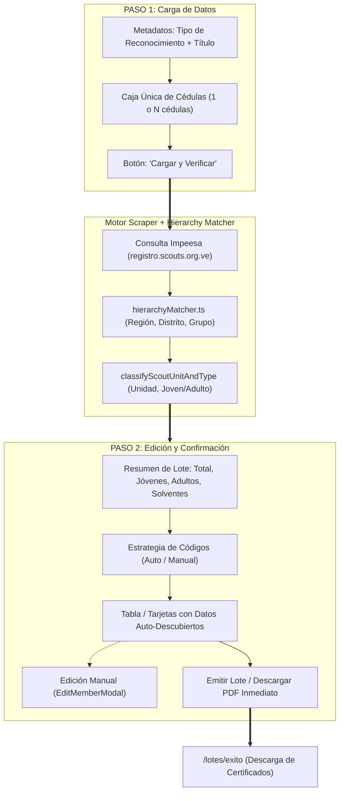
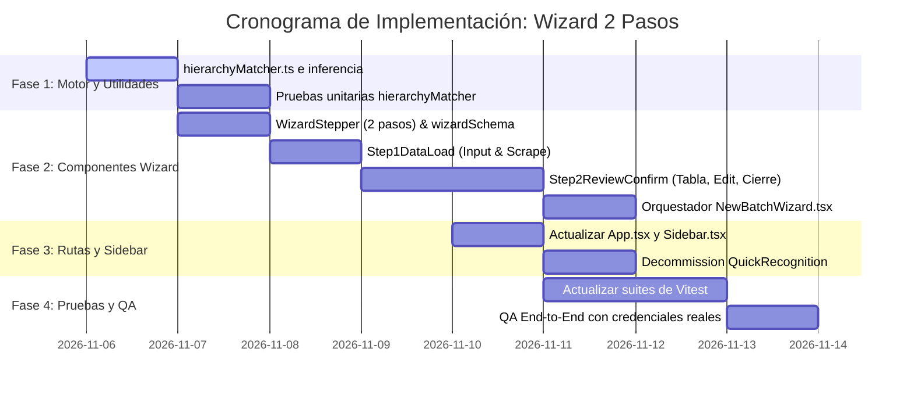

# Plan de Implementación: Simplificación del Asistente de Lotes a 2 Pasos y Consolidación del Método Rápido

> **Documento:** Plan de Refactorización y Arquitectura UX  
> **Módulo:** Asistente de Creación de Lotes (`NewBatchWizard`) & Emisión Rápida (`QuickRecognition`)  
> **Fecha:** Noviembre 2026  
> **Versión:** 2.0.0  
> **Autor:** Subagent B: Wizard Simplification & Fast Method Consolidation Planner  
> **Estado:** Listo para Implementación  

---

## 1. Resumen Ejecutivo y Diagnóstico

### 1.1 El Problema Actual
El flujo de emisión de reconocimientos en Chil presenta actualmente una duplicación innecesaria y una sobrecarga cognitiva severa para los dirigentes y administradores scouts:

1. **Wizard de 3 Pasos Ineficiente:**
   - **Paso 1 (Organización):** Obliga a navegar por tres modales en cascada (*Región*, *Distrito*, *Grupo*) y seleccionar un *Alcance de Unidad* restrictivo, antes de siquiera poder ingresar una cédula. Si un lote incluye jóvenes de varios grupos (común en campamentos, eventos distritales o regionales), el usuario debía marcar "Mixto" / "No aplica", perdiendo la jerarquía.
   - **Paso 2 (Verificación):** Divide manualmente a los miembros en dos áreas de texto separadas (*Cédulas de Jóvenes* y *Cédulas de Adultos*), forzando al usuario a clasificar previamente a las personas.
   - **Paso 3 (Generación):** Repite tablas de revisión y controles de códigos que deberían estar unificados con los resultados de la verificación.
2. **Módulo Aislado y Clunky de "Emisión Rápida" (`QuickRecognition`):**
   - Creado originalmente como un atajo para emitir un certificado individual sin crear un lote manual.
   - Requiere rellenar manualmente hasta 10 campos (Región, Distrito, Grupo, Unidad, Tipo de Miembro, Nombres, Apellidos, etc.) si el scraper legacy no devolvía la estructura completa.
   - Mantiene rutas paralelas redundantes (`/lotes/rapido` y `/emision-rapida`), aumentando la deuda técnica y fragmentando la interfaz.

### 1.2 La Oportunidad: El Nuevo Scraper Impeesa Auto-Descubre Todo
Conforme a la investigación en `docs/refactor/scraper_impeesa_research_report.md`, el nuevo scraper de Impeesa (`registro.scouts.org.ve`) extrae directamente:
* **Jerarquía Territorial Completa:** Región, Distrito y Grupo Scout exactos.
* **Rama / Unidad y Cargo:** Manada, Tropa, Caminantes, Clan, Institucional / Dirigente.
* **Clasificación Automática:** Joven vs. Adulto calculada por rol y edad.
* **Identidad y Solvencia:** Nombres, fecha de nacimiento, foto Cloudinary, UUID y solvencia hasta año/mes/día.

### 1.3 Decisión de Diseño: Asistente Unificado de 2 Pasos
Gracias a esta densidad de datos, **el módulo separado de emisión rápida queda obsoleto**. El nuevo asistente de 2 pasos es capaz de procesar **1 sola cédula** tan rápido como **50 cédulas**:
* **Paso 1: Carga de Datos (Input & Loading):**
  - Título / Comentario del lote (opcional).
  - Selector de Tipo de Reconocimiento (catálogo dinámico).
  - **Campo Único de Cédulas:** Una sola área de texto unificada (sin distinción joven/adulto).
  - Barra de progreso en vivo durante la consulta al scraper.
* **Paso 2: Edición y Confirmación (Review & Confirmation):**
  - Tabla / tarjetas ricas con los miembros auto-descubiertos (foto, estatus, jerarquía detectada, unidad, solvencia).
  - Modal de edición rápida compartido (`EditMemberModal`) para corregir o agregar emisiones excepcionales / no scouts.
  - Generación de códigos oficiales (automático / manual).
  - Botón de emisión: **"Emitir Lote"** (o **"Emitir y Descargar PDF"** cuando se trate de un miembro único).



---

## 2. Arquitectura de Componentes del Asistente de 2 Pasos

### 2.1 Estructura de Directorios & Archivos

```
src/features/batches/
├── components/
│   ├── NewBatchWizard.tsx                  # Orquestador del Asistente de 2 pasos
│   ├── SuccessPage.tsx                     # Pantalla de confirmación y descargas
│   ├── shared/
│   │   ├── EditMemberModal.tsx             # Modal universal para edición de miembros
│   │   └── ManualMemberModal.tsx           # Modal rápido para agregar miembro no scout
│   └── wizard/
│       ├── WizardStepper.tsx               # Stepper simplificado a 2 pasos
│       ├── Step1DataLoad.tsx               # PASO 1: Input de datos, selector y cédulas
│       ├── Step2ReviewConfirm.tsx          # PASO 2: Revisión, códigos, edición y confirmación
│       ├── ScraperAlertModals.tsx          # Modales de credenciales / errores de sesión
│       ├── wizardHelpers.ts                # Parsers, transformadores y persistencia en DB
│       ├── wizardSchema.ts                 # Esquemas Zod para Step 1
│       └── index.ts                        # Barrel export
├── utils/
│   ├── hierarchyMatcher.ts                 # Matcher de nombres Impeesa -> hierarchy.json
│   ├── codeGenerator.ts                    # Generación de códigos oficiales de lote
│   ├── nameHelper.ts                       # Split de nombres y apellidos
│   └── unitInference.ts                    # Clasificador de unidades y edades
└── api/
    ├── scraperApi.ts                       # Llamadas a functions/scraper/lookup
    └── batchesApi.ts                       # CRUD Firestore/IndexedDB de lotes y miembros
```

### 2.2 Flujo de Datos y Estado Global del Asistente

En `NewBatchWizard.tsx`:

```typescript
// Estado principal del Wizard
const [currentStep, setCurrentStep] = useState<1 | 2>(1);
const [batchId, setBatchId] = useState<number | null>(null);
const [batchMetadata, setBatchMetadata] = useState<{
  comment: string;
  recognitionType: string;
}>({ comment: '', recognitionType: '' });

// Estado de Miembros Verificados (Paso 2)
const [membersList, setMembersList] = useState<ScoutMember[]>([]);

// Estado de Verificación en Progreso (Paso 1)
const [isVerifying, setIsVerifying] = useState<boolean>(false);
const [verifyProgress, setVerifyProgress] = useState<{ current: number; total: number }>({ current: 0, total: 0 });
```

---

## 3. Especificación Detallada de los Pasos

### 3.1 PASO 1: Carga de Datos (`Step1DataLoad.tsx`)

#### Responsabilidades:
1. Captura el Tipo de Reconocimiento (obligatorio, extraído del catálogo dinámico).
2. Captura un título/comentario para el lote (opcional; si está vacío, se autogenera con fecha y tipo).
3. Ofrece una **única caja de texto de cédulas** (`textarea`), tolerante a:
   - Saltos de línea.
   - Comas o espacios.
   - Prefijos "V-", "E-", puntos de mil ("V-12.345.678" -> "12345678").
4. Muestra un contador en vivo: *"X cédula(s) detectada(s)"*.
5. Soporta carga de archivo rápido (botón "Importar CSV / TXT").
6. Al pulsar **"Cargar y Verificar Datos"**:
   - Valida el formulario con Zod (`step1DataLoadSchema`).
   - Verifica credenciales de scraper (`hasScraperCredentials()`).
   - Inicia la barra de progreso reactiva.
   - Crea el registro inicial del lote (`createBatch`).
   - Ejecuta las consultas scraper concurrentemente (con concurrencia controlada de 3-5 workers para no saturar Impeesa).
   - Ejecuta `matchHierarchy` y `classifyScoutUnitAndType` para cada respuesta.
   - Guarda los miembros iniciales en base de datos (`createMember`).
   - Transiciona automáticamente al **Paso 2**.

#### Esquema de Validación Zod (`wizardSchema.ts`):
```typescript
import { z } from 'zod';
import { parseCedulasFromText } from './wizardHelpers';

export const step1DataLoadSchema = z.object({
  comment: z.string().optional(),
  recognitionType: z.string().min(1, 'Debe seleccionar un tipo de reconocimiento'),
  cedulas: z
    .string()
    .min(1, 'Debe ingresar al menos una cédula')
    .refine((val) => parseCedulasFromText(val).length > 0, {
      message: 'Ingrese al menos una cédula válida (solo números)'
    })
});

export type Step1DataLoadFormData = z.infer<typeof step1DataLoadSchema>;
```

#### Estructura JSX y Mockup Visual:
```tsx
<Card className="border-primary/10 shadow-sm">
  <CardHeader className="bg-primary/5 border-b border-primary/10">
    <div className="flex items-center justify-between">
      <div>
        <h2 className="text-lg font-bold text-neutral">Carga de Datos del Lote</h2>
        <p className="text-xs text-neutral/60">
          Ingresa los datos generales y la lista de cédulas. La estructura geográfica y las unidades se auto-detectarán.
        </p>
      </div>
      <span className="text-xs font-semibold px-2.5 py-1 bg-primary/10 text-primary rounded-full">
        Paso 1 de 2
      </span>
    </div>
  </CardHeader>

  <CardBody className="space-y-6">
    <form onSubmit={handleSubmit(onSubmitStep1)} className="space-y-6">
      {/* Metadatos Generales */}
      <div className="grid md:grid-cols-2 gap-6">
        <div>
          <label className="block text-xs font-bold uppercase tracking-wider text-neutral mb-2">
            Tipo de Reconocimiento *
          </label>
          <select
            {...register('recognitionType')}
            className="w-full rounded-field px-4 h-[46px] bg-primary/5 border border-primary/20 text-neutral text-sm focus:ring-2 focus:ring-primary"
            disabled={isVerifying}
          >
            <option value="">Seleccione un reconocimiento...</option>
            {recognitionTypes.map((rt) => (
              <option key={rt.id} value={rt.id}>
                {rt.name}
              </option>
            ))}
          </select>
          {errors.recognitionType && (
            <p className="text-xs text-red-500 mt-1 font-medium">{errors.recognitionType.message}</p>
          )}
        </div>

        <div>
          <label className="block text-xs font-bold uppercase tracking-wider text-neutral mb-2">
            Título / Comentario del Lote (Opcional)
          </label>
          <input
            {...register('comment')}
            placeholder="Ej. Reconocimientos Campamento Nacional 2026"
            className="w-full rounded-field px-4 h-[46px] bg-primary/5 border border-primary/20 text-neutral text-sm focus:ring-2 focus:ring-primary"
            disabled={isVerifying}
          />
        </div>
      </div>

      {/* Caja Única de Cédulas */}
      <div className="space-y-2">
        <div className="flex items-center justify-between">
          <label className="block text-xs font-bold uppercase tracking-wider text-neutral">
            Cédulas de Identidad (Jóvenes y Adultos) *
          </label>
          <div className="flex items-center gap-2">
            <span className="text-xs font-semibold px-2 py-0.5 rounded-md bg-neutral/10 text-neutral/70">
              {parsedCount} {parsedCount === 1 ? 'cédula detectada' : 'cédulas detectadas'}
            </span>
            <label className="text-xs text-primary font-bold hover:underline cursor-pointer">
              <span>Importar archivo</span>
              <input type="file" accept=".csv,.txt" className="hidden" onChange={handleFileUpload} />
            </label>
          </div>
        </div>

        <textarea
          {...register('cedulas')}
          rows={6}
          placeholder="Pega aquí las cédulas una por línea o separadas por comas.&#10;Ejemplos:&#10;11926931&#10;30541929&#10;28123456"
          className="w-full rounded-field p-4 bg-primary/5 border border-primary/20 text-neutral text-sm font-mono focus:ring-2 focus:ring-primary"
          disabled={isVerifying}
        />
        {errors.cedulas && (
          <p className="text-xs text-red-500 font-medium">{errors.cedulas.message}</p>
        )}
        <p className="text-xs text-neutral/50">
          Nota: No necesitas separar jóvenes de adultos ni indicar región o grupo. El sistema consultará el portal oficial de registro y clasificará a cada miembro automáticamente.
        </p>
      </div>

      {/* Indicador de Progreso en Vivo */}
      {isVerifying && (
        <div className="p-4 bg-blue-50 border border-blue-200 rounded-2xl space-y-2 animate-fade-in">
          <div className="flex justify-between items-center text-xs font-bold text-blue-900">
            <span className="flex items-center gap-2">
              <RefreshCw className="w-4 h-4 animate-spin text-blue-600" />
              Consultando Sistema de Registro Impeesa...
            </span>
            <span>{verifyProgress.current} de {verifyProgress.total}</span>
          </div>
          <div className="w-full bg-blue-200 h-2 rounded-full overflow-hidden">
            <div
              className="bg-primary h-full transition-all duration-300 rounded-full"
              style={{ width: `${(verifyProgress.current / Math.max(1, verifyProgress.total)) * 100}%` }}
            />
          </div>
        </div>
      )}

      {/* Botón de Envío */}
      <div className="flex justify-end pt-4 border-t border-primary/10">
        <Button
          type="submit"
          variant="primary"
          disabled={isVerifying || parsedCount === 0}
          icon={isVerifying ? <RefreshCw className="animate-spin" size={18} /> : <ArrowRight size={18} />}
          iconPosition="right"
        >
          {isVerifying ? 'Verificando con Impeesa...' : 'Cargar y Verificar Miembros'}
        </Button>
      </div>
    </form>
  </CardBody>
</Card>
```

---

### 3.2 PASO 2: Edición y Confirmación (`Step2ReviewConfirm.tsx`)

#### Responsabilidades:
1. **Resumen de Métricas del Lote:** Tarjetas con Total de miembros, Jóvenes, Adultos, Solventes y Casos Excepcionales/Pendientes.
2. **Barra de Estrategia de Códigos de Reconocimiento:**
   - Modo Automático (prefijo oficial tipo `REC-2026-001` o configurable).
   - Modo Manual (permite edición inline de cualquier código).
   - Botón *"Regenerar Códigos"* y *"Limpiar Códigos"*.
3. **Tabla de Miembros Auto-Descubiertos:**
   - **Avatar:** Foto de perfil oficial de Cloudinary (o avatar con iniciales).
   - **Cédula & Estatus:** Badge con `Registro Válido` (verde), `No Registrado` (rojo), `Error de Red` (amarillo con reintento) o `Excepcional` (morado).
   - **Nombre Completo:** Nombres y apellidos extraídos del portal.
   - **Estructura Scout Auto-Mapeada:** Badge claro mostrando `Región` > `Distrito` > `Grupo Scout` (con icono de edición para cambiarlo si se requiere).
   - **Rama / Unidad & Tipo:** `Manada`, `Tropa`, `Caminantes`, `Clan`, `Institucional` + `Joven` / `Adulto`.
   - **Solvencia:** `Solvente hasta DD/MM/YYYY` (o badge de alerta si está vencida).
   - **Código de Reconocimiento:** Campo editable o autogenerado.
   - **Acciones:**
     - Botón de Edición: Abre `EditMemberModal` para modificar cualquier dato o registrar justificación excepcional.
     - Botón Eliminar: Quita al miembro del lote.
     - Botón Reintentar: Reintenta la consulta individual si hubo timeout.
4. **Adición Rápida de Miembros Especiales:**
   - Botón *"Agregar Miembro Manual / No Scout"* para invitados de honor, autoridades civiles o colaboradores sin registro ASV.
5. **Botones de Cierre & Emisión:**
   - Botón *"Atrás (Modificar Cédulas)"*: Regresa al Paso 1 conservando el borrador.
   - **Atajo para 1 Cédula:** Si el lote tiene 1 solo miembro, se muestra el botón destacado **"Emitir y Descargar PDF Ahora"**.
   - Botón Principal: **"Emitir Lote"**, que guarda códigos con `batchUpdateMembers` y redirige a `/lotes/exito`.

#### Estructura JSX y Mockup Visual:
```tsx
<div className="space-y-6">
  {/* Header de Métricas */}
  <Card className="border-primary/10">
    <CardHeader className="bg-primary/5 border-b border-primary/10 flex flex-wrap justify-between items-center gap-4">
      <div>
        <h2 className="text-lg font-bold text-neutral">Revisión y Confirmación del Lote</h2>
        <p className="text-xs text-neutral/60">
          Lote: <span className="font-semibold text-neutral">{batchMetadata.comment || 'Lote sin título'}</span> · Tipo: <span className="font-semibold text-primary">{recognitionTypeName}</span>
        </p>
      </div>

      <div className="flex items-center gap-3">
        <div className="px-3 py-1.5 bg-primary/10 text-primary font-bold text-xs rounded-xl flex items-center gap-1.5">
          <Users className="w-4 h-4" />
          <span>Total: {membersList.length}</span>
        </div>
        <div className="px-3 py-1.5 bg-blue-50 text-blue-700 font-bold text-xs rounded-xl flex items-center gap-1.5 border border-blue-200">
          <GraduationCap className="w-4 h-4" />
          <span>Jóvenes: {countYoung}</span>
        </div>
        <div className="px-3 py-1.5 bg-amber-50 text-amber-700 font-bold text-xs rounded-xl flex items-center gap-1.5 border border-amber-200">
          <User className="w-4 h-4" />
          <span>Adultos: {countAdult}</span>
        </div>
      </div>
    </CardHeader>

    <CardBody className="space-y-6">
      {/* Barra de Control de Códigos y Acciones Rápidas */}
      <div className="bg-[#faf8f5] border border-primary/15 rounded-2xl p-4 flex flex-col sm:flex-row justify-between items-start sm:items-center gap-3">
        <div>
          <h3 className="text-sm font-bold text-neutral">Estrategia de Códigos de Reconocimiento</h3>
          <p className="text-xs text-neutral/50">
            {codeMode === 'auto'
              ? 'Códigos asignados automáticamente de acuerdo al tipo y orden.'
              : 'Modo manual activo: puedes editar el código directamente en la tabla.'}
          </p>
        </div>

        <div className="flex items-center gap-2 flex-wrap">
          <Button
            type="button"
            variant="outline"
            size="sm"
            onClick={toggleCodeMode}
            className="text-xs border-primary/20 hover:bg-primary/10"
          >
            {codeMode === 'auto' ? 'Editar Códigos Manualmente' : 'Auto-Generar Códigos'}
          </Button>

          {codeMode === 'auto' && (
            <Button
              type="button"
              variant="outline"
              size="sm"
              onClick={handleRegenerateCodes}
              icon={<RotateCcw size={14} />}
              className="text-xs border-primary/20 hover:bg-primary/10"
            >
              Regenerar
            </Button>
          )}

          <Button
            type="button"
            variant="outline"
            size="sm"
            onClick={() => setIsManualModalOpen(true)}
            icon={<UserPlus size={14} />}
            className="text-xs border-primary/20 hover:bg-primary/10"
          >
            Agregar No Scout
          </Button>
        </div>
      </div>

      {/* Tabla de Miembros Auto-Descubiertos */}
      <div className="border border-primary/20 rounded-2xl overflow-hidden bg-white shadow-sm">
        <Table columns={columns} data={membersList} className="!border-0 !rounded-none" />
      </div>
    </CardBody>

    <CardFooter className="flex justify-between items-center bg-gray-50/50 border-t border-primary/10">
      <Button variant="outline" onClick={onBack} icon={<ArrowLeft size={18} />}>
        Atrás (Modificar Cédulas)
      </Button>

      <div className="flex items-center gap-3">
        {/* Atajo si es 1 solo miembro */}
        {membersList.length === 1 && (
          <Button
            variant="secondary"
            onClick={handleEmitAndDownloadSinglePdf}
            icon={<Download size={18} />}
            disabled={isFinalizing}
          >
            Emitir y Descargar PDF
          </Button>
        )}

        <Button
          variant="primary"
          onClick={handleFinalizeBatch}
          disabled={membersList.length === 0 || isFinalizing}
          icon={isFinalizing ? <RefreshCw className="animate-spin" size={18} /> : <CheckCircle2 size={18} />}
          iconPosition="right"
        >
          {isFinalizing ? 'Guardando Lote...' : 'Emitir Lote'}
        </Button>
      </div>
    </CardFooter>
  </Card>

  {/* Modal Universal de Edición de Miembro */}
  <EditMemberModal
    isOpen={isEditModalOpen}
    onClose={() => setIsEditModalOpen(false)}
    member={selectedEditingMember}
    onSave={handleSaveEditedMember}
    regions={regions}
    districts={districts}
    groups={groups}
  />
</div>
```

---

## 4. Hierarchy Matching Engine (`hierarchyMatcher.ts`)

### 4.1 Ubicación y Propósito
El motor residirá en `src/features/batches/utils/hierarchyMatcher.ts` y se encargará de transformar los textos en mayúsculas devueltos por el scraper de Impeesa en los IDs numéricos estandarizados de `src/data/hierarchy.json`.

### 4.2 Algoritmo de Coincidencia Jerárquica y Clasificación

```typescript
/**
 * src/features/batches/utils/hierarchyMatcher.ts
 */
import hierarchyData from '../../../data/hierarchy.json';
import { ScoutUnit } from '../types';

export interface MatchedHierarchy {
  region_id?: number;
  region_name?: string;
  district_id?: number;
  district_name?: string;
  group_id?: number;
  group_name?: string;
}

/**
 * Normaliza nombres eliminando tildes, signos de puntuación y espacios extras
 */
export function normalizeScoutName(str?: string): string {
  if (!str) return '';
  return str
    .trim()
    .toUpperCase()
    .normalize('NFD')
    .replace(/[\u0300-\u036f]/g, '') // Elimina acentos/diacríticos
    .replace(/[^\w\s]/g, ' ')       // Elimina caracteres especiales y signos
    .replace(/\s+/g, ' ');          // Colapsa espacios repetidos
}

/**
 * Mapea nombres extraídos de Impeesa a IDs de hierarchy.json
 */
export function matchHierarchy(
  regionStr?: string,
  districtStr?: string,
  groupStr?: string
): MatchedHierarchy {
  const normRegion = normalizeScoutName(regionStr);
  const normDistrict = normalizeScoutName(districtStr);
  const normGroup = normalizeScoutName(groupStr);

  // 1. Coincidencia de Región
  let matchedRegion = hierarchyData.regions.find(
    (r) => normalizeScoutName(r.name) === normRegion
  );

  // 2. Coincidencia de Distrito (prioriza la región si se encontró)
  let matchedDistrict = null;
  if (matchedRegion) {
    matchedDistrict = hierarchyData.districts.find(
      (d) => d.region_id === matchedRegion!.id && normalizeScoutName(d.name) === normDistrict
    );
  }
  if (!matchedDistrict && normDistrict) {
    matchedDistrict = hierarchyData.districts.find(
      (d) => normalizeScoutName(d.name) === normDistrict
    );
    if (matchedDistrict && !matchedRegion) {
      matchedRegion = hierarchyData.regions.find((r) => r.id === matchedDistrict!.region_id);
    }
  }

  // 3. Coincidencia de Grupo Scout
  let matchedGroup = null;
  if (matchedDistrict && normGroup) {
    // 3.1 Coincidencia exacta dentro del distrito
    matchedGroup = hierarchyData.groups.find(
      (g) => g.district_id === matchedDistrict!.id && normalizeScoutName(g.name) === normGroup
    );
    // 3.2 Coincidencia parcial/subcadena (ej. "DON BOSCO" con "DON BOSCO 21")
    if (!matchedGroup) {
      matchedGroup = hierarchyData.groups.find(
        (g) =>
          g.district_id === matchedDistrict!.id &&
          (normalizeScoutName(g.name).includes(normGroup) ||
            normGroup.includes(normalizeScoutName(g.name)))
      );
    }
  } else if (normGroup) {
    // 3.3 Búsqueda global de grupo si no hubo distrito
    matchedGroup = hierarchyData.groups.find(
      (g) => normalizeScoutName(g.name) === normGroup
    );
    if (matchedGroup) {
      matchedDistrict = hierarchyData.districts.find((d) => d.id === matchedGroup!.district_id);
      if (matchedDistrict && !matchedRegion) {
        matchedRegion = hierarchyData.regions.find((r) => r.id === matchedDistrict!.region_id);
      }
    }
  }

  return {
    region_id: matchedRegion?.id,
    region_name: matchedRegion?.name || regionStr,
    district_id: matchedDistrict?.id,
    district_name: matchedDistrict?.name || districtStr,
    group_id: matchedGroup?.id,
    group_name: matchedGroup?.name || groupStr
  };
}

/**
 * Clasifica la unidad y el tipo de miembro (joven vs adulto) a partir de los datos Impeesa
 */
export function classifyScoutUnitAndType(scraped: {
  unidad?: string;
  cargo_grupo?: string;
  cargo_institucional?: string;
  tipo_miembro?: string;
  edad?: number | null;
}): { unit: ScoutUnit; member_type: 'young' | 'adult' } {
  const normUnit = (scraped.unidad || '').toLowerCase();
  const normCargo = (scraped.cargo_grupo || '').toLowerCase();
  const normCargoInst = (scraped.cargo_institucional || '').toLowerCase();
  const normTipo = (scraped.tipo_miembro || '').toLowerCase();
  const edad = scraped.edad ?? null;

  // 1. Detección de Adulto
  const isAdultRole =
    normCargo.includes('adulto') ||
    normCargo.includes('dirigente') ||
    normCargo.includes('jefe') ||
    normCargo.includes('colaborador') ||
    normCargoInst.includes('nacional') ||
    normCargoInst.includes('distrital') ||
    normTipo.includes('institucional') ||
    normTipo.includes('distrito') ||
    normTipo.includes('nacional');

  const isAdultAge = edad !== null && edad >= 21;
  const isAdult = isAdultRole || isAdultAge;

  // 2. Mapeo de Unidad Scout
  let unit: ScoutUnit = 'institucional';

  if (normUnit.includes('manada') || (edad !== null && edad >= 7 && edad < 11)) {
    unit = 'manada';
  } else if (normUnit.includes('tropa') || (edad !== null && edad >= 11 && edad < 16)) {
    unit = 'tropa';
  } else if (
    normUnit.includes('comunidad') ||
    normUnit.includes('caminante') ||
    (edad !== null && edad >= 16 && edad < 18)
  ) {
    unit = 'caminantes';
  } else if (
    normUnit.includes('clan') ||
    normUnit.includes('rover') ||
    (edad !== null && edad >= 18 && edad < 21)
  ) {
    unit = 'clan';
  } else if (normUnit.includes('conductor') || isAdult) {
    unit = 'institucional';
  }

  return {
    unit,
    member_type: isAdult ? 'adult' : 'young'
  };
}
```

---

## 5. Emisión de Cédula Única ("Modo Rápido" Sin Módulo Separado)

Una de las quejas principales del usuario era la existencia de un módulo separado de "Emisión Rápida" que obligaba a llenar campos manualmente y mantenía su propio código y rutas.

### 5.1 Comparativa de Flujos: Antes vs. Después

| Aspecto | Flujo Antiguo (`QuickRecognition`) | Nuevo Flujo Unificado (2 Pasos) |
| :--- | :--- | :--- |
| **Página / Ruta** | `/lotes/rapido` o `/emision-rapida` separada | `/lotes/nuevo` universal |
| **Campos Requeridos** | 7 a 10 campos (Región, Distrito, Grupo, Unidad, Tipo, Nombres...) | **2 campos:** Tipo de Reconocimiento + Cédula |
| **Ingreso de Cédula** | Consultar botón -> Esperar respuesta -> Rellenar faltantes | Pegar cédula -> Clic "Cargar y Verificar" |
| **Tiempo de Emisión** | ~45-60 segundos por certificado | **< 8 segundos** |
| **Descarga Inmediata** | Botón dedicado "Emitir y Descargar" | Botón contextual **"Emitir y Descargar PDF"** en Paso 2 |
| **Consistencia de Datos** | Lote aislado con metadatos a menudo incompletos | Lote registrado con jerarquía oficial auto-mapeada |

### 5.2 Experiencia de Usuario al Ingresar 1 Sola Cédula
1. El usuario entra a **Nuevo Lote** (`/lotes/nuevo`).
2. Selecciona el Tipo de Reconocimiento (ej. *Espíritu Scout*).
3. Pega una sola cédula (ej. `30541929`).
4. Pulsa **"Cargar y Verificar Miembros"**.
5. En 1-2 segundos aterriza en el **Paso 2**:
   - Aparece la tarjeta/fila de Miguel Ciavato con foto, *Distrito Capital / Ávila / Don Bosco 21*, *Caminantes*, *Solvente*, y código generado `REC-929`.
6. Al detectar que el lote tiene `membersList.length === 1`, el sistema activa el botón secundario con icono de descarga: **"Emitir y Descargar PDF"**.
7. Al hacer clic, descarga el certificado PDF de inmediato y finaliza el lote en la base de datos.
8. **Resultado:** Se logra la misma inmediatez de la emisión rápida, pero con **cero carga manual de jerarquía** y un solo codebase unificado.

---

## 6. Actualización de Rutas, Navegación y Decommissioning

### 6.1 Actualización de Rutas en `src/App.tsx`
Se reemplazan los componentes montados en `/lotes/rapido` y `/emision-rapida` por redirecciones permanentes a `/lotes/nuevo`:

```tsx
// src/App.tsx
import { HashRouter, Routes, Route, Navigate } from 'react-router-dom';
import { NewBatchWizard, BatchDetail, BatchList, SuccessPage } from './features/batches';

// Rutas protegidas:
<Route
  path="/lotes/rapido"
  element={<Navigate to="/lotes/nuevo" replace />}
/>
<Route
  path="/emision-rapida"
  element={<Navigate to="/lotes/nuevo" replace />}
/>
<Route
  path="/lotes/nuevo"
  element={
    <ProtectedRoute>
      <NewBatchWizard />
    </ProtectedRoute>
  }
/>
```

### 6.2 Actualización de la Barra de Navegación (`src/components/navigation/Sidebar.tsx`)
Se retira el enlace `Emisión Rápida` (ícono `Zap`) y se realza el enlace principal `Nuevo Lote`:

```typescript
// src/components/navigation/Sidebar.tsx
const navItems = [
  {
    to: '/lotes',
    label: 'Lotes',
    icon: Folder,
    dataWalkthrough: 'nav-lotes'
  },
  {
    to: '/lotes/nuevo',
    label: 'Nuevo Lote',
    icon: PlusCircle,
    dataWalkthrough: 'nav-nuevo',
    isPrimaryAction: true // Estilizado destacado
  },
  {
    to: '/reconocimientos',
    label: 'Reconocimientos',
    icon: Award,
    dataWalkthrough: 'nav-reconocimientos'
  },
  {
    to: '/resumen',
    label: 'Resumen',
    icon: Table,
    dataWalkthrough: 'nav-resumen'
  },
  {
    to: '/estadisticas',
    label: 'Estadísticas',
    icon: BarChart3,
    dataWalkthrough: 'nav-estadisticas'
  }
];
```

### 6.3 Estrategia de Decommissioning de Archivos Obsoletos
Una vez que el nuevo asistente de 2 pasos esté probado y operativo, los siguientes archivos quedarán limpios y removidos del repositorio:
1. `src/features/batches/components/QuickRecognition.tsx`
2. `src/features/batches/components/quick/` (`QuickRecognitionSuccess.tsx`, `RecipientFieldsSection.tsx`, `RecognitionFieldsSection.tsx`)
3. `src/features/batches/hooks/useQuickRecognition.ts`
4. `src/features/batches/hooks/quickRecognitionHelpers.ts`
5. `src/features/batches/hooks/quickRecognitionSchema.ts`
6. `src/features/batches/components/wizard/Step1Org.tsx` (reemplazado por `Step1DataLoad.tsx`)
7. `src/features/batches/components/wizard/Step2Verification.tsx` y `Step3Review.tsx` (consolidados en `Step2ReviewConfirm.tsx`)

---

## 7. Estrategia de Pruebas y Migración de Tests

### 7.1 Nuevo Conjunto de Pruebas Unitarias e Integración

1. **`hierarchyMatcher.test.ts` (Nuevo):**
   - Coincidencias exactas (`DISTRITO CAPITAL` -> id: 5, `AVILA` -> id: 18, `DON BOSCO 21` -> id: 104).
   - Tolerancia a acentos, minúsculas y diacríticos (`distrito capital`, `ÁVILA`, `maracaibo`).
   - Coincidencias difusas y subcadenas (`DON BOSCO` match con `DON BOSCO 21`).
   - Clasificación de unidades (`manada`, `tropa`, `caminantes`, `clan`, `institucional`).
   - Clasificación de jóvenes vs adultos por rol y por edad.

2. **`NewBatchWizardFull.test.tsx` (Actualización a 2 Pasos):**
   - **Paso 1:** Selecciona tipo de reconocimiento, escribe o pega cédulas (`11926931`), hace clic en *"Cargar y Verificar"*.
   - **Verificación:** Valida llamada a `getMemberStatus`, inserción de datos enriquecidos.
   - **Paso 2:** Verifica que la tabla muestre la Región, Distrito, Grupo y Unidad detectados.
   - **Generación:** Hace clic en *"Emitir Lote"* y verifica llamada a `batchUpdateMembers` y redirección a `/lotes/exito`.

3. **`NewBatchWizardErrors.test.tsx` (Actualización):**
   - Validación de cédulas vacías o inválidas en Paso 1.
   - Manejo de falta de credenciales de scraper (`showAuthAlert`).
   - Manejo de cédula no registrada (muestra estatus *"No registrado"* y permite marcar como emisión excepcional).
   - Manejo de timeout de red (botón de reintento en Paso 2).

4. **`Step2ReviewConfirm.test.tsx` (Consolidación de `Step2Verification` y `Step3Review`):**
   - Asignación y regeneración de códigos oficiales de reconocimiento.
   - Apertura de `EditMemberModal` y guardado de modificaciones de datos.
   - Adición de miembro manual no scout.
   - Botón de descarga de PDF individual cuando `members.length === 1`.

5. **Pruebas de Redirección de Rutas Obsoletas:**
   - Verificar que navegar a `/lotes/rapido` redirige automáticamente a `/lotes/nuevo`.
   - Verificar que navegar a `/emision-rapida` redirige automáticamente a `/lotes/nuevo`.

---

## 8. Cronograma de Implementación por Fases



### Checklist de Tareas Específicas:
- [ ] Crear `src/features/batches/utils/hierarchyMatcher.ts`.
- [ ] Crear pruebas exhaustivas en `src/features/batches/utils/__tests__/hierarchyMatcher.test.ts`.
- [ ] Crear nuevo esquema Zod `step1DataLoadSchema` en `src/features/batches/components/wizard/wizardSchema.ts`.
- [ ] Actualizar `WizardStepper.tsx` para reflejar el modelo de 2 pasos (*Carga de Datos* y *Edición y Confirmación*).
- [ ] Construir `Step1DataLoad.tsx` con soporte de caja única de cédulas y barra de progreso.
- [ ] Construir `Step2ReviewConfirm.tsx` unificando resultados de verificación, edición de miembros y finalización.
- [ ] Conectar `NewBatchWizard.tsx` integrando el nuevo flujo de 2 pasos.
- [ ] Actualizar rutas en `src/App.tsx` con `<Navigate to="/lotes/nuevo" replace />`.
- [ ] Actualizar `src/components/navigation/Sidebar.tsx` eliminando el tab "Emisión Rápida".
- [ ] Actualizar suites de tests (`NewBatchWizardFull.test.tsx`, `NewBatchWizardErrors.test.tsx`, etc.).
- [ ] Remover código obsoleto de `QuickRecognition`.
- [ ] Ejecutar suite completa de Vitest para garantizar cero regresiones.
