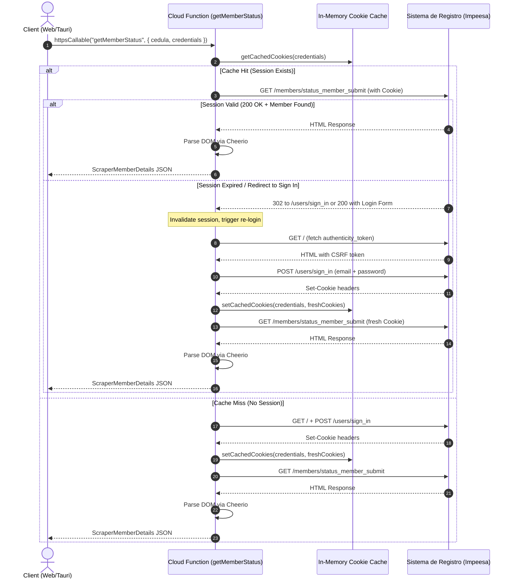
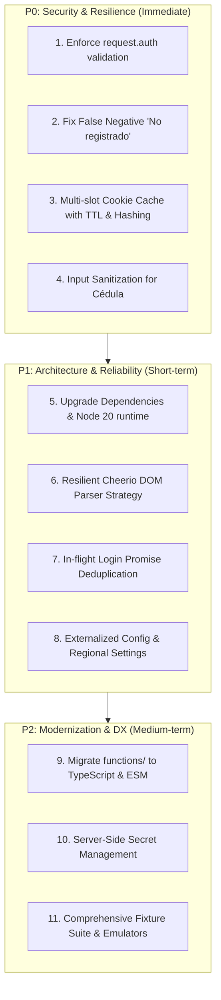
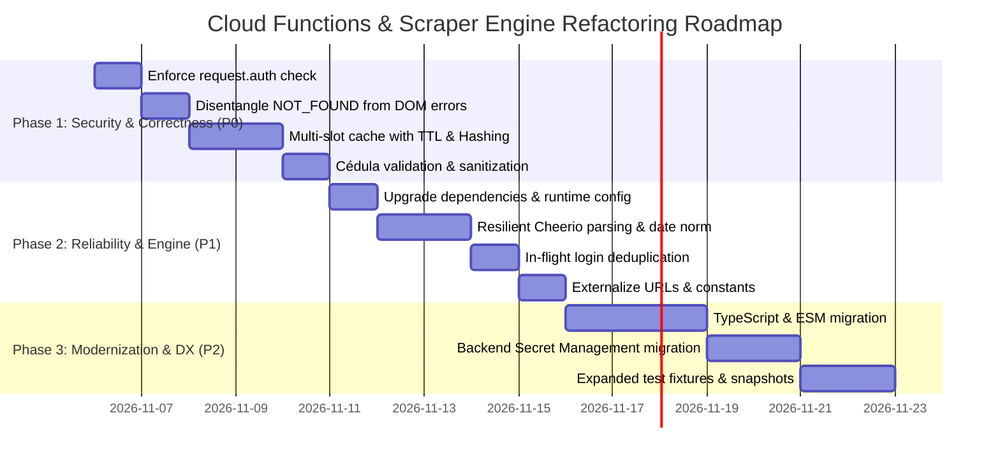

# Module Analysis & Refactoring Plan: Cloud Functions & Scraper Engine

> **Module Target:** `functions/` (Cloud Functions v2 & Registro Scouts Scraper Engine)  
> **Status:** Current Architecture Analysis & Strategic Refactoring Roadmap  
> **Scope:** `functions/index.js`, `functions/handlers/`, `functions/scraper/`, `functions/__tests__/`, `functions/package.json`

---

## 1. Domain Responsibility & Architectural Overview

### 1.1 Domain Responsibility
The **Cloud Functions & Scraper Engine** serves as Chil's server-side integration bridge with the national Scout association's official portal (*"Sistema de Registro"* / Impeesa at `https://registro.scouts.org.ve/`). 

Its primary responsibilities are:
1. **Overcoming Browser Sandbox & CORS Restrictions:** Browser applications cannot directly scrape or query external endpoints that do not provide permissive CORS headers. The Cloud Functions act as an authenticated proxy.
2. **Automated Session Authentication (`loginScraper`):** Extracts CSRF authenticity tokens from the portal sign-in page, executes form-encoded authentication, parses `Set-Cookie` response headers, and maintains session cookies.
3. **Member Status Verification & Data Extraction (`getMemberStatus`):** Executes national ID (`cedula`) lookups against `members/status_member_submit`, parses the resulting HTML using Cheerio, extracts member biographical and solvency status data, and transforms it into structured JSON (`ScraperMemberDetails`).
4. **Session Cookie Caching & Renewal:** Minimizes portal overhead and latency by reusing active session cookies across lookups, automatically falling back to re-login when sessions expire.



### 1.2 Module Structure & Inventory

| File Path | LOC | Type | Responsibility |
|:---|:---|:---|:---|
| [`functions/package.json`](file:///data/data/com.termux/files/home/chil/functions/package.json) | 22 | Config | Node 20 runtime configuration and backend dependencies. |
| [`functions/index.js`](file:///data/data/com.termux/files/home/chil/functions/index.js) | 9 | Entrypoint | Initializes `firebase-admin` and exports Cloud Function callables. |
| [`functions/handlers/loginScraper.js`](file:///data/data/com.termux/files/home/chil/functions/handlers/loginScraper.js) | 47 | Handler | Callable entrypoint for scraper authentication and cookie caching. |
| [`functions/handlers/getMemberStatus.js`](file:///data/data/com.termux/files/home/chil/functions/handlers/getMemberStatus.js) | 86 | Handler | Callable entrypoint for member status lookup with cached session fallback. |
| [`functions/scraper/auth.js`](file:///data/data/com.termux/files/home/chil/functions/scraper/auth.js) | 90 | Scraper Engine | CSRF token extraction, POST authentication, and in-memory cookie storage. |
| [`functions/scraper/lookup.js`](file:///data/data/com.termux/files/home/chil/functions/scraper/lookup.js) | 118 | Scraper Engine | Query dispatch and dual-mode HTML parsing (Legacy vs. Modern Impeesa). |
| [`functions/scraper/cookieHelper.js`](file:///data/data/com.termux/files/home/chil/functions/scraper/cookieHelper.js) | 26 | Utility | Parsing `Set-Cookie` headers and serializing cookie objects into HTTP headers. |
| [`functions/__tests__/`](file:///data/data/com.termux/files/home/chil/functions/__tests__) | ~450 | Tests | Unit test suite covering handlers, auth, lookup, and cookie helper modules. |

---

## 2. Code Quality & Technical Debt Assessment

### 2.1 Architectural Issues & Module Fragmentation

#### Dual Module System (CommonJS in Functions vs ESM/TypeScript in Client)
- **CommonJS Lock-in:** The backend codebase strictly uses CommonJS (`require`, `module.exports`, `exports.*`), while the root project is configured as `"type": "module"` with strict TypeScript (`~5.8.3`).
- **No Shared Typing:** Client types (`ScraperMemberDetails`, `ScraperCredentials` in `src/features/batches/api/scraperApi.ts`) are manually duplicated and not enforced on the backend. Cloud Functions accept untyped `request` parameters and return untyped JavaScript objects.
- **Vitest Environment Friction:** Unit tests (`functions/__tests__/*.test.js`) are written in ESM (`import { describe, it } from 'vitest'`) running in Node environment, importing CommonJS files. This causes synthetic default import warnings and hinders modern bundler tooling.

#### Extreme Dependency Drift
A critical version mismatch exists between `functions/package.json` and the root `package.json`:
- `firebase-admin`: `^11.8.0` (in `functions/`) vs. `^14.3.0` (root). Three major versions behind.
- `firebase-functions`: `^4.3.1` (in `functions/`) vs. `^7.3.2` (root). Three major versions behind.
- `cheerio`: `^1.0.0-rc.12` (in `functions/`) vs. `^1.2.0` (root).
- `axios`: `^1.6.8` (in `functions/`) vs. `^1.19.0` (root).

> [!WARNING]
> Running `firebase-functions` v4 on Node 20 runtime deprives the module of v5/v6/v7 performance optimizations, structured error telemetry, modern HTTP options, and enhanced concurrency controls.

### 2.2 Cloud Functions v2 Runtime & Resource Configuration
Both `loginScraper` and `getMemberStatus` define:
```javascript
exports.getMemberStatus = onCall(
  {
    cors: true,
    maxInstances: 10,
    timeoutSeconds: 60,
  },
  getMemberStatusHandler
);
```

1. **Default Memory Allocation (256MB):** Not explicitly set. While basic Axios calls require minimal RAM, loading and traversing 500+ line HTML DOM trees with Cheerio under concurrent load can trigger V8 Garbage Collection pauses or OOM (Out Of Memory) container terminations.
2. **Missing Region Definition:** Defaults to `us-central1`. If the Firebase project default or portal geographic location differs, regional routing causes unnecessary cross-region latency.
3. **Cold Start Penalties (`minInstances: 0`):** Without minimum instances, first-time requests experience 3–5 second container spin-up latencies on top of the external portal's response time (1–2s), degrading the user experience during member batch creation.
4. **Missing Concurrency Safeguards:** By default in Functions v2, instances handle concurrent requests (up to 80). Because the cookie cache is stored in a single module-level variable, concurrent executions within the same instance corrupt or overwrite each other's sessions.

### 2.3 Scraper Reliability & Parsing Vulnerabilities

#### False "No registrado" Alerts on Upstream Failures
In [`functions/scraper/lookup.js`](file:///data/data/com.termux/files/home/chil/functions/scraper/lookup.js#L109-L111):
```javascript
if (!member.nombre_completo) {
  throw new Error("No registrado");
}
```
If the portal alters its DOM layout, responds with a temporary Cloudflare challenge, or displays a maintenance splash page, `member.nombre_completo` remains empty. The function throws `"No registrado"`, and `getMemberStatusHandler` transforms this into `HttpsError("not-found", "No registrado")`.
**Impact:** Active registered members are erroneously flagged to the user as unregistered, causing administrative confusion and erroneous manual interventions.

#### Fragile Impeesa DOM Selectors
The Impeesa HTML parsing relies on brittle CSS utility classes and loose text matching:
1. `h3.fw-bold.text-dark, h3.text-dark, h3.fw-bold, .card-body h3`: Relies heavily on Bootstrap 5 utility classes. If the portal developers replace `text-dark` with `text-body` or change `h3` to `h2` or `div`, extraction breaks.
2. Status Badge Selector:
   ```javascript
   const badgeEl = $(".badge").filter((i, el) => {
     const t = $(el).text();
     return t.includes("Activo") || t.includes("Inactivo") || t.includes("Solvente");
   }).first();
   ```
   If a member holds a role badge such as `"Dirigente Activo"` or `"Miembro Inactivo en Grupo"`, this selector matches the role badge rather than the solvency badge.
3. Status Normalization:
   ```javascript
   member.status = t.toLowerCase().includes("activo") || t.toLowerCase().includes("solvente") ? "Activo" : t;
   ```
   This does not normalize other statuses (e.g., `"Inactivo"`, `"Suspendido"`, `"Pendiente"`, `"Solvente hasta DD/MM/YYYY"`), passing unstandardized strings downstream.
4. Date Extraction:
   Assumes `DD/MM/YYYY` formatted dates. If the portal displays `YYYY-MM-DD` or text like `"No registrada"`, date parsing can produce corrupted ISO dates.

#### In-Memory Cookie Cache Concurrency & Memory Leak
In [`functions/scraper/auth.js`](file:///data/data/com.termux/files/home/chil/functions/scraper/auth.js#L7-L26):
```javascript
let cachedCookies = null;
let cachedCredentialsKey = null;

function getCredentialsKey(credentials) {
  if (!credentials) return 'default';
  return `${credentials.email}:${credentials.password}`;
}
```
- **Single-Slot Capacity:** Only one set of credentials can be cached per instance. If two Scout leaders use different portal credentials simultaneously, their sessions continually invalidate each other.
- **Missing Expiration / TTL:** Cookies are held in memory indefinitely until the instance terminates or an HTTP error occurs. Expired cookies (`Max-Age=0` or expired timestamps) are neither pruned nor validated against `Set-Cookie` metadata.
- **Race Condition on Parallel Logins:** If two concurrent requests arrive for the same user without cached cookies, both execute `performLogin` simultaneously, triggering multiple concurrent logins against the upstream portal.

### 2.4 Security & Input Sanitization Vulnerabilities

> [!CAUTION]
> **Zero Caller Authentication Validation (`request.auth`)**
> Neither `loginScraperHandler` nor `getMemberStatusHandler` verifies caller identity. Any anonymous entity on the internet can invoke these callables with arbitrary payloads and use the backend as an open scraping proxy.

```javascript
// Current Implementation:
const getMemberStatusHandler = async (request) => {
  const { cedula, credentials } = request?.data || {};
  // NO check for request.auth!
```

- **Credential Transmission Over Wire:** The client application currently persists scraper credentials in browser `localStorage` and transmits them over every `getMemberStatus` callable call. This exposes credentials to XSS vectors in the browser and increases payload surface area.
- **Plaintext Password in Memory Key:** `getCredentialsKey` constructs `${credentials.email}:${credentials.password}`, leaving the raw password in memory as a key string rather than using a cryptographic hash (`sha256`).
- **Unsanitized Cédula Input:** The `cedula` parameter is accepted as raw input without length checks, type validation, or format sanitization (e.g., stripping punctuation `V-12.345.678` -> `12345678`).
- **Sensitive Information in Logs:** In `getMemberStatus.js`, `logger.error(\`getMemberStatus failed for \${cedula}:\`, error)` logs member national IDs directly to Cloud Logging.

---

## 3. Test Coverage & Resilience Analysis

### 3.1 Current Test Suite Evaluation

The test suite in [`functions/__tests__/`](file:///data/data/com.termux/files/home/chil/functions/__tests__) contains 5 test suites:

```
functions/__tests__/
├── auth.test.js           # 5 tests: token missing, invalid creds, successful login, cache store
├── cookieHelper.test.js   # 6 tests: null headers, single/multi headers, malformed headers, serialize
├── handlers.test.js       # 11 tests: argument validations, login handler, lookup handler fallbacks
├── index.test.js          # 1 test: callable exports
└── lookup.test.js         # 5 tests: redirects, login HTML, not-found, legacy parsing, Impeesa fixture
```

### 3.2 Coverage Gaps & Fragile Areas

| Vulnerability / Scenario | Covered? | Risk Level | Description |
|:---|:---:|:---:|:---|
| **Missing Caller Auth (`request.auth`)** | ❌ No | **High** | No tests verify rejection of unauthenticated callers. |
| **Upstream Portal 500 / 502 / 503 Outage** | ❌ No | **High** | Not tested. If portal returns an HTML 500 error page, parser treats it as "No registrado". |
| **Concurrent Cache Invalidation / Race Conditions** | ❌ No | **Medium** | No tests simulate simultaneous requests with alternating credentials or simultaneous logins. |
| **Malformed / Non-numeric Cédula Values** | ❌ No | **Medium** | No edge cases testing malicious strings, SQL/XSS payloads, or invalid national ID formats. |
| **Cookie Expiration (`Max-Age=0` / Set-Cookie flags)** | ❌ No | **Medium** | `cookieHelper` assumes all `Set-Cookie` items are active key-value pairs. |
| **Cloudflare / Anti-Bot Challenge Handling** | ❌ No | **High** | No test ensures detection of captcha or Cloudflare protection blocks. |
| **Date Parsing Edge Cases** | ❌ No | **Low** | Tests only supply valid `DD/MM/YYYY` dates; malformed dates or missing date cells are untested. |

---

## 4. Prioritized Refactoring Proposals



---

### 4.1 Priority P0: Critical Security & Correctness (Must-Have)

#### Proposal 1: Enforce Firebase Authentication Verification
- **File:** `functions/handlers/loginScraper.js`, `functions/handlers/getMemberStatus.js`
- **Action:** Validate that incoming requests originate from an authenticated Firebase user.
- **Specification:**
  ```javascript
  if (!request.auth) {
    throw new HttpsError(
      "unauthenticated",
      "La solicitud debe ser realizada por un usuario autenticado en la plataforma Chil."
    );
  }
  ```

#### Proposal 2: Disentangle "No Registrado" from Portal / Layout Failures
- **File:** `functions/scraper/lookup.js`
- **Action:** Distinguish between an explicit "member not found" message from the portal and an unexpected DOM structure.
- **Specification:**
  - If `bodyText` explicitly contains `"Miembro no localizado"` or `"No se encontró ningún miembro"`, throw error code `NOT_FOUND`.
  - If the member cannot be parsed and there is no explicit not-found banner, check for portal error banners or status codes. If none, throw `PARSING_ERROR` / `UPSTREAM_CHANGED` instead of `NOT_FOUND`.
  - In `getMemberStatus.js`, map `PARSING_ERROR` to `HttpsError('unavailable', 'El Sistema de Registro cambió su formato o no está disponible')` instead of `not-found`.

#### Proposal 3: Multi-Slot In-Memory Cache with TTL, Mutex & SHA-256 Keys
- **File:** `functions/scraper/auth.js`
- **Action:** Replace single global variables with a bounded cache map storing expiration timestamps and in-flight login promises.
- **Specification:**
  ```javascript
  const crypto = require("crypto");
  
  const cookieCache = new Map(); // key: sha256 -> { cookies, expiresAt }
  const inFlightLogins = new Map(); // key: sha256 -> Promise
  const CACHE_TTL_MS = 15 * 60 * 1000; // 15 minutes TTL

  function hashCredentials(credentials) {
    return crypto.createHash('sha256')
      .update(`${credentials?.email}:${credentials?.password}`)
      .digest('hex');
  }
  ```

#### Proposal 4: Strict Cédula Normalization & Input Validation
- **File:** `functions/handlers/getMemberStatus.js`, `functions/scraper/lookup.js`
- **Action:** Sanitize national ID input on the server before querying upstream.
- **Specification:**
  - Strip formatting: remove periods (`.`), spaces, and leading dashes.
  - Regex check: validate format matches `^(?:[VEPJGvepjg]-?)?\d{5,9}$`.
  - Normalize to uppercase clean string before appending to query params.

---

### 4.2 Priority P1: Architecture & Engine Reliability (Should-Have)

#### Proposal 5: Dependency Upgrades & Cloud Function Runtime Settings
- **File:** `functions/package.json`, `functions/handlers/*.js`
- **Action:**
  - Upgrade `firebase-functions` to `^6.x` / `^7.x` and `firebase-admin` to `^12.x` / `^14.x`.
  - Upgrade `cheerio` to `^1.0.0` and `axios` to `^1.19.0`.
  - Explicitly configure memory, region, and timeout in functions configuration:
    ```javascript
    const RUNTIME_OPTS = {
      cors: true,
      maxInstances: 10,
      memory: "512MiB",
      timeoutSeconds: 60,
      region: "us-central1" // or match primary Firestore region
    };
    ```

#### Proposal 6: Resilient Cheerio DOM Parser Strategy
- **File:** `functions/scraper/lookup.js`
- **Action:** Refactor parsing into independent, testable extraction functions:
  1. `extractFullName($)`: Checks primary headers, falls back to breadcrumbs or profile card titles.
  2. `extractSolvencyStatus($)`: Searches specifically for `.badge` elements inside status containers, filtering by exact keyword classes (`bg-success`, `bg-danger`, `bg-warning`) and checking expiration dates (`Solvente hasta DD/MM/YYYY`).
  3. `extractPersonalDetailsTable($)`: Normalizes table keys using accent-insensitive regex (`/fecha.*nacimiento/i`, `/tel[eé]fono/i`, `/correo.*(usuario|electr[oó]nico)/i`).
  4. `normalizeBirthDate(rawDate)`: Robust date parser supporting `DD/MM/YYYY`, `YYYY-MM-DD`, and returning ISO `YYYY-MM-DD` with fallback validation.

#### Proposal 7: In-Flight Login Promise Deduplication
- **File:** `functions/scraper/auth.js`
- **Action:** Prevent duplicate simultaneous logins. If request B arrives while request A is performing login with the same credentials, request B awaits request A's pending promise instead of triggering a second login.

#### Proposal 8: Configurable Upstream Base URL & Constants
- **File:** `functions/scraper/constants.js`
- **Action:** Extract portal base URLs and HTTP options into a shared constants file, supporting `process.env.REGISTRO_BASE_URL` overrides for testing and staging environments.

---

### 4.3 Priority P2: Modernization & Developer Experience (Nice-to-Have)

#### Proposal 9: TypeScript & ESM Migration for `functions/`
- Convert `functions/` to TypeScript (`functions/src/`) and enable `"type": "module"`.
- Share backend request/response types with frontend `src/features/batches/api/scraperApi.ts`.
- Add build step (`tsc`) and NPM scripts (`npm test`, `npm run build`, `npm run lint`) inside `functions/package.json`.

#### Proposal 10: Server-Side Secret Management
- Migrate portal credentials from client `localStorage` to Google Cloud Secret Manager (`defineSecret` in Firebase Functions v2) or an encrypted Firestore configuration collection accessible only to admins.
- Eliminates passing scraper passwords across the network on every client RPC.

#### Proposal 11: Comprehensive Test Fixture & Snapshot Suite
- Create fixtures for:
  - `sample_member_inactive.html`
  - `sample_member_not_found.html`
  - `sample_portal_maintenance.html`
  - `sample_session_expired.html`
- Implement Vitest snapshot tests for parsed member objects across varied fixture samples.

---

## 5. Risk Assessment & Verification Strategy

### 5.1 Risk Matrix

| Risk Event | Severity | Likelihood | Mitigation Strategy |
|:---|:---:|:---:|:---|
| **Portal DOM Restructure** | High | Medium | Dual-mode parsing, resilient regex-based key matching, and alerts on parsing errors (preventing false "No registrado" flags). |
| **Breaking Client Compatibility** | High | Low | Retain exact `HttpsError` error codes and response shape (`ScraperMemberDetails`). |
| **Rate Limiting / IP Throttling** | High | Medium | Bounded caching (15 min TTL), in-flight login deduplication, and maxInstances cap. |
| **Memory Exhaustion on Large HTML** | Medium | Low | Upgrade function memory allocation to 512MiB and ensure Cheerio instances are dereferenced after parse. |

### 5.2 Verification Strategy & Test Plan

1. **Unit Test Suite Expansion (`vitest run functions/`):**
   - Verify unauthenticated requests throw `HttpsError('unauthenticated')`.
   - Verify Cédula sanitization handles `V-12.345.678`, `12345678`, and rejects invalid formats.
   - Verify cache deduplication prevents concurrent logins for identical credentials.
   - Verify non-200 responses and portal maintenance pages throw `unavailable`, not `not-found`.
2. **Fixture-Driven Regression Tests:**
   - Execute lookup tests against `sample_member_impeesa.html` and additional fixtures to ensure backwards compatibility with both modern and legacy portal layouts.
3. **End-to-End Emulation Testing:**
   - Run `firebase emulators:start --only functions` and execute smoke tests against local callable functions using the Firebase Functions test SDK.

---

## 6. Implementation Roadmap


