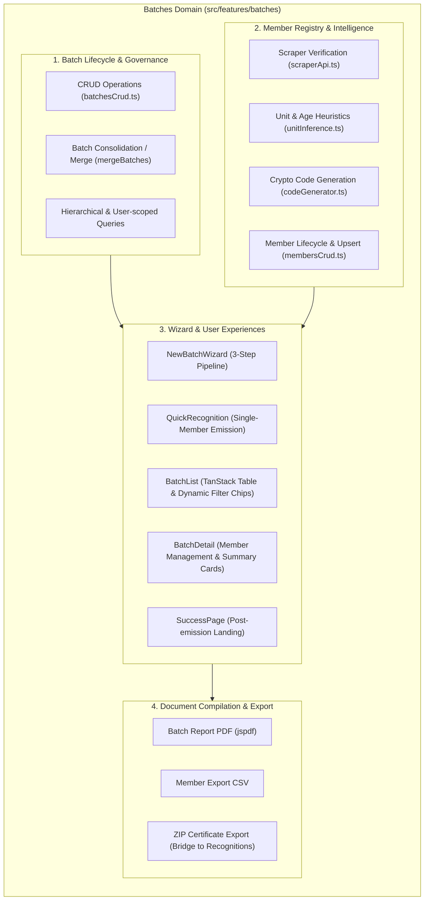
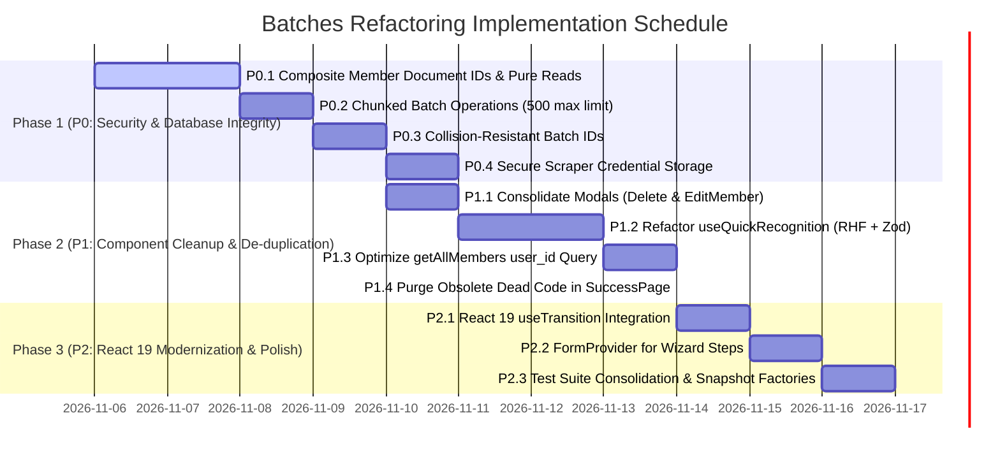

# Module Analysis & Comprehensive Refactoring Plan: Batches Domain

**Target Module:** `src/features/batches/` & Transversal Types (`src/types/batch.ts`, `src/types/member.ts`, `src/types/filters.ts`)  
**Project:** Chil — Sistema de Gestión y Emisión de Reconocimientos Scout  
**Stack Context:** React 19.1.0, TypeScript 5.8.3, Vite 7.0.4, TailwindCSS 4.2.4, TanStack Table 8.21.3, React Hook Form 7.75.0, Zod 4.4.3, Firebase / Firestore 12.14.0, jsPDF 4.2.1, JSZip 3.10.2, Vitest 4.1.5  
**Review Status:** Read-Only Audit & Architectural Refactoring Proposal  

---

## Executive Summary

The **Batches** (`Lotes`) domain represents the core operational backbone of the Chil application. It manages the complete lifecycle of batch creation, automated and manual member verification against the external Scout Registry system, unit inference heuristics, unique recognition code allocation, certificate rendering / ZIP compilation, and analytical PDF reporting.

While the module features substantial test coverage (16 test suites, over 5,500 lines of test code) and functional UI walkthrough integrations, our architectural audit uncovered **critical scalability risks**, **destructive side-effects in read paths**, **database document-collision risks**, **plaintext credential exposure**, and **significant component duplication**.

This document outlines a prioritized, phased refactoring plan (P0, P1, P2) designed to elevate the Batches module to enterprise standards, ensure React 19 best practices, enforce strict TypeScript safety, and eliminate structural debt.

---

## 1. Domain Responsibility & Architectural Overview

### 1.1 Core Responsibilities

The Batches domain encapsulates four primary functional pillars:



1. **Batch Lifecycle & Governance:**
   - Multi-tenant, user-isolated batch entity creation, modification, cascading deletion, and multi-batch consolidation (`mergeBatches`).
   - Structural grouping across Scout Regions, Districts, and Groups (`hierarchyApi.ts`).
2. **Member Intelligence & Verification:**
   - Verification against the external Scout Registry via Firebase Functions (`loginScraper`, `getMemberStatus`).
   - Business rule inference for age, scout units (`manada`, `tropa`, `caminantes`, `clan`, `institucional`), and adult unit mode allocation (`inferBatchMemberUnits`).
   - Cryptographic alphanumeric recognition code generation (`REC-XXXXXX`) avoiding ambiguous characters (`0, O, 1, I`).
3. **Form & Interactive Workflows:**
   - **NewBatchWizard:** 3-step pipeline (Step 1: Configuration & Structure; Step 2: Bulk Cédula verification & manual override; Step 3: Final review, code editing, exceptional issuance justifications).
   - **QuickRecognition:** Rapid single-scout emission path bypassing multi-step batch overhead.
   - **BatchList:** TanStack Table data grid with dynamic date, region, district, group, and recognition filters.
   - **BatchDetail:** Detailed breakdown with quick view, member edit modals, and aggregated metric cards.
4. **Document Generation:**
   - PDF member registry summary generation via `jspdf` (`generateBatchReport`).
   - Client-side CSV export (`exportMembersToCSV`).
   - Integration with `src/features/recognitions` for bulk ZIP certificate generation (`generateBatchCertificatesZip`).

### 1.2 Module Directory & File Structure

```
src/features/batches/
├── api/
│   ├── index.ts                     # Public API barrel export
│   ├── batchesCrud.ts               # Firestore CRUD & mergeBatches logic
│   ├── membersCrud.ts               # ScoutMember Firestore operations & deduplication
│   ├── batchReports.ts              # jsPDF batch report & CSV generation
│   ├── hierarchyApi.ts              # Scout organizational hierarchy loader & fallback seeder
│   ├── recognitionMetadata.ts       # Hardcoded recognition types & badge color styling mappings
│   ├── scraperApi.ts                # Cloud Functions scraper client & credentials storage
│   └── __tests__/
│       ├── api.test.ts              # Comprehensive API unit tests (738 lines)
│       └── generateBatchReport.test.ts # jsPDF report unit tests (144 lines)
├── components/
│   ├── NewBatchWizard.tsx           # Multi-step batch creation container
│   ├── BatchList.tsx                # Data table of all emitted batches
│   ├── BatchDetail.tsx              # Detailed batch view & member management
│   ├── QuickRecognition.tsx         # Single-member rapid emission view
│   ├── SuccessPage.tsx              # Post-creation summary page
│   ├── detail/                      # Subcomponents for BatchDetail
│   │   ├── BatchDetailHeader.tsx
│   │   ├── BatchMembersTable.tsx
│   │   ├── BatchSummaryCards.tsx
│   │   ├── DeleteBatchModal.tsx     # [DUPLICATED] Duplicate of list/DeleteBatchModal
│   │   ├── EditMemberModal.tsx       # [DUPLICATED] Duplicate of Step3Review edit modal
│   │   ├── MemberQuickViewModal.tsx
│   │   ├── batchDetailColumns.tsx
│   │   ├── batchDetailTour.ts
│   │   ├── index.ts
│   │   └── types.ts
│   ├── list/                        # Subcomponents for BatchList
│   │   ├── AddFilterModal.tsx
│   │   ├── DeleteBatchModal.tsx     # [DUPLICATED] Duplicate of detail/DeleteBatchModal
│   │   ├── MergeBatchesModal.tsx
│   │   ├── batchListColumns.tsx
│   │   ├── batchListFilters.ts
│   │   ├── batchListTour.ts
│   │   ├── index.ts
│   │   └── types.ts
│   ├── quick/                       # Subcomponents for QuickRecognition
│   │   ├── QuickRecognitionSuccess.tsx
│   │   ├── RecipientFieldsSection.tsx
│   │   └── RecognitionFieldsSection.tsx
│   ├── wizard/                      # Subcomponents for NewBatchWizard
│   │   ├── Step1Org.tsx
│   │   ├── Step2Verification.tsx
│   │   ├── Step3Review.tsx
│   │   ├── WizardStepper.tsx
│   │   ├── ScraperAlertModals.tsx
│   │   ├── wizardHelpers.ts
│   │   ├── wizardSchema.ts          # Zod schema for Step 1
│   │   ├── wizardTour.ts
│   │   └── index.ts
│   └── __tests__/                   # Component test suites (11 files, >4,500 lines)
├── hooks/
│   ├── useQuickRecognition.ts       # 700-line monolithic custom hook
│   └── __tests__/
│       └── useQuickRecognition.test.ts
├── types/
│   └── index.ts                     # Module-specific & re-exported types
└── utils/
    ├── codeGenerator.ts             # Alphanumeric hash generator
    ├── nameHelper.ts                # Spanish full name splitter
    ├── unitInference.ts             # Age calculation & unit mode heuristics
    └── __tests__/
        ├── codeGenerator.test.ts
        └── unitInference.test.ts
```

---

## 2. Code Quality & Technical Debt Assessment

### 2.1 Critical Architectural Deficiencies & Firestore Anti-Patterns

#### A. Query-Time Side-Effects (Destructive Reads) in `membersCrud.ts`
In [membersCrud.ts](file:///data/data/com.termux/files/home/chil/src/features/batches/api/membersCrud.ts#L176-L195), reading members executes background deletions:
```typescript
// src/features/batches/api/membersCrud.ts:176-194
if (staleDocsToDelete.length > 0) {
  Promise.all(staleDocsToDelete.map(ref => deleteDoc(ref))).catch(err => {
    console.warn("Failed to delete duplicate member docs:", err);
  });
}
```
**Impact:** A read operation (`getMembersByBatchId`) should be pure and idempotent. Performing destructive mutations (`deleteDoc`) inside a query causes race conditions, unexpected permission errors during read-only views, and hides corrupted state instead of managing document keys cleanly.

#### B. Flawed Document Keying Strategy in `scout_members`
In [membersCrud.ts](file:///data/data/com.termux/files/home/chil/src/features/batches/api/membersCrud.ts#L71) and [batchesCrud.ts](file:///data/data/com.termux/files/home/chil/src/features/batches/api/batchesCrud.ts#L201):
```typescript
// Using recognition_code || identity as Firestore Document ID
await setDoc(doc(db, "scout_members", member.recognition_code || member.identity), newMember);
```
**Failure Modes:**
1. **Generic Identity Collisions:** When members do not have a national ID (e.g. `S/C`, `Sin Cédula`, `None`), all members in that category share the exact same document ID `"S/C"`, overwriting each other in Firestore.
2. **Cross-Batch Overwrite:** If a person with cédula `V-12345678` is awarded a recognition in Batch 101, and later included in Batch 202 before recognition codes are generated, writing to `scout_members/V-12345678` overwrites the Batch 101 record.
3. **Orphaned Draft Documents:** When moving from Step 2 to Step 3, doc ID transitions from `identity` to `recognition_code`. This requires convoluted cleanup logic (`updateMember` lines 106-119 and `getMembersByBatchId` lines 176-194) attempting to find and delete the old document.
4. **Clean Fix:** Member document IDs in Firestore should be composite keys (`${batch_id}_${member.identity}`) or Firestore auto-generated UUIDs (`doc(collection(db, "scout_members"))`), completely eliminating document collisions and orphan cleanup code.

#### C. Unbatched Concurrent Writes & 500-Operation Limit Violations
In [Step3Review.tsx](file:///data/data/com.termux/files/home/chil/src/features/batches/components/wizard/Step3Review.tsx#L185) and [wizardHelpers.ts](file:///data/data/com.termux/files/home/chil/src/features/batches/components/wizard/wizardHelpers.ts#L229):
```typescript
// Unbatched individual writes triggering N concurrent HTTP round-trips:
await Promise.all(savedMembers.map(member => updateMember(member)));
```
For a batch of 150 members, each `updateMember` performs:
1. `setDoc`
2. `getDoc` (checking for pre-existing doc under identity)
3. `deleteDoc` (deleting pre-existing doc)
This triggers up to **450 unbatched network requests** simultaneously.

Furthermore, in [deleteBatch](file:///data/data/com.termux/files/home/chil/src/features/batches/api/batchesCrud.ts#L78-L91) and [mergeBatches](file:///data/data/com.termux/files/home/chil/src/features/batches/api/batchesCrud.ts#L192-L222), a single `writeBatch` is used without chunking:
```typescript
// batchesCrud.ts:192
const batchOp = writeBatch(db);
// If (1 + membersByBatch.totalMembers + existingBatches.length) > 500:
// Firestore throws: INVALID_ARGUMENT: maximum 500 operations allowed in a batch
await batchOp.commit();
```
Batches with more than 495 combined members will crash catastrophically.

#### D. Highly Inefficient `getAllMembers` Query Structure
In [membersCrud.ts](file:///data/data/com.termux/files/home/chil/src/features/batches/api/membersCrud.ts#L215-L244):
```typescript
// First fetches ALL batches:
const userBatches = await getAllBatches(targetUserId);
// Slices batch IDs into arrays of 30:
for (let i = 0; i < batchIds.length; i += 30) {
  chunks.push(batchIds.slice(i, i + 30));
}
// Runs N parallel queries using `in` operator:
const memberPromises = chunks.map(chunk => getDocs(query(collection(db, "scout_members"), where("batch_id", "in", chunk))));
```
`ScoutMember` already has `user_id` stored on every document (see line 67). Querying `where("user_id", "==", targetUserId)` directly requires a **single indexed query** rather than fetching all batches, chunking IDs, running N queries, and manually deduplicating in memory.

#### E. Insecure Batch Numeric ID Generator
In [batchesCrud.ts](file:///data/data/com.termux/files/home/chil/src/features/batches/api/batchesCrud.ts#L15-L22):
```typescript
function generateSecureBatchId(): number {
  const array = new Uint32Array(1);
  if (typeof globalThis !== 'undefined' && globalThis.crypto?.getRandomValues) {
    globalThis.crypto.getRandomValues(array);
    return (array[0] % 1_000_000) + 1;
  }
  return (Date.now() % 1_000_000) + 1;
}
```
**Risk:** Modulo `1,000,000` provides only a 6-digit integer space. By the Birthday Paradox, the collision probability reaches ~40% at only 1,177 batches, and 50% at 1,180 batches. Furthermore, `createBatch` executes `setDoc` with no pre-flight collision check, meaning collisions silently overwrite existing batches.

---

### 2.2 Security & Credential Vulnerabilities

#### Plaintext Passwords in `localStorage`
In [scraperApi.ts](file:///data/data/com.termux/files/home/chil/src/features/batches/api/scraperApi.ts#L39-L52):
```typescript
export async function saveScraperCredentials(credentials: ScraperCredentials): Promise<void> {
  safeSetItem('chil_scraper_credentials', JSON.stringify(credentials));
}
```
The scraper credentials (`email` and raw `password`) are saved in plaintext in browser `localStorage`. Any third-party script, browser extension, or XSS flaw has full read access to these credentials. Furthermore, `JSON.parse` is executed without a try-catch guard in `loginScraper` (line 52), making it prone to crashes if storage is corrupted.

---

### 2.3 Component Smells & Duplication Debt

#### A. Exact Duplicate Modals
| Component 1 | Component 2 | Nature of Duplication |
|---|---|---|
| [`list/DeleteBatchModal.tsx`](file:///data/data/com.termux/files/home/chil/src/features/batches/components/list/DeleteBatchModal.tsx) (56 lines) | [`detail/DeleteBatchModal.tsx`](file:///data/data/com.termux/files/home/chil/src/features/batches/components/detail/DeleteBatchModal.tsx) (55 lines) | **Identical JSX, styling, and text.** Only difference is one receives a `BatchRowData` object while the other receives `batchId` and `batchComment`. |
| [`detail/EditMemberModal.tsx`](file:///data/data/com.termux/files/home/chil/src/features/batches/components/detail/EditMemberModal.tsx) (401 lines) | Inline Edit Modal in [`Step3Review.tsx`](file:///data/data/com.termux/files/home/chil/src/features/batches/components/wizard/Step3Review.tsx#L454-L650) (200 lines) | **Identical form fields, hierarchy cascading dropdowns, unit change logic, and validation rules.** |
| [`utils/nameHelper.ts`](file:///data/data/com.termux/files/home/chil/src/features/batches/utils/nameHelper.ts) (27 lines) | [`wizardHelpers.ts:17-40`](file:///data/data/com.termux/files/home/chil/src/features/batches/components/wizard/wizardHelpers.ts#L17-L40) | **100% identical implementation of `splitFullName`.** |

#### B. Prop Proliferation & Lack of Compound Architecture
Components suffer from extreme prop drilling:
- [`RecipientFieldsSectionProps`](file:///data/data/com.termux/files/home/chil/src/features/batches/components/quick/RecipientFieldsSection.tsx#L7-L26): **15 individual props** (`identity`, `onIdentityChange`, `firstNames`, `onFirstNamesChange`, `lastNames`, `onLastNamesChange`, etc.).
- [`RecognitionFieldsSectionProps`](file:///data/data/com.termux/files/home/chil/src/features/batches/components/quick/RecognitionFieldsSection.tsx): **14 individual props**.
- [`Step2VerificationProps`](file:///data/data/com.termux/files/home/chil/src/features/batches/components/wizard/Step2Verification.tsx#L11-L33): **16 individual props**.

This directly conflicts with modern React composition patterns where forms use Context (`FormProvider` / `useFormContext`) or Compound Components to encapsulate field state.

#### C. Monolithic Custom Hook (`useQuickRecognition.ts`)
[`useQuickRecognition.ts`](file:///data/data/com.termux/files/home/chil/src/features/batches/hooks/useQuickRecognition.ts) has **700 lines** and exposes **38 return values** (22 state variables + 16 handlers).
- It eschews React Hook Form and Zod (which are already installed in the project) and reinvents manual change handlers and error maps for 12 distinct form fields.
- Contains uncleaned asynchronous timers:
  ```typescript
  // useQuickRecognition.ts:276
  setTimeout(() => { setShowToast(false); }, 4000);
  ```
  If the user navigates away before 4 seconds elapse, this causes a state update on an unmounted component.

#### D. Obsolete Legacy Code in `SuccessPage.tsx`
In [`SuccessPage.tsx:57-73`](file:///data/data/com.termux/files/home/chil/src/features/batches/components/SuccessPage.tsx#L57-L73):
```typescript
async function loadFallbackBatch(): Promise<{ batch: Batch | null; members: ScoutMember[] }> {
  let batches: Batch[] = [];
  try {
    if (typeof localStorage !== 'undefined' && typeof localStorage.getItem === 'function') {
      batches = JSON.parse(localStorage.getItem('chil_batches') || '[]');
    }
  } catch { batches = []; }
  // ...
}
```
This is dead code remaining from an early prototype that stored batches in browser localStorage.

#### E. Data Divergence in Table Display
In [`batchDetailColumns.tsx:78-86`](file:///data/data/com.termux/files/home/chil/src/features/batches/components/detail/batchDetailColumns.tsx#L78-L86):
```typescript
export function renderMemberCodeCell(info: CellContext<ScoutMember, unknown>): React.ReactNode {
  const rowData = info.row.original;
  const code = (info.getValue() as string) || (rowData.status === 'active' || rowData.status === 'exceptional' ? `REC-${rowData.identity.slice(-4)}` : '-');
  return <span className="font-mono text-xs sm:text-sm text-neutral/70">{code}</span>;
}
```
If `recognition_code` is missing from the database, the UI dynamically fabricates a placeholder (`REC-${identity.slice(-4)}`) that has **never been saved in Firestore**. When certificates are generated, they will either show an empty code or mismatch what the user saw on screen.

---

### 2.4 TypeScript Strictness & Typing Health

1. **Non-null assertions (`!`):**
   - `NewBatchWizard.tsx:551`: `<Step3Review batchId={batchId!} ... />` — If `batchId` is `null`, this passes an invalid ID down the component tree without compiler warning.
   - `membersCrud.ts:162, 263`: `d.member.recognition_code!` — Forced non-null assertion on optional field.
   - `SuccessPage.tsx:68`: `batches.at(-1)!` — Non-null assertion on potentially empty array.
2. **Untyped Firestore Document Conversions:**
   - Multiple instances of `doc.data() as ScoutMember` or `doc.data() as Batch` without runtime validation (Zod schema parser) at database boundaries, allowing corrupted Firestore documents to crash frontend renderers.

---

## 3. Test Coverage & Resilience Analysis

### 3.1 Test Suite Inventory

| Test File | Lines of Code | Scope of Coverage | Quality Assessment |
|---|---|---|---|
| `api/__tests__/api.test.ts` | 738 | CRUD for batches & members, mergeBatches, hierarchy fallback, code generation, CSV export | **High coverage, brittle mocks.** Mocks individual Firestore primitives (`getDoc`, `setDoc`, `getDocs`, `writeBatch`) sequentially. |
| `api/__tests__/generateBatchReport.test.ts` | 144 | jsPDF report structure, member filtering, RGB text coloring, pagination | **High quality.** Good structural assertions on PDF drawing coordinates and status headers. |
| `hooks/__tests__/useQuickRecognition.test.ts` | 197 | Quick recognition hook state initialization, unit cascading, identity sanitization | **Good.** Thoroughly tests unit-to-memberType mapping. |
| `utils/__tests__/codeGenerator.test.ts` | 124 | Ambiguous character exclusion (0, O, 1, I), length formatting, batch code distribution | **Excellent.** Fast, deterministic pure function tests. |
| `utils/__tests__/unitInference.test.ts` | 155 | Age calculation (YYYY-MM-DD, DD/MM/YYYY), youth unit brackets, batch mode tie-breaking | **Excellent.** Comprehensive business rule coverage. |
| `components/__tests__/BatchDetail.test.tsx` | 1,517 | Detail loading, 4 metric cards, search filtering, edit modal, delete modal, ZIP & PDF download triggers | **Very thorough.** Covers almost all user interaction branches. |
| `components/__tests__/BatchList.test.tsx` | 760 | TanStack Table rendering, active filter chips, multi-select rows, merge action, delete flow | **Very thorough.** Strong test coverage of table states. |
| `components/__tests__/NewBatchWizardFull.test.tsx` | 763 | End-to-end multi-step flow (Step 1 -> Step 2 -> Step 3 -> Success redirect) | **High value.** Critical integration test for happy path. |
| `components/__tests__/NewBatchWizardErrors.test.tsx` | 204 | Scraper credential failure alerts, network retry buttons, unregistered member handling | **Good.** Verifies error states and modals. |
| `components/__tests__/QuickRecognition.test.tsx` | 791 | Form rendering, validation messages, scraper auto-fill, PDF single emission trigger | **Thorough.** Covers full quick recognition lifecycle. |
| `components/__tests__/RecipientFieldsSection.test.tsx` | 235 | Section-level unit switches, identity input, error display | **Good.** Unit test for isolated section. |
| `components/__tests__/Step2Verification.test.tsx` | 280 | Step 2 table rendering, verification status badges, group override modal | **Good.** |
| `components/__tests__/Step3Review.test.tsx` | 380 | Step 3 tabs (valid vs pending), code mode toggles, inline code editing | **Good.** |
| `components/__tests__/SuccessPage.test.tsx` | 240 | Post-creation summary metrics, download actions, navigation links | **Good.** |
| `components/__tests__/batches.test.tsx` | 155 | Early Step 1 test | **DEPRECATED/REDUNDANT.** 100% duplicate of tests in `NewBatchWizardFull.test.tsx`. |
| `list/__tests__/MergeBatchesModal.test.tsx` | 194 | Merge modal preview calculation, multi-group label preview, submission error display | **High quality.** Good assertion of preview logic. |

### 3.2 Weaknesses in Existing Test Harness
1. **Mock Brittleness:** The API tests rely on mocking raw Firestore SDK functions (`vi.mock('firebase/firestore')`) with chained `.mockResolvedValueOnce(...)`. Any subtle reordering of database calls breaks the test suites even when functional behavior is preserved.
2. **Redundant Test File:** `batches.test.tsx` is an obsolete test artifact that tests Step 1 in isolation; it duplicates the modern tests in `NewBatchWizardFull.test.tsx`.
3. **Missing Stress/Limit Tests:** No tests exist for batch operations exceeding 500 items (Firestore limit) or concurrent ID collision handling.

---

## 4. Prioritized Refactoring Proposals

### 4.1 P0: Critical Architecture, Data Integrity & Security (Immediate Action)

#### P0.1: Deterministic Composite Document IDs & Elimination of Read Side-Effects
- **Problem:** Storing members keyed by `recognition_code || identity` causes document collisions for generic identities (`S/C`), overwrites cross-batch members, and requires destructive `deleteDoc` calls inside `getMembersByBatchId`.
- **Target Files:** [`src/features/batches/api/membersCrud.ts`](file:///data/data/com.termux/files/home/chil/src/features/batches/api/membersCrud.ts), [`src/features/batches/api/batchesCrud.ts`](file:///data/data/com.termux/files/home/chil/src/features/batches/api/batchesCrud.ts)
- **Solution:**
  1. Define document key as `${batchId}_${cleanIdentity}` (or Firestore auto-ID when identity is generic).
  2. Eliminate lines 176–194 in `getMembersByBatchId` so read queries are strictly read-only.
  3. Simplify `getMembersByBatchId` and `getAllMembers` to a direct map without complex deduplication or stale document hunting.
- **Estimated Effort:** 1.5 days | **Impact:** High (Eliminates data corruption and silent overwrites).

#### P0.2: Chunked Atomic Batch Operations (Safe from 500-Item Firestore Limit)
- **Problem:** `deleteBatch`, `mergeBatches`, and Step 3 finalization execute unbounded single `writeBatch` or unbatched `Promise.all(updateMember)` requests.
- **Target Files:** [`src/features/batches/api/batchesCrud.ts`](file:///data/data/com.termux/files/home/chil/src/features/batches/api/batchesCrud.ts), [`src/features/batches/components/wizard/Step3Review.tsx`](file:///data/data/com.termux/files/home/chil/src/features/batches/components/wizard/Step3Review.tsx)
- **Solution:** Implement a chunked batch commit utility:
  ```typescript
  export async function commitChunkedBatches(
    db: Firestore,
    operations: ((batch: WriteBatch) => void)[],
    chunkSize = 450
  ): Promise<void> {
    for (let i = 0; i < operations.length; i += chunkSize) {
      const batch = writeBatch(db);
      const chunk = operations.slice(i, i + chunkSize);
      chunk.forEach(op => op(batch));
      await batch.commit();
    }
  }
  ```
- **Estimated Effort:** 1 day | **Impact:** High (Prevents database crashes on large batches).

#### P0.3: Collision-Resistant Batch Identification
- **Problem:** `(crypto.getRandomValues() % 1_000_000) + 1` produces frequent collisions in multi-user environments.
- **Target Files:** [`src/features/batches/api/batchesCrud.ts`](file:///data/data/com.termux/files/home/chil/src/features/batches/api/batchesCrud.ts)
- **Solution:**
  - Option A: Transition to standard Firestore auto-generated string IDs (`collection(db, "batches").doc()`).
  - Option B (if numeric IDs are strictly required for UI badges): Increase random space to 9 digits (e.g., `100_000_000` to `999_999_999`) and add a pre-check `docSnap.exists()` guard before writing.
- **Estimated Effort:** 0.5 days | **Impact:** High (Prevents silent batch overwrite).

#### P0.4: Secure Scraper Credential Storage
- **Problem:** Plaintext password saved in `localStorage`.
- **Target Files:** [`src/features/batches/api/scraperApi.ts`](file:///data/data/com.termux/files/home/chil/src/features/batches/api/scraperApi.ts)
- **Solution:**
  - Transition credential storage from `localStorage` to `sessionStorage` (so credentials are wiped when the browser tab closes).
  - Wrap all JSON parsing in safe `try/catch` blocks.
  - Recommended backend strategy: Have Cloud Functions store session cookies or encrypted server-side tokens instead of requiring the client to store the raw password.
- **Estimated Effort:** 0.5 days | **Impact:** Critical (Fixes OWASP client-side storage vulnerability).

---

### 4.2 P1: Code Quality, Duplication & Performance (High Priority)

#### P1.1: Deduplicate Shared Modals (`DeleteBatchModal` & `EditMemberModal`)
- **Problem:** Duplicate modals between `list/` and `detail/`, and between `wizard/Step3Review.tsx` and `detail/EditMemberModal.tsx`.
- **Target Files:**
  - Consolidate to `src/features/batches/components/shared/DeleteBatchModal.tsx`
  - Consolidate to `src/features/batches/components/shared/EditMemberModal.tsx`
  - Remove duplicate `splitFullName` from `wizardHelpers.ts` and import from `utils/nameHelper.ts`.
- **Estimated Effort:** 1 day | **Impact:** High (Deletes ~500 lines of redundant code and ensures consistent bug fixes).

#### P1.2: Refactor `useQuickRecognition` with React Hook Form & Zod
- **Problem:** 700-line hook with 38 return variables and 20+ `useState` calls.
- **Target Files:** [`src/features/batches/hooks/useQuickRecognition.ts`](file:///data/data/com.termux/files/home/chil/src/features/batches/hooks/useQuickRecognition.ts), [`src/features/batches/components/QuickRecognition.tsx`](file:///data/data/com.termux/files/home/chil/src/features/batches/components/QuickRecognition.tsx)
- **Solution:**
  - Define `quickRecognitionSchema` with Zod.
  - Use `useForm<QuickRecognitionFormData>({ resolver: zodResolver(quickRecognitionSchema) })`.
  - Reduce hook length from 700 lines to ~180 lines.
  - Encapsulate toast logic in a safe, auto-cleaning hook (`useToast`).
- **Estimated Effort:** 1.5 days | **Impact:** High (Improves maintainability, eliminates re-renders on every keystroke).

#### P1.3: Direct User Querying for `getAllMembers`
- **Problem:** Inefficient N+1 chunked querying by batch IDs.
- **Target Files:** [`src/features/batches/api/membersCrud.ts`](file:///data/data/com.termux/files/home/chil/src/features/batches/api/membersCrud.ts)
- **Solution:**
  ```typescript
  export async function getAllMembers(userId?: string): Promise<ScoutMember[]> {
    const targetUserId = userId ?? auth.currentUser?.uid ?? '';
    if (!targetUserId) return [];
    const q = query(collection(db, "scout_members"), where("user_id", "==", targetUserId));
    const snap = await getDocs(q);
    return snap.docs.map(d => d.data() as ScoutMember);
  }
  ```
- **Estimated Effort:** 0.5 days | **Impact:** High (Reduces network latency and Firestore read quota consumption by up to 90%).

#### P1.4: Purge Obsolete Dead Code
- **Problem:** `loadFallbackBatch` in `SuccessPage.tsx` reading dead `chil_batches` from `localStorage`.
- **Target Files:** [`src/features/batches/components/SuccessPage.tsx`](file:///data/data/com.termux/files/home/chil/src/features/batches/components/SuccessPage.tsx)
- **Solution:** Remove `loadFallbackBatch` and direct the page to read purely from Firestore via `getBatchById` and `getMembersByBatchId`.
- **Estimated Effort:** 0.25 days | **Impact:** Medium (Eliminates confusion and legacy code rot).

---

### 4.3 P2: Modernization, Typing Strictness & Test Cleanup (Medium Priority)

#### P2.1: React 19 State Transition Modernization
- **Modernization:** Adopt React 19's `useTransition` for asynchronous actions:
  - Scraper consult action in `Step2Verification` and `QuickRecognition`.
  - Batch finalization in `Step3Review`.
  - Batch merge execution in `MergeBatchesModal`.
  - This eliminates manual `isSubmitting` / `isVerifying` state flags and allows React 19 to keep the UI responsive during background processing.
- **Estimated Effort:** 1 day | **Impact:** Medium (Enhances perceived UX performance and aligns with React 19 best practices).

#### P2.2: Replace Prop Drilling with Form Context in Wizard Steps
- **Modernization:** Replace 15-prop interfaces (`Step2VerificationProps`, `RecipientFieldsSectionProps`) with React Hook Form's `<FormProvider>` and custom field subcomponents.
- **Estimated Effort:** 1 day | **Impact:** Medium (Cleaner component interfaces, simplified testing).

#### P2.3: Remove Inconsistent Code Placeholders in Table Cells
- **Fix:** In `batchDetailColumns.tsx`, display `'-'` when `recognition_code` is not set in Firestore, or enforce code generation before batch emission. Do not fabricate display-only codes.
- **Estimated Effort:** 0.25 days | **Impact:** Low (Ensures data integrity between display and printed certificates).

#### P2.4: Consolidate Test Suites
- **Cleanup:** Remove `batches.test.tsx` (redundant with `NewBatchWizardFull.test.tsx`). Extract reusable Firestore snapshot factory mocks into a test utility helper (`test/factories/firestoreMocks.ts`).
- **Estimated Effort:** 0.5 days | **Impact:** Medium (Faster CI test runs and easier test maintenance).

---

## 5. Risk Assessment & Verification Strategy

### 5.1 Risk Matrix

| Risk Identified | Severity | Probability | Mitigation Strategy |
|---|---|---|---|
| **Data Migration / ID Format Breaking Changes** | High | Medium | When switching `scout_members` document IDs to composite keys, implement a backward-compatible reader that checks both legacy and new key formats during transition. |
| **Wizard Stepping State Loss** | Medium | Low | Ensure form default values in Step 1, Step 2, and Step 3 are unified under a single wizard context so navigating backward never clears entered cédulas. |
| **Firestore Index Requirement** | Medium | Medium | Direct querying of `scout_members` with `where("user_id", "==", uid)` requires a single-field index. Verify `firestore.indexes.json` includes `scout_members: user_id (ASC)`. |
| **PDF Layout Regressions** | Low | Low | Run `generateBatchReport.test.ts` to assert that cell coordinates and text boundaries in jsPDF remain unchanged. |

---

### 5.2 Verification Strategy & Test Plan


#### Step-by-Step Verification Checklist:
1. **Automated Vitest Regression:** Run `npm test -- src/features/batches --run` and ensure 100% test pass rate across all 15 active suites.
2. **Type Check Verification:** Run `npx tsc --noEmit` to verify zero TypeScript errors after removing non-null assertions and adding composite key types.
3. **Multi-Step Creation Flow:**
   - Create a batch with mixed young and adult cédulas.
   - Verify that non-scout members bypass the scraper and receive `active` status.
   - Verify that active youth members are assigned correct units based on age brackets (`manada`, `tropa`, `caminantes`, `clan`).
   - Verify that Step 3 auto-generates unique recognition codes (`REC-XXXXXX`).
4. **Batch Merge Validation:**
   - Select 2 batches with different groups and click "Fusionar lotes".
   - Verify that the resulting batch has `Multigrupo` classification and the latest creation timestamp.
   - Verify that the original batches are deleted and all members are reassociated under the new batch ID.
5. **Document Generation:**
   - Generate and inspect the member list PDF report (`generateBatchReport`).
   - Trigger the ZIP certificate export (`generateBatchCertificatesZip`) and verify certificate files are compiled correctly.

---

## 6. Summary Implementation Roadmap



This comprehensive plan equips the team with a clear, low-risk blueprint to fortify the Batches domain for enterprise scale, ensuring stability, security, and developer velocity.
