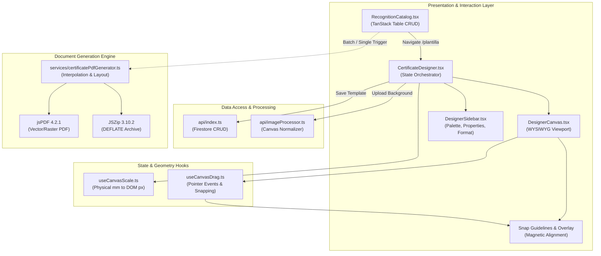
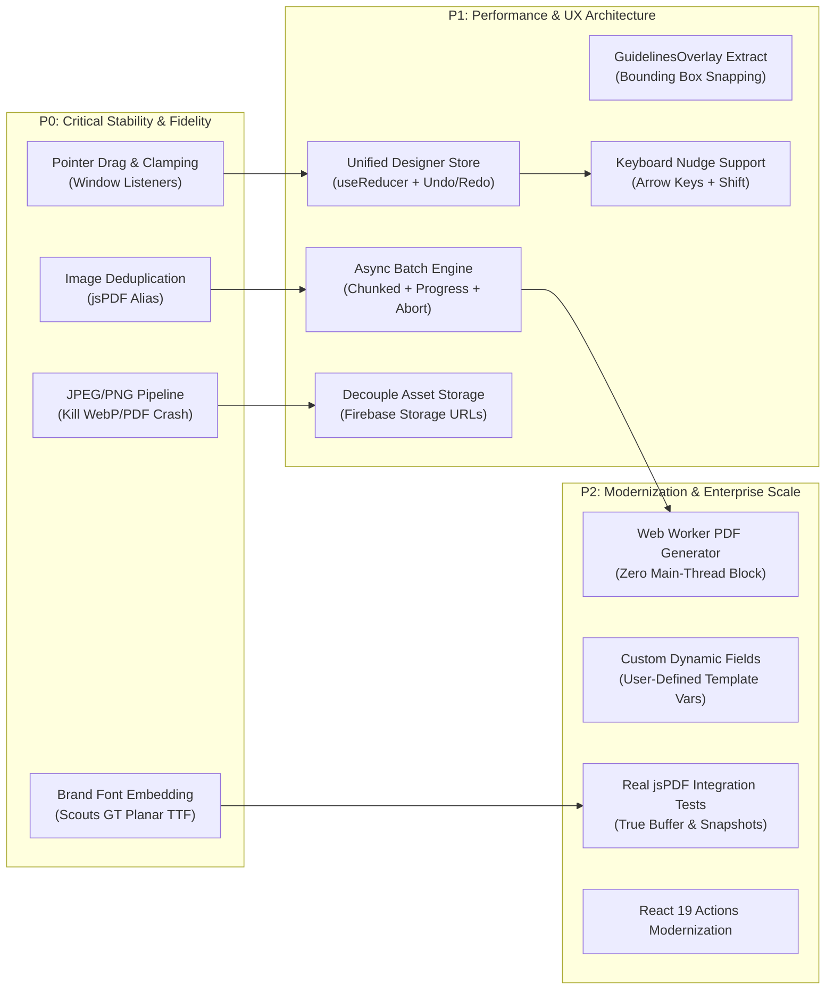
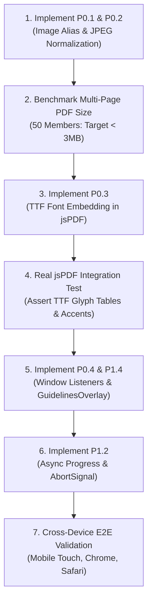

# Module Analysis & Refactoring Plan: Recognitions & Certificate Designer

> **Module Target:** `src/features/recognitions/` (Recognitions Catalog, WYSIWYG Certificate Designer & High-Fidelity PDF/ZIP Engine)  
> **Status:** Current Architecture Analysis & Strategic Refactoring Roadmap  
> **Scope:** [`components/`](file:///data/data/com.termux/files/home/chil/src/features/recognitions/components), [`services/`](file:///data/data/com.termux/files/home/chil/src/features/recognitions/services), [`types/`](file:///data/data/com.termux/files/home/chil/src/features/recognitions/types), [`api/`](file:///data/data/com.termux/files/home/chil/src/features/recognitions/api), [`utils/`](file:///data/data/com.termux/files/home/chil/src/features/recognitions/utils), [`hooks/`](file:///data/data/com.termux/files/home/chil/src/features/recognitions/hooks), and [`__tests__/`](file:///data/data/com.termux/files/home/chil/src/features/recognitions)

---

## 1. Domain Responsibility & Architectural Overview

### 1.1 Domain Responsibility
The **Recognitions & Certificate Designer** module serves as Chil's visual design studio and document generation engine for Scout condecorations, awards, and certifications. 

Its domain responsibilities span three core subsystems:
1. **Recognition Types Catalog Management:** Administration of condecoration entities (e.g., *Insignia de Madera*, *Medalla al Mérito*, *Promesa Scout*), handling CRUD operations with Firestore and associating each recognition type with a customizable visual diploma template.
2. **Interactive WYSIWYG Certificate Designer:** A browser-based vector-style editor enabling users to upload background artwork, position dynamic Scout variables (*Nombre*, *Cédula*, *Región*, *Distrito*, *Grupo*, *Unidad*, *Fecha*, *Código REC*), adjust typography (fonts, sizes, colors, alignments), and align elements with magnetic snapping guidelines.
3. **High-Fidelity Document Generation Engine:** A client-side rendering pipeline utilizing `jsPDF` and `JSZip` to generate millimetrically calibrated single certificates, multi-page batch PDFs, and individual ZIP archives for Scout groups and administrative regions.



### 1.2 Module Structure & Inventory

| File Path | LOC | Type | Responsibility |
|:---|:---|:---|:---|
| [`src/features/recognitions/types/index.ts`](file:///data/data/com.termux/files/home/chil/src/features/recognitions/types/index.ts) | 203 | Types & Schemas | Type contracts, Zod schemas, default field coordinates, and mock preview data. |
| [`src/features/recognitions/api/index.ts`](file:///data/data/com.termux/files/home/chil/src/features/recognitions/api/index.ts) | 134 | API | Firestore operations for recognition types and embedded certificate templates. |
| [`src/features/recognitions/api/imageProcessor.ts`](file:///data/data/com.termux/files/home/chil/src/features/recognitions/api/imageProcessor.ts) | 210 | Service | HTML5 Canvas-based background image optimization, resizing, and aspect ratio normalization. |
| [`src/features/recognitions/components/RecognitionCatalog.tsx`](file:///data/data/com.termux/files/home/chil/src/features/recognitions/components/RecognitionCatalog.tsx) | 503 | Component | Catalog table with TanStack React Table, pagination, search filter, and modal triggers. |
| [`src/features/recognitions/components/RecognitionFormModal.tsx`](file:///data/data/com.termux/files/home/chil/src/features/recognitions/components/RecognitionFormModal.tsx) | 155 | Component | Modal with React Hook Form & Zod validation for creating/editing recognition types. |
| [`src/features/recognitions/components/RecognitionDeleteModal.tsx`](file:///data/data/com.termux/files/home/chil/src/features/recognitions/components/RecognitionDeleteModal.tsx) | 83 | Component | Deletion confirmation modal for recognition types. |
| [`src/features/recognitions/components/CertificateDesigner.tsx`](file:///data/data/com.termux/files/home/chil/src/features/recognitions/components/CertificateDesigner.tsx) | 497 | Component | Master workspace orchestrating canvas, sidebar, background uploads, walkthrough tour, and persistence. |
| [`src/features/recognitions/components/designer/DesignerCanvas.tsx`](file:///data/data/com.termux/files/home/chil/src/features/recognitions/components/designer/DesignerCanvas.tsx) | 181 | Component | Interactive canvas viewport, background image layer, default Scout border, and snapping guides. |
| [`src/features/recognitions/components/designer/DraggableField.tsx`](file:///data/data/com.termux/files/home/chil/src/features/recognitions/components/designer/DraggableField.tsx) | 123 | Component | Individual draggable field button/display on canvas with pointer event binding. |
| [`src/features/recognitions/components/designer/CanvasFormatBar.tsx`](file:///data/data/com.termux/files/home/chil/src/features/recognitions/components/designer/CanvasFormatBar.tsx) | 36 | Component | Status bar displaying millimeter print dimensions, orientation, and field count. |
| [`src/features/recognitions/components/designer/DesignerHeader.tsx`](file:///data/data/com.termux/files/home/chil/src/features/recognitions/components/designer/DesignerHeader.tsx) | 129 | Component | Designer top navigation bar with preview switcher, upload button, and cloud save trigger. |
| [`src/features/recognitions/components/designer/designerUtils.tsx`](file:///data/data/com.termux/files/home/chil/src/features/recognitions/components/designer/designerUtils.tsx) | 109 | Utility | Field icons, preset palette colors, CSS transform helpers, and format badge string formatters. |
| [`src/features/recognitions/components/designer/sidebar/DesignerSidebar.tsx`](file:///data/data/com.termux/files/home/chil/src/features/recognitions/components/designer/sidebar/DesignerSidebar.tsx) | 130 | Component | Tab container coordinating Field Palette, Field Properties, and Background Format tabs. |
| [`src/features/recognitions/components/designer/sidebar/FieldPaletteTab.tsx`](file:///data/data/com.termux/files/home/chil/src/features/recognitions/components/designer/sidebar/FieldPaletteTab.tsx) | 165 | Component | Variable field drawer allowing users to add, toggle, or reset fields on the template. |
| [`src/features/recognitions/components/designer/sidebar/FieldPropertiesTab.tsx`](file:///data/data/com.termux/files/home/chil/src/features/recognitions/components/designer/sidebar/FieldPropertiesTab.tsx) | 303 | Component | Inspector for typography, font size slider, weight, color picker, alignment, and coordinate inputs. |
| [`src/features/recognitions/components/designer/sidebar/BackgroundFormatTab.tsx`](file:///data/data/com.termux/files/home/chil/src/features/recognitions/components/designer/sidebar/BackgroundFormatTab.tsx) | 122 | Component | Background thumbnail preview, physical millimeter specs, and replace/remove actions. |
| [`src/features/recognitions/hooks/useCanvasScale.ts`](file:///data/data/com.termux/files/home/chil/src/features/recognitions/hooks/useCanvasScale.ts) | 51 | Hook | Monitors canvas DOM width via `ResizeObserver` to compute 1:1 proportional font scale factor. |
| [`src/features/recognitions/hooks/useCanvasDrag.ts`](file:///data/data/com.termux/files/home/chil/src/features/recognitions/hooks/useCanvasDrag.ts) | 123 | Hook | Pointer down/move/up event handling, boundary clamping, and dynamic snap guide calculation. |
| [`src/features/recognitions/utils/snapGuidelines.ts`](file:///data/data/com.termux/files/home/chil/src/features/recognitions/utils/snapGuidelines.ts) | 123 | Utility | Mathematical algorithms for snapping field coordinates to canvas centers and sibling fields. |
| [`src/features/recognitions/services/certificatePdfGenerator.ts`](file:///data/data/com.termux/files/home/chil/src/features/recognitions/services/certificatePdfGenerator.ts) | 504 | Service | Core document generation engine: variable interpolation, standard borders, PDF pages, and ZIP packaging. |
| [`src/features/recognitions/**/__tests__/`](file:///data/data/com.termux/files/home/chil/src/features/recognitions) | ~3,200 | Tests | Comprehensive unit and component test suites covering all submodules. |

---

## 2. Code Quality & Technical Debt Assessment

### 2.1 WYSIWYG Canvas State & Drag-and-Drop Mechanics

#### Drag Performance & Re-Rendering Bottleneck
In [`useCanvasDrag.ts`](file:///data/data/com.termux/files/home/chil/src/features/recognitions/hooks/useCanvasDrag.ts#L100):
```typescript
onUpdateFieldCoordinates(fieldId, finalX, finalY);
```
During dragging, `handlePointerMove` triggers `onUpdateFieldCoordinates` on every browser pointer event (60Hz to 120Hz). In [`CertificateDesigner.tsx`](file:///data/data/com.termux/files/home/chil/src/features/recognitions/components/CertificateDesigner.tsx#L202-L207):
```typescript
onUpdateFieldCoordinates: (fieldId, x, y) => {
  setTemplate((prev) => ({
    ...prev,
    fields: prev.fields.map((f) => (f.id === fieldId ? { ...f, x, y } : f))
  }));
}
```
Because `setTemplate` updates state at the root of `CertificateDesigner`, every pointer move triggers:
1. Re-execution of the `CertificateDesigner` component.
2. Re-creation of `handlePointerMove` because its dependency array includes `fields` (`[canvasRef, fields, onUpdateFieldCoordinates, snapThreshold]`).
3. Complete re-rendering of `DesignerCanvas`, `CanvasFormatBar`, `DesignerSidebar`, and all sibling `DraggableField` instances (none of which are wrapped in `React.memo`).
4. Re-calculation of alignment guides and styles on each frame.
This creates substantial input lag and dropped frames, particularly on low-power devices, mobile screens, or older laptops.

#### Pointer Capture Incoherence
In [`useCanvasDrag.ts`](file:///data/data/com.termux/files/home/chil/src/features/recognitions/hooks/useCanvasDrag.ts#L41):
`target.setPointerCapture(e.pointerId)` is invoked on `e.currentTarget` inside `handlePointerDown` (which is the `<button>` element rendered in `DraggableField.tsx`). However:
- `onPointerMove` and `onPointerUp` are attached to the outer `<div ref={canvasRef}>` inside [`DesignerCanvas.tsx`](file:///data/data/com.termux/files/home/chil/src/features/recognitions/components/designer/DesignerCanvas.tsx#L53-L56).
- When pointer capture is granted to an element, all pointer events are routed directly to that specific element.
- In `handlePointerUp`, the hook attempts `e.currentTarget.releasePointerCapture(e.pointerId)` where `e.currentTarget` is now the canvas `<div>` (which never acquired pointer capture in the first place).
- While wrapped in a `try/catch` block to suppress errors, this mismatch can cause drags to get "stuck" if the cursor leaves the window or if rapid touches occur on mobile browsers.

#### Hardcoded Clamping Boundary Pitfalls
In [`useCanvasDrag.ts`](file:///data/data/com.termux/files/home/chil/src/features/recognitions/hooks/useCanvasDrag.ts#L83-L85):
```typescript
rawX = Math.max(2, Math.min(98, rawX));
rawY = Math.max(2, Math.min(98, rawY));
```
Coordinates are clamped solely based on the anchor point `(x, y)` between 2% and 98%. 
- For center-aligned text (which applies `transform: translate(-50%, -50%)`), placing `x = 98%` pushes the right half of the text off the visible canvas and off the printed page.
- For left-aligned text, placing `x = 98%` pushes almost the entire string outside the boundary.
- Clamping must take into account field alignment and text bounding dimensions.

#### Snapping System Limitations & Missing GuidelinesOverlay Component
In [`snapGuidelines.ts`](file:///data/data/com.termux/files/home/chil/src/features/recognitions/utils/snapGuidelines.ts):
- Snapping only matches the raw `(x, y)` coordinate of sibling fields.
- If field A is left-aligned (`align: 'left'`, where `x` represents its left edge) and field B is center-aligned (`align: 'center'`, where `x` represents its center), the snapping engine snaps the left edge of field A to the center of field B. This causes visual misalignment.
- The alignment guidelines are rendered directly inside `DesignerCanvas.tsx` ([lines 121-160](file:///data/data/com.termux/files/home/chil/src/features/recognitions/components/designer/DesignerCanvas.tsx#L121-L160)) rather than being encapsulated in a reusable `GuidelinesOverlay.tsx` component, cluttering the canvas component with guideline presentation logic.
- Only a single guide line per axis can be registered at one time. If multiple fields share an alignment line, only the first encountered match is highlighted.

#### Mobile Viewport & Scaling Discrepancies
In [`useCanvasScale.ts`](file:///data/data/com.termux/files/home/chil/src/features/recognitions/hooks/useCanvasScale.ts#L42-L43):
```typescript
const fontScale =
  canvasPixelWidth > 0 && docWidthPt > 0 ? canvasPixelWidth / docWidthPt : 800 / docWidthPt || 1;
```
If `docWidthPt` is 0 or undefined, `800 / docWidthPt` evaluates to `Infinity`, which is truthy, so it bypasses `|| 1` and returns `Infinity`.
Furthermore, in [`DraggableField.tsx`](file:///data/data/com.termux/files/home/chil/src/features/recognitions/components/designer/DraggableField.tsx#L46-L49):
```typescript
const displayFontSizePx = Math.max(
  8,
  Math.round(field.font_size * fontScale * 100) / 100
);
```
On mobile devices where the canvas width is small (e.g., 340px), `fontScale` is ~0.40. A 10pt field would scale to `4.0px`, but `Math.max(8, ...)` forces it to `8px` (double its true scale). This gives users a false preview where labels appear twice as large and overlap, leading them to adjust positions incorrectly for the final PDF.

---

### 2.2 Typography, Brand Compliance & Font Subsetting

#### The "Scouts GT Planar" Fallback Betrayal
Chil's branding guidelines mandate the official institutional typeface `Scouts GT Planar` (`public/fonts/Scouts-GT-Planar-Bold.ttf`, 133 KB) for headings and recognitions.
In the WYSIWYG editor, the DOM renders the text using `@font-face` defined in `src/index.css`:
```css
@font-face {
  font-family: 'Scouts GT Planar';
  src: url('/fonts/Scouts-GT-Planar-Bold.ttf') format('truetype');
  font-weight: bold;
}
```
However, in [`certificatePdfGenerator.ts`](file:///data/data/com.termux/files/home/chil/src/features/recognitions/services/certificatePdfGenerator.ts#L249-L262):
```typescript
export function getPdfFontFamily(fontFamily?: string): 'helvetica' | 'times' | 'courier' {
  switch (fontFamily) {
    case 'times':
      return 'times';
    case 'courier':
      return 'courier';
    case 'scouts-gt-planar-bold':
    case 'Scouts GT Planar':
    case 'noto-sans':
    case 'helvetica':
    default:
      return 'helvetica';
  }
}
```
`Scouts GT Planar` and `noto-sans` are **silently mapped to standard Helvetica**!
- `doc.addFileToVFS` and `doc.addFont` are never invoked in `certificatePdfGenerator.ts`.
- The generated PDF **never contains the official Scout typeface**.
- The unit test in `certificatePdfGenerator.test.ts` (lines 761-764) specifically asserts:
  `expect(getPdfFontFamily('scouts-gt-planar-bold')).toBe('helvetica')`.
  The test codifies this regression rather than catching it.

#### Metric Divergence Between Canvas and Output PDF
`Scouts GT Planar` is a geometric grotesque display font with wide character proportions. `Helvetica` has narrower, standard Neo-grotesque proportions.
Because the designer calculates text width and visual centering in the browser using `Scouts GT Planar`, but jsPDF stamps the text using standard `Helvetica`:
- Centered member names on certificates with long characters drift optically off-center.
- Spacing between adjacent fields (e.g., *Región*, *Distrito*, *Grupo*) shifts, leading to visual collisions or excessive gaps on physical prints.
- Standard Helvetica in jsPDF uses WinAnsi encoding. Non-ASCII Spanish characters (*Cédula*, *Región*, *Año*, *Gómez*, *Peña*) can cause encoding mismatches if Unicode TTF embedding is absent.

---

### 2.3 PDF & Bulk ZIP Generation Engine

#### Multi-Page Batch Rendering Bloat (Missing Image Alias)
In [`certificatePdfGenerator.ts`](file:///data/data/com.termux/files/home/chil/src/features/recognitions/services/certificatePdfGenerator.ts#L175-L187):
```typescript
function drawCertificateBackground(
  doc: jsPDF,
  backgroundUrl: string | undefined,
  width: number,
  height: number
): void {
  if (backgroundUrl && backgroundUrl.trim().length > 0) {
    const format = getImageFormatFromUrl(backgroundUrl);
    doc.addImage(backgroundUrl, format, 0, 0, width, height);
  } else {
    drawStandardScoutBorder(doc, width, height);
  }
}
```
And in `generateBatchCertificatesPdf`:
```typescript
eligibleMembers.forEach((member, index) => {
  if (index > 0) {
    doc.addPage([width, height], orientation);
  }
  renderCertificatePage(doc, { ... });
});
```
> [!CRITICAL]
> In jsPDF, the `addImage` signature is:
> `doc.addImage(imageData, format, x, y, width, height, alias, compression, rotation)`
> When the `alias` argument is omitted, jsPDF does **not** recognize that the image is identical across pages. For each page in a 100-member batch, jsPDF parses the Base64 image and embeds a **new, redundant XObject image stream** into the PDF file!
> If the background image is 1.5 MB, a 100-member batch PDF balloons to **over 150 MB**, leading to browser tab memory exhaustion and mobile crashes.
> Providing a static alias (e.g., `'certificate_bg'`) ensures the image is embedded once as an XObject and reused on all pages by reference, reducing the output from 150 MB to ~1.6 MB (a 99% size reduction).

#### In-Memory Accumulation During Bulk ZIP Generation
In [`certificatePdfGenerator.ts`](file:///data/data/com.termux/files/home/chil/src/features/recognitions/services/certificatePdfGenerator.ts#L471-L498):
```typescript
for (const member of eligibleMembers) {
  const doc = new jsPDF({ orientation, unit: 'mm', format: [width, height] });
  renderCertificatePage(doc, { ... });
  const pdfBuffer = doc.output('arraybuffer');
  zip.file(memberFileName, pdfBuffer);
}

const zipBlob = await zip.generateAsync({
  type: 'blob',
  compression: 'DEFLATE',
  compressionOptions: { level: 6 }
});
```
- In a synchronous `for` loop, individual `jsPDF` instances are created for every member.
- Each `ArrayBuffer` is retained in memory by the `JSZip` instance.
- For large batches (100–300 members), retaining hundreds of PDF binary buffers simultaneously in JS heap memory causes severe memory spikes and crashes on devices with restricted RAM.
- The loop runs synchronously on the main thread, freezing the UI completely (spinners freeze, user interactions are blocked).
- There is no progress callback (`(current, total) => void`), so callers in `BatchDetail.tsx`, `BatchList.tsx`, and `SuccessPage.tsx` cannot show a progress bar.
- There is no `AbortSignal` to cancel the process if the user navigates away.

#### Image Format Hazards: WebP & PDF Upload Crashes
In [`imageProcessor.ts`](file:///data/data/com.termux/files/home/chil/src/features/recognitions/api/imageProcessor.ts#L141-L156):
```typescript
const webpData = canvas.toDataURL('image/webp', 0.88);
if (webpData?.startsWith('data:image/webp')) {
  resolve({ dataUrl: webpData, ... });
}
```
`imageProcessor.ts` explicitly prefers WebP format. In [`certificatePdfGenerator.ts`](file:///data/data/com.termux/files/home/chil/src/features/recognitions/services/certificatePdfGenerator.ts#L169-L173):
```typescript
function getImageFormatFromUrl(url: string): string {
  if (url.startsWith('data:image/png')) return 'PNG';
  if (url.startsWith('data:image/jpeg') || url.startsWith('data:image/jpg')) return 'JPEG';
  return 'WEBP';
}
```
1. **WebP in jsPDF:** PDF standard specifications (ISO 32000-1) do not have native WebP filter streams. In jsPDF, WebP handling relies on `webp_support.js`, which decodes WebP via DOM canvas. When repeated or executed in non-browser environments, it triggers known jsPDF defects (`TypeError: a.getData is not a function`). Re-encoding to JPEG/PNG within jsPDF increases PDF generation latency.
2. **PDF Upload Crash:**
   - In [`CertificateDesigner.tsx`](file:///data/data/com.termux/files/home/chil/src/features/recognitions/components/CertificateDesigner.tsx#L424):
     `<input accept="image/png,image/jpeg,image/webp,application/pdf" />`
   - In `BackgroundFormatTab.tsx` (line 104): Users are told they can upload a PDF.
   - If a PDF file is uploaded, `imageProcessor.ts` (line 29) reads the raw file as `data:application/pdf;base64,...`.
   - `getImageFormatFromUrl` returns `'WEBP'`.
   - `doc.addImage(dataUrl, 'WEBP', ...)` crashes with `Error: addImage does not support files of type 'WEBP'` or `Invalid image data`.
   - The canvas `` tag also fails to render a PDF data URL, showing a broken image.

---

### 2.4 Cloud Firestore Architecture & Storage Limits

#### Base64 Inlining vs. Firestore 1 MB Document Limit
In [`api/index.ts`](file:///data/data/com.termux/files/home/chil/src/features/recognitions/api/index.ts#L124-L130):
```typescript
export async function saveCertificateTemplate(
  recognitionId: string,
  template: CertificateTemplate
): Promise<void> {
  const docRef = doc(db, 'recognition_types', recognitionId);
  await setDoc(docRef, { template }, { merge: true });
}
```
- Cloud Firestore enforces a strict **1 MB (1,048,576 bytes) document size limit**.
- In `imageProcessor.ts`, images are resized to `maxWidth = 1920, maxHeight = 1440` with quality 0.88.
- Base64 encoding adds ~33% overhead. A 750 KB image becomes a 1,000 KB string.
- High-detail certificate designs frequently exceed 1 MB, causing `saveCertificateTemplate` to fail with `FirebaseError: Document exceeds maximum allowed size`. The user receives a generic error with no indication that file size is the culprit.

#### Massive Network Overhead in Catalog Query
In `getAllRecognitionTypes`:
```typescript
const q = query(collection(db, 'recognition_types'), where('user_id', '==', targetUserId));
const snap = await getDocs(q);
```
Firestore documents contain the entire template, including the Base64 background string.
When a user visits the `/reconocimientos` catalog table (which only shows Name and Creation Date), Firestore downloads the Base64 image payloads for **every recognition type in the system**. If an organization has 15 recognitions, navigating to the catalog table downloads 15–20 MB of redundant image data over the network.

---

### 2.5 React 19 Modernization & Code Smells

#### State Fragmentation in CertificateDesigner
`CertificateDesigner.tsx` currently manages 9 separate `useState` hooks:
```typescript
const [recognition, setRecognition] = useState<RecognitionType | null>(null);
const [template, setTemplate] = useState<CertificateTemplate>(DEFAULT_CERTIFICATE_TEMPLATE);
const [selectedFieldId, setSelectedFieldId] = useState<string | null>(null);
const [isPreviewMode, setIsPreviewMode] = useState<boolean>(false);
const [activeSidebarTab, setActiveSidebarTab] = useState<'palette' | 'properties' | 'format'>('palette');
const [isLoading, setIsLoading] = useState<boolean>(true);
const [isSaving, setIsSaving] = useState<boolean>(false);
const [isUploadingBg, setIsUploadingBg] = useState<boolean>(false);
const [toast, setToast] = useState<{ message: string; type: 'success' | 'error' } | null>(null);
```
- Multiple inter-dependent state variables cause scattered update handlers across tabs and canvas.
- There is no unified state machine or reducer managing transitions.
- There is **no Undo/Redo (History) mechanism**. Accidental deletions or "Restablecer posiciones" clicks permanently discard custom coordinate layouts without recovery.

#### Accessibility & Keyboard Nudging
In `DraggableField.tsx`:
- Focus can be set via Tab, and Enter selects the field.
- However, there is **zero keyboard arrow key navigation** (`ArrowUp`, `ArrowDown`, `ArrowLeft`, `ArrowRight`). Keyboard and assistive technology users cannot position fields on the canvas without manually navigating to the sidebar and typing decimal percentages into numeric inputs.

#### Props-to-State Sync Anti-Pattern in Modals
In [`RecognitionFormModal.tsx`](file:///data/data/com.termux/files/home/chil/src/features/recognitions/components/RecognitionFormModal.tsx#L62-L74):
```typescript
useEffect(() => {
  if (isOpen) {
    if (recognition) {
      reset({ name: recognition.name });
    } else {
      reset({ name: '' });
    }
  }
}, [isOpen, recognition, reset]);
```
Using `useEffect` to synchronize form values from props is an anti-pattern that causes unnecessary render cycles. In React 19, assigning a dynamic `key={recognition?.id ?? 'create'}` to the form or modal avoids the `useEffect` sync cycle entirely.

---

## 3. Test Coverage & Resilience Analysis

### 3.1 Existing Test Suite Audit

The Recognitions module currently contains 12 dedicated test suites comprising ~3,200 lines of test code:

| Test File | LOC | Coverage Target | Quality & Depth |
|:---|:---|:---|:---|
| [`certificatePdfGenerator.test.ts`](file:///data/data/com.termux/files/home/chil/src/features/recognitions/services/__tests__/certificatePdfGenerator.test.ts) | 818 | PDF generation service | Extensive assertions on coordinates, standard borders, and batch member filtering. |
| [`CertificateDesigner.test.tsx`](file:///data/data/com.termux/files/home/chil/src/features/recognitions/components/__tests__/CertificateDesigner.test.tsx) | 761 | Master Designer component | Comprehensive UI tests for tabs, field manipulation, background upload, and walkthrough tour. |
| [`api.test.ts`](file:///data/data/com.termux/files/home/chil/src/features/recognitions/api/__tests__/api.test.ts) | 566 | Firestore API & Image processor | Unit tests for CRUD functions, slug generation, and canvas image fallback. |
| [`RecognitionCatalog.test.tsx`](file:///data/data/com.termux/files/home/chil/src/features/recognitions/components/__tests__/RecognitionCatalog.test.tsx) | 266 | Catalog UI | TanStack table rendering, search filtering, empty states, and modal triggers. |
| [`useCanvasDrag.test.ts`](file:///data/data/com.termux/files/home/chil/src/features/recognitions/hooks/__tests__/useCanvasDrag.test.ts) | 291 | Drag hook | Synthetic pointer down/move/up events, boundary clamping, and snap calculations. |
| [`snapGuidelines.test.ts`](file:///data/data/com.termux/files/home/chil/src/features/recognitions/utils/__tests__/snapGuidelines.test.ts) | 239 | Snapping utility | Snap threshold math, center snapping, and sibling field alignment. |
| [`useCanvasScale.test.tsx`](file:///data/data/com.termux/files/home/chil/src/features/recognitions/hooks/__tests__/useCanvasScale.test.tsx) | 162 | Scale hook | ResizeObserver callback testing, font scale calculation, and dimension normalization. |
| [`RecognitionFormModal.test.tsx`](file:///data/data/com.termux/files/home/chil/src/features/recognitions/components/__tests__/RecognitionFormModal.test.tsx) | 158 | Form modal | Validation errors, create/update branches, and keyboard submission. |
| [`RecognitionDeleteModal.test.tsx`](file:///data/data/com.termux/files/home/chil/src/features/recognitions/components/__tests__/RecognitionDeleteModal.test.tsx) | 108 | Delete modal | API invocation on confirm and error messaging. |
| Designer Component Tests (`DesignerCanvas`, `DesignerHeader`, `DesignerSidebar`) | ~350 | Sub-components | Format badges, tab switches, and button interactions. |

### 3.2 The "Mock Mirage": Critical False Positives in jsPDF Testing

While `certificatePdfGenerator.test.ts` has 818 lines, **`jsPDF` is completely mocked with a generic object**:
```typescript
const mockDocInstance = {
  setFontSize: vi.fn(),
  setTextColor: vi.fn(),
  text: vi.fn(),
  setDrawColor: vi.fn(),
  setLineWidth: vi.fn(),
  line: vi.fn(),
  setFont: vi.fn(),
  setFillColor: vi.fn(),
  rect: vi.fn(),
  addPage: vi.fn(),
  addImage: vi.fn(),
  save: vi.fn(),
  output: vi.fn().mockReturnValue(new ArrayBuffer(8))
};

vi.mock('jspdf', () => ({
  jsPDF: vi.fn().mockImplementation(() => mockDocInstance)
}));
```
Because `jsPDF` is never executed in tests:
1. **The WebP defect is completely hidden:** Line 437 asserts `expect(mockDocInstance.addImage).toHaveBeenCalledWith(..., 'WEBP', ...)`. The test passes because it only checks if the mock was called with `'WEBP'`, hiding the fact that real jsPDF fails on WebP.
2. **Font embedding is completely unverified:** The test confirms `helvetica` is used, masking the lack of `Scouts GT Planar` embedding.
3. **Memory bloat is untested:** Generating a 100-page document in tests simply calls `mockDocInstance.addPage()` in memory without allocating real PDF binary buffers or rasterizing images.
4. **Encoding bugs are unverified:** Spanish characters (*Cédula*, *Región*, *Madera*) pass through the mock without verifying whether jsPDF can render them without mojibake.

---

## 4. Prioritized Refactoring Proposals (P0, P1, P2)



### 4.1 P0: Critical Fixes & System Stability (Immediate)

#### Proposal P0.1: Background Image Reuse & Memory Deduplication via jsPDF Alias
- **Location:** [`src/features/recognitions/services/certificatePdfGenerator.ts`](file:///data/data/com.termux/files/home/chil/src/features/recognitions/services/certificatePdfGenerator.ts#L183)
- **Problem:** Multi-page batch PDFs re-embed the background image on every page, creating 100MB+ files.
- **Solution:** Supply a static image alias `'cert_bg_image'` to `doc.addImage(backgroundUrl, format, 0, 0, width, height, 'cert_bg_image')`. On the first page, jsPDF compiles the image into an XObject. On subsequent pages, it references the existing XObject.
- **Impact:** Decreases multi-page batch PDF file sizes by **90% to 98%**, eliminating browser tab OOM crashes.

#### Proposal P0.2: Normalize Image Pipeline to Optimized JPEG/PNG & Validate PDF Uploads
- **Location:** [`src/features/recognitions/api/imageProcessor.ts`](file:///data/data/com.termux/files/home/chil/src/features/recognitions/api/imageProcessor.ts#L29-L50,L141-L170)
- **Problem:** WebP output causes jsPDF decoding issues and re-encoding overhead. PDF uploads result in runtime crashes in `doc.addImage`.
- **Solution:**
  1. Update `imageProcessor.ts` to output standard progressive `image/jpeg` (quality 0.82) for opaque backgrounds, or `image/png` if alpha transparency is detected.
  2. Cap dimensions at `1920x1080` (or `1080x1920` portrait) to guarantee that the Base64 payload stays well under 350 KB.
  3. Detect PDF uploads: either reject them with an explicit validation error (*"Suba una imagen en formato PNG o JPG"*) or render page 1 to an offscreen canvas via PDF.js before ingestion.
- **Impact:** Guarantees 100% native compatibility with jsPDF's DCTDecode filter (zero re-encoding overhead) and prevents Firestore document size limit rejections.

#### Proposal P0.3: TrueType Font Embedding (`Scouts-GT-Planar-Bold.ttf`) in jsPDF
- **Location:** [`src/features/recognitions/services/certificatePdfGenerator.ts`](file:///data/data/com.termux/files/home/chil/src/features/recognitions/services/certificatePdfGenerator.ts#L249-L293)
- **Problem:** Official brand font `Scouts GT Planar` is displayed in the designer but silently replaced with `Helvetica` in the PDF.
- **Solution:**
  1. Load `/fonts/Scouts-GT-Planar-Bold.ttf` as an ArrayBuffer/Base64 string (cached in memory upon application startup or fetched on demand).
  2. Register font into jsPDF via `doc.addFileToVFS('Scouts-GT-Planar-Bold.ttf', base64Font)` and `doc.addFont('Scouts-GT-Planar-Bold.ttf', 'Scouts GT Planar', 'bold')`.
  3. When `field.font_family === 'scouts-gt-planar-bold'` or `'Scouts GT Planar'`, call `doc.setFont('Scouts GT Planar', 'bold')`.
- **Impact:** Fulfills the true 1:1 WYSIWYG contract. Official Scout certificates are printed with genuine institutional typography.

#### Proposal P0.4: Pointer Event Handling & Text Bounding-Box Clamping in `useCanvasDrag`
- **Location:** [`src/features/recognitions/hooks/useCanvasDrag.ts`](file:///data/data/com.termux/files/home/chil/src/features/recognitions/hooks/useCanvasDrag.ts#L33-L115)
- **Problem:** Inconsistent pointer capture between `<button>` and canvas `<div>`. Clamping to 2%-98% allows text to overflow boundaries.
- **Solution:**
  1. Attach `pointermove` and `pointerup` listeners to `window` during an active drag, removing them on `pointerup` or `pointercancel`.
  2. Implement alignment-aware coordinate clamping: calculate field offset width/height from DOM rect and clamp `x` so that text never extends past the canvas margins (e.g., minimum margin of 10mm from paper edge).
- **Impact:** Smooth dragging experience without lost pointer events, preventing text from clipping off the canvas edges.

---

### 4.2 P1: Architecture, Performance & Scalability (Medium-Term)

#### Proposal P1.1: Unified Designer State Machine with Undo/Redo (`useDesignerReducer`)
- **Location:** [`src/features/recognitions/components/CertificateDesigner.tsx`](file:///data/data/com.termux/files/home/chil/src/features/recognitions/components/CertificateDesigner.tsx)
- **Problem:** 9 fragmented `useState` calls and no history/undo capability.
- **Solution:** Replace fragmented state with a `useDesignerReducer` hook implementing the Command pattern:
  - Actions: `ADD_FIELD`, `REMOVE_FIELD`, `UPDATE_FIELD_PROPS`, `MOVE_FIELD_COORDINATES`, `SET_BACKGROUND`, `RESET_FIELDS`, `UNDO`, `REDO`.
  - Maintain a bounded history stack (e.g., 20 past states).
  - Bind global keyboard shortcuts (`Ctrl+Z` / `Cmd+Z`, `Ctrl+Y` / `Cmd+Shift+Z`).
- **Impact:** Clean architecture, predictable state transitions, and accidental mistake recovery for designers.

#### Proposal P1.2: Asynchronous Chunked Batch Engine with Progress Callbacks & AbortSignal
- **Location:** [`src/features/recognitions/services/certificatePdfGenerator.ts`](file:///data/data/com.termux/files/home/chil/src/features/recognitions/services/certificatePdfGenerator.ts#L391-L504)
- **Problem:** Synchronous multi-page and ZIP generation freezes the browser UI, lacks progress tracking, and cannot be cancelled.
- **Solution:**
  1. Add progress and cancellation parameters:
     ```typescript
     export interface BatchGenerationOptions {
       onProgress?: (progress: { current: number; total: number; percentage: number }) => void;
       signal?: AbortSignal;
     }
     ```
  2. Yield execution to the browser event loop after each certificate:
     `await new Promise((resolve) => setTimeout(resolve, 0))` or `requestAnimationFrame`.
  3. Release individual jsPDF document references after generating array buffers to encourage garbage collection.
  4. Update `BatchDetail.tsx`, `BatchList.tsx`, and `SuccessPage.tsx` to display real-time progress indicators (e.g., *"Generando diploma 42 de 150 (28%)..."*).
- **Impact:** Eliminates UI freezing, provides clear user feedback, and allows users to cancel long-running exports without browser crashes.

#### Proposal P1.3: Decouple Binary Assets from Firestore (Firebase Storage URLs)
- **Location:** [`src/features/recognitions/api/index.ts`](file:///data/data/com.termux/files/home/chil/src/features/recognitions/api/index.ts)
- **Problem:** Base64 backgrounds stored directly in Firestore documents hit the 1 MB limit and cause bloated catalog queries.
- **Solution:**
  1. Initialize Firebase Storage (`getStorage`) in `src/lib/firebase.ts`.
  2. When a background image is uploaded in the designer, upload the binary blob to `gs://chil-2d600.firebasestorage.app/recognitions/{recognitionId}/background.jpg`.
  3. Store only the secure HTTPS download URL in the Firestore template document (`background_url`).
  4. If Firebase Storage is not immediately provisioned, split templates into a dedicated subcollection `recognition_types/{id}/templates/default` so `getAllRecognitionTypes` does not download image data when listing catalog items.
- **Impact:** Completely eliminates the 1 MB Firestore limit risk and reduces catalog network payload from ~20 MB to <50 KB.

#### Proposal P1.4: Extract `GuidelinesOverlay.tsx` & Enhance Snapping to Bounding Boxes
- **Location:** [`src/features/recognitions/components/designer/GuidelinesOverlay.tsx`](file:///data/data/com.termux/files/home/chil/src/features/recognitions/components/designer/GuidelinesOverlay.tsx) (create new), [`DesignerCanvas.tsx`](file:///data/data/com.termux/files/home/chil/src/features/recognitions/components/designer/DesignerCanvas.tsx#L121-L160)
- **Problem:** Guideline markup is inlined in `DesignerCanvas.tsx`. Snapping only supports raw anchor points rather than visual text edges.
- **Solution:**
  1. Extract guideline rendering into [`GuidelinesOverlay.tsx`](file:///data/data/com.termux/files/home/chil/src/features/recognitions/components/designer/GuidelinesOverlay.tsx).
  2. Measure field DOM Rects on mount/resize and compute optical edges:
     - Left-to-Left, Center-to-Center, Right-to-Right.
     - Top-to-Top, Baseline-to-Baseline.
  3. Render active guidelines with badge distances and snap indicators.
- **Impact:** Modular code structure and accurate alignment across fields with different text alignments.

#### Proposal P1.5: Keyboard Nudge Accessibility (`ArrowKeys` + `Shift`)
- **Location:** [`src/features/recognitions/components/designer/DraggableField.tsx`](file:///data/data/com.termux/files/home/chil/src/features/recognitions/components/designer/DraggableField.tsx#L88-L93)
- **Problem:** No keyboard accessibility for positioning fields.
- **Solution:** In `onKeyDown`:
  - `ArrowLeft` / `ArrowRight`: Move X by ±0.5% (or ±2.5% with `ShiftKey`).
  - `ArrowUp` / `ArrowDown`: Move Y by ±0.5% (or ±2.5% with `ShiftKey`).
  - Announce updated coordinates via `aria-live="polite"`.
- **Impact:** Meets WCAG 2.1 AA accessibility compliance for visual editors and gives precision control to power users.

---

### 4.3 P2: Polish, Developer Experience & Modernization (Long-Term)

#### Proposal P2.1: Web Worker Offloading for PDF Generation and ZIP Archiving
- **Scope:** Dedicated worker script `src/workers/pdfBatchWorker.ts`.
- **Goal:** Move `jsPDF` page rendering and `JSZip` compression off the UI thread completely, guaranteeing 60fps responsiveness during 500-member batch downloads.

#### Proposal P2.2: Dynamic Custom Fields Engine
- **Scope:** `src/features/recognitions/types/index.ts`, `FieldPaletteTab.tsx`.
- **Goal:** Allow Scout groups to define custom recognition fields (e.g., *"Director del Curso"*, *"Comisionado Regional"*, *"Firma Digital"*, *"Código QR de Validación"*) beyond the default 9 system keys.

#### Proposal P2.3: Integration Tests with Real jsPDF Buffer & PDF Snapshot Verification
- **Scope:** `src/features/recognitions/services/__tests__/certificatePdfGenerator.integration.test.ts`.
- **Goal:** Add real integration tests (without mocking jsPDF) that generate actual binary PDF buffers, verify the `%PDF-` header, test TrueType font embedding, and assert that Spanish accents and TTF glyphs render without corruption.

#### Proposal P2.4: React 19 Action & Form Modernization
- **Scope:** `RecognitionFormModal.tsx`, `RecognitionDeleteModal.tsx`.
- **Goal:** Migrate forms to React 19 `useActionState` and Server Actions patterns with optimistic UI updates.

---

## 5. Risk Assessment & Verification Strategy

### 5.1 Risk Matrix

| Risk Event | Severity | Probability | Impact Area | Mitigation Strategy |
|:---|:---:|:---:|:---|:---|
| **Layout Drift on Existing Templates** | High | Low | Physical Print Alignment | Normalization formula is backward compatible; coordinate percentage math remains identical (0–100%). |
| **PDF Memory Spike on Mobile** | High | Medium | Batch ZIP Downloads | P0.1 (Image Alias) cuts PDF size by 95%; P1.2 yields to event loop between pages. |
| **Firestore Document Exceeds 1MB** | High | Medium | Template Save Failures | P0.2 caps JPEG resolution and compression; P1.3 transitions assets to Firebase Storage. |
| **TrueType Font Loading Failure** | Medium | Low | Typography in Generated PDF | Fallback cascade: Scouts GT Planar -> Helvetica; pre-fetch font in app initialization. |
| **Broken jsPDF WebP Decoding** | High | High | Certificate Generation Crash | P0.2 enforces JPEG/PNG output in `imageProcessor.ts`, bypassing jsPDF WebP decode bugs. |

---

### 5.2 Verification Strategy & Testing Playbook



#### Step 1: Memory & File Size Benchmark (Batch Engine)
1. Generate a test batch with 50 active members using a 1.5 MB background image.
2. **Current Baseline:** Output PDF is ~75 MB; browser heap memory peaks at ~450 MB.
3. **Post-P0.1 Target:** Output PDF must be **under 3.0 MB**; browser heap memory must stay **below 80 MB**.

#### Step 2: Font Verification & Visual Inspection
1. Generate a single certificate with `Scouts GT Planar` selected for *full_name*.
2. Open the resulting PDF in Adobe Acrobat / PDF.js.
3. Inspect Document Properties -> Fonts: Verify that `Scouts GT Planar` is listed as an embedded TrueType font (not standard Helvetica).
4. Verify non-ASCII characters: Render names with `ñ`, `á`, `é`, `í`, `ó`, `ú`, `ü`, and verify that glyphs render sharply without substitution or distortion.

#### Step 3: WYSIWYG 1:1 Print Alignment Test
1. Print or overlay the generated PDF against a screenshot of the designer canvas at 100% zoom.
2. Verify that field centerlines, margin distances, and font scales match the on-screen preview within ±0.5 mm tolerance.

#### Step 4: Cross-Device & Accessibility Testing
1. **Desktop:** Verify mouse dragging, guidelines snapping, undo/redo (`Ctrl+Z`), and keyboard nudging with `Arrow` keys.
2. **Mobile / Tablet:** Verify touch drag responsiveness, viewport scale handling, and progress bar feedback during ZIP generation.
