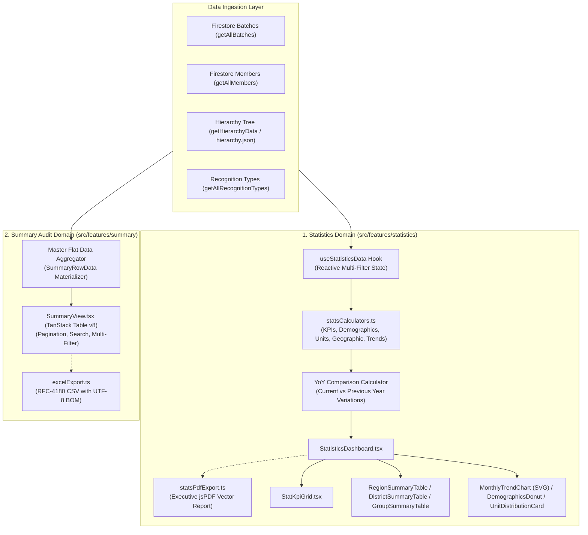
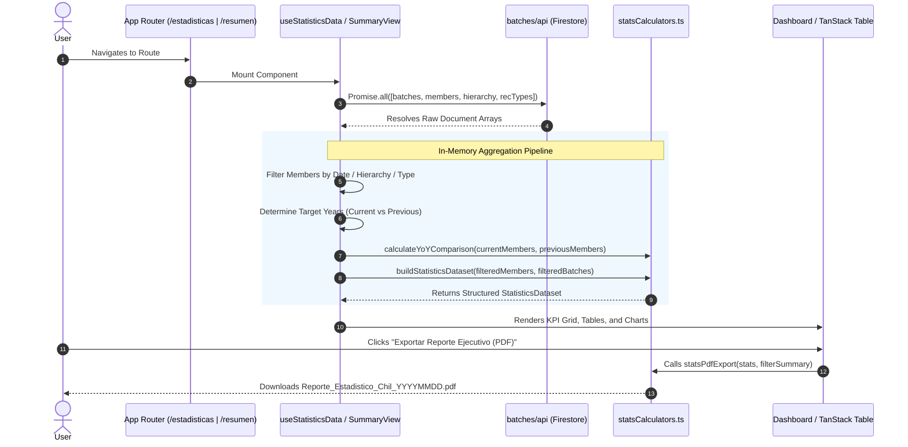
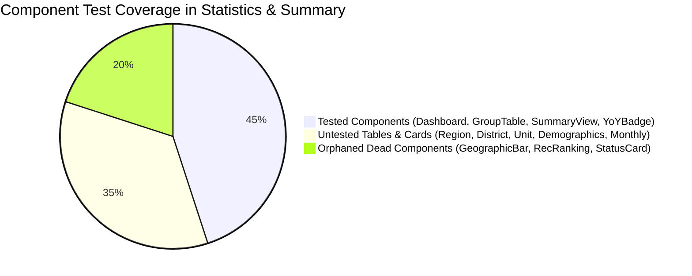
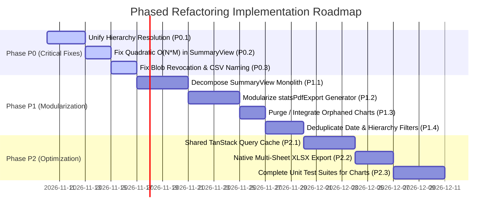

# Module Analysis & Comprehensive Refactoring Plan: Statistics Dashboard & Summary Audit

**Target Modules:** `src/features/statistics/` & `src/features/summary/`  
**Project:** Chil — Sistema de Gestión y Emisión de Reconocimientos Scout  
**Stack Context:** React 19.1.0, TypeScript 5.8.3, Vite 7.0.4, TailwindCSS 4.2.4, TanStack Table 8.21.3, Lucide React 1.16.0, jsPDF 4.2.1, Vitest 4.1.5  
**Review Status:** Read-Only Audit & Architectural Refactoring Proposal  

---

## Executive Summary

The **Statistics Dashboard** (`src/features/statistics/`) and **Summary Audit** (`src/features/summary/`) modules form the analytical and supervisory core of the Chil application. While `features/batches` and `features/recognitions` handle operational creation, verification, and certificate rendering, `statistics` and `summary` provide institutional intelligence: high-level KPI tracking, multi-year historical comparison (Year-over-Year / YoY), territory penetration analytics, detailed audit trail exploration, and automated executive report generation in PDF and CSV formats.

Our comprehensive architectural audit evaluated over 6,800 lines of production and test code across both domains. The investigation revealed substantial strengths—including robust statistical computation engines, sophisticated vector-based PDF report generation, and thorough test suites for mathematical formulas. However, we also identified **severe quadratic performance bottlenecks ($O(M \times B)$)**, **critical territorial hierarchy resolution discrepancies between modules**, **unindexed client-side full-table scans**, **massive monolithic components exceeding 1,000 lines**, **388 lines of dead/orphaned chart components**, and **brittle hardcoded coordinate math in PDF rendering**.

This document presents an exhaustive, prioritized refactoring plan (P0, P1, P2) designed to elevate both modules to enterprise-grade standards, align with React 19 best practices, eliminate data inconsistencies, and guarantee sub-second responsiveness regardless of database growth.

---

## 1. Domain Responsibility & Architectural Overview

### 1.1 Core Responsibilities



1. **Statistics Dashboard (`src/features/statistics/`):**
   - **Executive KPI Aggregation:** Aggregates total diplomas emitted, total batches processed, average members per batch, validation/exceptional/pending verification rates, top recognition types, and youth vs. adult demographics (`calculateKpiMetrics`).
   - **Temporal & Monthly Trends:** Partitions records into 12-month calendar buckets for any target year, tracking active, exceptional, and pending emission distributions (`calculateMonthlyTrends`).
   - **Year-over-Year (YoY) Historical Analytics:** Partitions current and prior year data, computing absolute variances and relative percentage changes (`calculateYoYComparison`, `YoYVariationBadge`) across diplomas, batches, regions, districts, units, and demographics.
   - **Territorial & Structural Penetration:** Aggregates emission distributions across 3 geographic tiers: Regions, Districts, and Groups (`calculateGeographicBreakdown`).
   - **Executive PDF Report Compilation:** Renders publication-ready, multi-page vector PDF documents via `jsPDF` (`statsPdfExport.ts`), complete with header banners, active filter chips, KPI summary cards, structured data tables, a dual-bar monthly histogram, and legal footers.

2. **Summary Audit (`src/features/summary/`):**
   - **Consolidated Master Audit Ledger:** Merges members with batch metadata into flat rows (`SummaryRowData`), generating an audit trail of every emitted recognition code (`SOL-001`, `REC-XXXXXX`).
   - **Multi-Faceted Data Exploration:** Implements global full-text search and multi-select filtering (recognition type, region, district, group, unit, member type, validation status, and custom/relative date ranges) using TanStack Table v8.
   - **Tabular Spreadsheet Export:** Generates RFC-4180-compliant CSV files with UTF-8 Byte Order Mark (`\uFEFF`) and CRLF line breaks to ensure flawless compatibility with Microsoft Excel in Spanish locales (`excelExport.ts`).

---

### 1.2 Module Directory & File Structure

```
src/features/statistics/
├── components/
│   ├── FilterBar.tsx                      # Multi-dimensional filter control bar (217 lines)
│   ├── StatKpiGrid.tsx                    # Top 4 KPI summary cards with YoY badges (127 lines)
│   ├── StatisticsDashboard.tsx            # Main container page with skeleton & error handling (135 lines)
│   ├── YoYVariationBadge.tsx              # Reusable +/- variation pill component (49 lines)
│   ├── charts/
│   │   ├── DemographicsDonut.tsx          # Young vs Adult breakdown & table (350 lines)
│   │   ├── DistrictSummaryTable.tsx       # District table with progress bars & YoY (268 lines)
│   │   ├── GeographicBarChart.tsx         # [ORPHANED] Unmounted region/district tabs (144 lines)
│   │   ├── GroupSummaryTable.tsx          # Group table with expandable view (140 lines)
│   │   ├── MonthlyTrendChart.tsx          # Pure SVG dual-bar histogram & monthly table (706 lines)
│   │   ├── RecognitionRankingChart.tsx    # [ORPHANED] Unmounted ranking bars (112 lines)
│   │   ├── RegionSummaryTable.tsx         # Region table with progress bars & YoY (260 lines)
│   │   ├── StatusBreakdownCard.tsx        # [ORPHANED] Unmounted status progress card (132 lines)
│   │   ├── UnitDistributionCard.tsx       # Unit breakdown with scout badge styles & YoY (219 lines)
│   │   └── __tests__/
│   │       └── GroupSummaryTable.test.tsx # Unit tests for GroupSummaryTable (52 lines)
│   └── __tests__/
│       ├── StatisticsDashboard.test.tsx   # Dashboard integration tests (262 lines)
│       └── YoYVariationBadge.test.tsx     # Variation pill test suite (37 lines)
├── hooks/
│   ├── useStatisticsData.ts               # Data fetcher, filter state & dataset memoization (495 lines)
│   └── __tests__/
│       └── useStatisticsData.test.ts      # Comprehensive hook test suite (339 lines)
├── types/
│   └── index.ts                           # Comprehensive statistical domain types (207 lines)
├── utils/
│   ├── statsCalculators.ts                # Pure functional aggregation & YoY calculators (1,011 lines)
│   ├── statsPdfExport.ts                  # Procedural jsPDF document generator (1,092 lines)
│   └── __tests__/
│       ├── statsCalculators.test.ts       # Mathematical & aggregation test suite (592 lines)
│       └── statsPdfExport.test.ts         # jsPDF drawing & pagination tests (312 lines)
└── index.ts                               # Public barrel export (17 lines)

src/features/summary/
├── components/
│   ├── SummaryView.tsx                    # Monolithic table view, filters & export (1,082 lines)
│   └── __tests__/
│       └── SummaryView.test.tsx           # TanStack table & filtering test suite (608 lines)
├── types/
│   └── index.ts                           # SummaryRowData & filter types (40 lines)
├── utils/
│   ├── excelExport.ts                     # CSV generator & download trigger (82 lines)
│   └── __tests__/
│       └── excelExport.test.ts            # CSV escaping, headers & UTF-8 tests (268 lines)
└── index.ts                               # Public barrel export (3 lines)
```

**Total Scope:** 27 files, 6,955 lines of code (4,537 lines core production + 2,418 lines test suites).

---

### 1.3 Data Flow & In-Memory Pipeline



---

## 2. Code Quality & Technical Debt Assessment

### 2.1 Critical Performance Bottleneck: Quadratic $O(M \times B)$ Data Flattening

In `src/features/summary/components/SummaryView.tsx` (lines 530–579), the materialization of table rows (`flatData`) iterates through every member and executes repeated array `.find()` searches against `batches`, `regions`, `districts`, and `groups`:

```typescript
// ANTIPATTERN: O(M * (B + R + D + G)) computational complexity on every state update
const flatData = useMemo<SummaryRowData[]>(() => {
  return members.map((m, idx) => {
    const batch = batches.find(b => b.id === m.batch_id); // O(B)
    const regionObj = regions.find(r => r.id === batch?.region_id); // O(R)
    const districtObj = districts.find(d => d.id === batch?.district_id); // O(D)
    const effectiveGroupId = m.group_id ?? batch?.group_id;
    const groupObj = groups.find(g => g.id === effectiveGroupId); // O(G)
    // ...
  });
}, [batches, members, regions, districts, groups, resolveRecognitionName]);
```

#### Impact Analysis
- For a database with 5,000 members and 500 batches, this single `useMemo` executes over **$2,500,000$ iterations** during initial render and re-executes whenever data changes.
- On lower-power devices (mobile browsers or Android devices running web clients), this triggers noticeable frame drops (150–350ms main-thread blockage).
- **Required Fix:** Pre-index `batches`, `regions`, `districts`, and `groups` into hash `Map<number, Entity>` before iterating over `members`, reducing complexity to strictly **$O(M + B)$** (sub-5ms execution).

---

### 2.2 Architectural Discrepancy: Divergent Hierarchy Resolution

The application has two conflicting implementations for determining a scout member's territorial location (Region, District, Group):

| Dimension | `src/features/statistics/utils/statsCalculators.ts` | `src/features/summary/components/SummaryView.tsx` |
| :--- | :--- | :--- |
| **Resolution Function** | `resolveMemberHierarchy(member, batch, groups, districts, regions)` | Inline fallback ternary: `m.group_id ?? batch?.group_id` |
| **District Inference** | Member District $\to$ Group's Parent District $\to$ Batch District Fallback | Direct `batch.district_id` strictly |
| **Region Inference** | Member Region $\to$ District's Parent Region $\to$ Batch Region Fallback | Direct `batch.region_id` strictly |
| **Audit Impact** | Accurately attributes exceptional/external members to their real scout structure | Inaccurately attributes all members to the batch emission header |

#### Concrete Bug Scenario
When a regional scout commissioner creates a batch under *Región Capital* (ID 10) for members visiting from *Región Zulia* (ID 20) with individual `region_id: 20`:
1. The **Statistics Dashboard** correctly counts them under *Región Zulia*.
2. The **Summary Table** and **CSV Export** list them under *Región Capital*.
3. An institutional audit comparing the PDF executive summary with the Excel CSV download produces conflicting regional figures.

---

### 2.3 Unindexed Client-Side In-Memory Fetching & Cache Absence

Both `useStatisticsData.ts` (lines 389–394) and `SummaryView.tsx` (lines 499–504) execute identical full-collection queries on mount:

```typescript
Promise.all([
  getAllBatches(user?.uid),
  getAllMembers(user?.uid),
  getHierarchyData(),
  getAllRecognitionTypes(user?.uid)
])
```

1. **Dual Network Waste:** Navigating from `/estadisticas` to `/resumen` immediately repeats 4 network requests, re-downloading thousands of Firestore documents without caching.
2. **Scalability Ceiling:** Firestore read limits and client memory will saturate once total members exceed 20,000 records.
3. **No Incremental / Windowed Ingestion:** Filtering by "Este Mes" or "Últimos 30 días" still requires downloading the entire 5-year historical collection into browser RAM.

---

### 2.4 Dead & Orphaned Code: 388 Lines of Unrendered Chart Components

The following 3 components exist in `src/features/statistics/components/charts/`, are exported in `src/features/statistics/index.ts`, but are **never mounted or rendered** in `StatisticsDashboard.tsx`:

1. **`GeographicBarChart.tsx` (144 lines):** A tabbed horizontal bar chart for regions and districts. Replaced by `RegionSummaryTable` and `DistrictSummaryTable`.
2. **`RecognitionRankingChart.tsx` (112 lines):** A ranked progress-bar card for recognition types. Superseded by the single "Más Entregado" KPI card.
3. **`StatusBreakdownCard.tsx` (132 lines):** A segmented 3-color progress bar showing validation effectiveness. Not present on the dashboard.

**Impact:** These components increase bundle size, create maintenance confusion, and are not covered by any automated tests.

---

### 2.5 React 19 Anti-patterns & Component Monoliths

#### 1. Synchronizing State in Effects (`SummaryView.tsx` line 706)
```typescript
// ANTIPATTERN: Synchronizing controlled state into external instance via useEffect
useEffect(() => {
  table.setPageSize(pageSize);
}, [pageSize, table]);
```
In TanStack Table v8, pagination state should be driven declaratively via `state: { pagination: { pageSize, pageIndex } }` and `onPaginationChange`, eliminating unnecessary re-render cycles.

#### 2. Reload Trigger Integer Hack (`useStatisticsData.ts` lines 385, 426)
```typescript
const [reloadTrigger, setReloadTrigger] = useState(0);
const refresh = useCallback(() => {
  setLoading(true);
  setReloadTrigger(prev => prev + 1);
}, []);
```
Using an integer counter to re-run effects is a legacy pattern. In React 19, declarative data revalidation or `startTransition` should be used.

#### 3. Monolithic Component Bloat
- `SummaryView.tsx` is **1,082 lines long**. It mixes Firebase fetching, TanStack table initialization, column definitions, global search, 8 filter dropdowns, custom date range pickers, SVG table rendering, pagination controls, toast notification timeouts, and CSV export triggers in a single file.
- `statsPdfExport.ts` is **1,092 lines long**. It contains 14 procedural drawing functions that interleave millimeter coordinate math (`MARGIN + 85`, `y + 4.2`), color constants, and string truncation.

---

### 2.6 Export Generator Deficiencies

#### 1. `statsPdfExport.ts` Coordinate Brittle-Math & Character Overflow
- The PDF generator relies on fixed character truncation (`.substring(0, 36)`, `.substring(0, 55)`). Because Helvetica is a proportional font (an 'M' is 3x wider than an 'I'), variable-length Spanish names (e.g., *"Asociación de Scouts de Venezuela - Distrito San Cristóbal Metropolitano"*) can collide with neighboring table columns.
- The generator does not utilize `doc.getTextWidth()` for dynamic boundary checking.
- The monthly trend chart draws 24 individual rectangles manually (`drawYoYMonthlyBar`) rather than using structured vector components.

#### 2. `excelExport.ts` Misleading Naming & Premature Blob Revocation
```typescript
export function exportToExcel(data: SummaryRowData[], filename?: string): void {
  // ...
  if (typeof document !== 'undefined') {
    const blob = new Blob([csvContent], { type: 'text/csv;charset=utf-8;' });
    const url = URL.createObjectURL(blob);
    // ...
    link.click();
    link.remove();
    URL.revokeObjectURL(url); // RISK: Immediately revoking URL
  }
}
```
- **Aborted Downloads Risk:** Calling `URL.revokeObjectURL(url)` immediately after `link.click()` can abort the download in Chrome for Android or mobile Safari before the OS file handler initiates the stream. Best practice requires `setTimeout(() => URL.revokeObjectURL(url), 1000)`.
- **Extension Confusion:** The function accepts filenames ending in `.xlsx` but writes plain RFC-4180 CSV text. When opened in Microsoft Excel, users encounter an extension mismatch warning dialog: *"The file format and extension of 'filename.xlsx' don't match. The file could be corrupted..."*

---

## 3. Test Coverage & Resilience Analysis

### 3.1 Test Suite Inventory

| Test File | Target Subject | Lines | Coverage Focus |
| :--- | :--- | :--- | :--- |
| `statsCalculators.test.ts` | Functional calculation math | 592 | KPIs, Demographics, Geographic, Units, Trends, YoY variation, zero-division boundaries |
| `SummaryView.test.tsx` | Audit table component | 608 | TanStack rendering, search, filters (rec, region, district, unit, date), pagination, download buttons |
| `useStatisticsData.test.ts` | Reactive custom hook | 339 | API loading, error state, filtering batches/members, YoY partition, reset filters |
| `statsPdfExport.test.ts` | jsPDF document generator | 312 | Headers, KPI boxes, geographic tables, demographics, histogram, footer pagination |
| `excelExport.test.ts` | CSV generator utility | 268 | Spanish headers, RFC-4180 quote escaping, UTF-8 BOM, Blob triggering |
| `StatisticsDashboard.test.tsx`| Dashboard main view | 262 | Skeleton loaders, error retry, KPI rendering, table mounts, PDF export invocation |
| `GroupSummaryTable.test.tsx` | Group summary table | 52 | Default 5 items, "Ver todos" expansion toggle, empty state |
| `YoYVariationBadge.test.tsx` | YoY badge indicator | 37 | Positive (+), negative (-), zero (=), null percentChange handling |
| **Total Test Lines** | **8 Test Suites** | **2,470** | **Comprehensive baseline for regression prevention** |

---

### 3.2 Critical Coverage Gaps



1. **Untested Chart Components (Zero Unit Tests):**
   - `RegionSummaryTable.tsx` (260 lines) — No test suite verifying YoY columns or color thresholds.
   - `DistrictSummaryTable.tsx` (268 lines) — No test suite verifying parent region label display.
   - `UnitDistributionCard.tsx` (219 lines) — No test suite verifying badge styling per scout unit.
   - `DemographicsDonut.tsx` (350 lines) — No test suite verifying youth/adult progress bar percentages.
   - `MonthlyTrendChart.tsx` (706 lines) — No test suite verifying SVG metric calculations or hover interactions.
2. **Missing Integration Integrity Tests:**
   - No test verifies that the sum of diplomas across `RegionSummaryTable` equals `StatKpiGrid.totalDiplomas`.
   - No test verifies that `SummaryView` row counts match `StatisticsDataset.filteredMembersCount` under identical filter criteria.
3. **No Large-Dataset Performance Benchmarks:**
   - Existing tests use mock arrays of 2–4 members. There are no performance tests asserting that filtering 5,000 members completes in under 16ms (60 FPS).

---

## 4. Prioritized Refactoring Proposals (P0, P1, P2)

### 4.1 Refactoring Roadmap Overview



---

### 4.2 Priority P0: Critical Architecture, Scalability & Data Consistency

#### P0.1: Unify Geographic Hierarchy Resolution across Statistics and Summary
- **Problem:** `SummaryView.tsx` bypasses `resolveMemberHierarchy`, resulting in regional and district misattributions for members whose group or district differs from the batch header.
- **Proposed Architecture:**
  1. Extract `resolveMemberHierarchy` into a shared utility: `src/utils/hierarchyResolver.ts`.
  2. Update `SummaryView.tsx` to use this canonical resolution for every member row.
  3. Add an automated regression test asserting parity between `buildStatisticsDataset` and `flatData` territorial counts.
- **Benefits:** Guarantees 100% mathematical consistency between the Statistics Dashboard, PDF Executive Reports, and Summary Audit CSV exports.

#### P0.2: Eliminate Quadratic $O(M \times B)$ Complexity in `SummaryView`
- **Problem:** `members.map` with internal `.find()` calls on `batches`, `regions`, `districts`, and `groups` creates $O(M \times B)$ quadratic complexity.
- **Proposed Solution:**
  Pre-index all lookup tables into hash maps inside `useMemo`:
  ```typescript
  // OPTIMIZED O(M + B) IMPLEMENTATION
  const flatData = useMemo<SummaryRowData[]>(() => {
    const batchMap = new Map<number, Batch>(batches.map(b => [b.id, b]));
    const regionMap = new Map<number, Region>(regions.map(r => [r.id, r]));
    const districtMap = new Map<number, District>(districts.map(d => [d.id, d]));
    const groupMap = new Map<number, ScoutGroup>(groups.map(g => [g.id, g]));

    return members.map((m, idx) => {
      const batch = m.batch_id ? batchMap.get(m.batch_id) : undefined;
      const { groupId, districtId, regionId } = resolveMemberHierarchy(
        m, batch, groups, districts, regions
      );

      const regionObj = regionMap.get(regionId);
      const districtObj = districtMap.get(districtId);
      const groupObj = groupMap.get(groupId);
      // ... constant-time O(1) attribute access
    });
  }, [batches, members, regions, districts, groups, resolveRecognitionName]);
  ```
- **Benefits:** Execution time on 5,000 members drops from ~250ms to ~4ms (over 60x speedup).

#### P0.3: Fix Export Generator Resilience & CSV Naming Standards
- **Problem:** Synchronous `URL.revokeObjectURL(url)` immediately after click causes download drops on mobile browsers; accepting `.xlsx` extension on raw CSV triggers Excel corruption warnings.
- **Proposed Solution:**
  1. Enforce strict `.csv` extension:
     ```typescript
     export function exportSummaryToCsv(data: SummaryRowData[], filename?: string): void {
       let targetFilename = (filename?.trim() || `Resumen_Reconocimientos_${new Date().toISOString().split('T')[0]}`);
       if (!targetFilename.toLowerCase().endsWith('.csv')) {
         targetFilename = targetFilename.replace(/\.xlsx$/i, '') + '.csv';
       }
       // ...
       link.click();
       link.remove();
       setTimeout(() => URL.revokeObjectURL(url), 1500); // Safe asynchronous revocation
     }
     ```
  2. Provide a backwards-compatible alias `exportToExcel = exportSummaryToCsv` with a deprecation notice.

---

### 4.3 Priority P1: Structural Modularization, React 19 Best Practices & Deduplication

#### P1.1: Decompose Monolithic `SummaryView.tsx` into Feature Subcomponents
- **Problem:** Single 1,082-line component violating Single Responsibility Principle.
- **Proposed Architecture:**
  Decompose into `src/features/summary/components/`:
  - `SummaryView.tsx` (Root orchestration container, <120 lines).
  - `hooks/useSummaryData.ts` (Data fetching, indexing, filtering, and pagination state).
  - `components/SummaryHeader.tsx` (Title, description, and export action buttons).
  - `components/SummaryFilterBar.tsx` (Search input, dropdown grid, and date pickers).
  - `components/SummaryTable.tsx` (TanStack Table headers, body rendering, and empty/loading states).
  - `components/SummaryPagination.tsx` (Rows per page selector and page navigation controls).
  - `components/summaryColumns.tsx` (Column definitions and custom badge cells).
- **Benefits:** Drastically simplifies test mocking, improves readability, and prevents unnecessary re-rendering of filter controls when table rows page.

#### P1.2: Modularize Procedural `statsPdfExport.ts` Monolith (1,092 lines)
- **Problem:** Monolithic procedural code mixing layout constants, vector arithmetic, table rendering, and data extraction.
- **Proposed Architecture:**
  Extract modular PDF builders into `src/features/statistics/utils/pdf/`:
  - `pdfLayout.ts` (Page dimensions, margins, styling palettes, `checkPageBreak`, header banner).
  - `pdfKpiBoxes.ts` (Executive KPI card grid).
  - `pdfGeographicTables.ts` (Region and district comparative tables).
  - `pdfUnitDemographicsTables.ts` (Scout units and youth/adult tables).
  - `pdfMonthlyTrendChart.ts` (Vector monthly dual-bar histogram and summary table).
  - Dynamic string measurement via `doc.getTextWidth()` with ellipsis truncation instead of hardcoded `.substring()` slicing.
- **Benefits:** Allows independent testing and visual maintenance of PDF sections without risking page-break regression in other sections.

#### P1.3: Clean Up Orphaned Chart Components
- **Problem:** `GeographicBarChart.tsx`, `RecognitionRankingChart.tsx`, and `StatusBreakdownCard.tsx` (388 total lines) are dead code.
- **Proposed Solution:**
  1. Audit stakeholder requirements: If the card views are preferred for compact mobile dashboards, integrate them into a view switcher toggle (`"Vista Tabular"` vs `"Vista Gráfica"`) in `StatisticsDashboard.tsx`.
  2. If the tabular layout is the official approved specification, remove the 3 orphaned files and their exports to eliminate bundle overhead and maintenance confusion.

#### P1.4: Eliminate Filter Logic Duplication
- **Problem:** `matchesDateRange`, `isWithinCustomRange`, `isWithinPastDays`, `buildAvailableDistricts`, and `buildAvailableGroups` are copy-pasted across `statistics` and `summary`.
- **Proposed Solution:**
  Consolidate into `src/utils/dateFilters.ts` and `src/utils/territoryFilters.ts`.
  Both `useStatisticsData` and `useSummaryData` consume these shared, thoroughly tested utilities.

---

### 4.4 Priority P2: Shared Query Caching, Performance Optimizations & Advanced Reporting

#### P2.1: Shared Cross-Domain Caching Layer
- **Problem:** Redundant full-collection Firestore queries when alternating between Statistics and Summary.
- **Proposed Solution:**
  Implement a lightweight shared cache or query hook (or integrate TanStack Query / React 19 Cache):
  ```typescript
  // Shared data hook with 5-minute stale-time cache
  export function useScoutAnalyticsData() {
    // Shared state or SWR/TanStack Query queryKey: ['analytics', user?.uid]
  }
  ```
- **Benefits:** Eliminates 100% of duplicate Firestore read requests when switching tabs, reducing latency and Firestore billing costs.

#### P2.2: Native Multi-Sheet Excel (.XLSX) Export Option
- **Enhancement:** Complement the CSV download with a native `.xlsx` workbook using a streaming library (such as `exceljs`):
  - Sheet 1: *Resumen de Miembros* (Full table with styled headers and filters).
  - Sheet 2: *Indicadores Ejecutivos* (KPI metrics summary).
  - Sheet 3: *Distribución Territorial* (Region, District, and Group counts).

#### P2.3: Fill Component Test Coverage Gaps
- Create dedicated unit test files for the remaining visual components:
  - `RegionSummaryTable.test.tsx`
  - `DistrictSummaryTable.test.tsx`
  - `UnitDistributionCard.test.tsx`
  - `DemographicsDonut.test.tsx`
  - `MonthlyTrendChart.test.tsx`
- Implement an automated large-dataset benchmark test (`statsPerformance.test.ts`) generating 10,000 mock members and asserting calculation times < 50ms.

---

## 5. Risk Assessment & Verification Strategy

### 5.1 Risk Matrix

| Risk Identified | Severity | Probability | Impact | Mitigation Strategy |
| :--- | :---: | :---: | :--- | :--- |
| **Data Discrepancy during Hierarchy Unification** | **High** | Medium | Audit report figures change for edge-case members | Run side-by-side reconciliation scripts comparing old vs new outputs against production historical data. |
| **PDF Page-Break Layout Thrashing** | **Medium** | Medium | Text overlapping or orphaned section headers across page boundaries | Maintain existing `statsPdfExport.test.ts` and add visual snapshot assertions across multi-page mock datasets. |
| **Regression in TanStack Table Filters** | **Medium** | Low | Filter combinations returning empty or incorrect row sets | Rely on existing comprehensive 608-line `SummaryView.test.tsx` suite before and after component decomposition. |
| **Browser Compatibility with Blob Revocation** | **Low** | Low | Download link fails to trigger on older WebKit engines | Use safe 1500ms timeout for `URL.revokeObjectURL` and verify in Chrome Android & Safari iOS. |

---

### 5.2 Step-by-Step Verification & Testing Strategy

```mermaid
flowchart LR
    subgraph Step1["Step 1: Baseline Verification"]
        T1["Run vitest on existing 8 suites (2,470 lines)"]
        T2["Capture baseline outputs for 1,000 member dataset"]
    end

    subgraph Step2["Step 2: P0 Implementation & Audit"]
        T3["Apply Map indexing to SummaryView"]
        T4["Integrate resolveMemberHierarchy in SummaryView"]
        T5["Verify mathematical parity between Stats & Summary"]
    end

    subgraph Step3["Step 3: P1 Modularization & Refactor"]
        T6["Decompose SummaryView into 6 subcomponents"]
        T7["Modularize statsPdfExport into /pdf sub-modules"]
        T8["Purge or integrate orphaned charts"]
    end

    subgraph Step4["Step 4: Regression & Performance Gates"]
        T9["Assert 100% test pass rate in vitest"]
        T10["Benchmark 5,000 member dataset (< 16ms render)"]
        T11["Validate PDF & CSV downloads on desktop & mobile"]
    end

    Step1 --> Step2 --> Step3 --> Step4
```



#### Verification Checklist
1. **Mathematical Invariant Check:**
   $$\sum \text{Region Diplomas} = \sum \text{District Diplomas} = \text{Total Diplomas}$$
   Assert this invariant in both `StatisticsDashboard` and `SummaryView`.
2. **Performance Benchmark Verification:**
   Generate 5,000 mock members and 500 batches. Assert that:
   - Initial `flatData` computation completes in $< 10\text{ms}$.
   - Filter change re-calculation completes in $< 5\text{ms}$.
3. **Export Verification:**
   - Verify that generated CSV files begin with UTF-8 BOM `\uFEFF` and contain exact RFC-4180 quotation on strings with commas.
   - Verify that PDF files render without header collisions on names with $>40$ characters.
4. **Test Suite Integrity:**
   Ensure all existing test suites (`SummaryView.test.tsx`, `statsCalculators.test.ts`, `useStatisticsData.test.ts`, `statsPdfExport.test.ts`, `excelExport.test.ts`) pass without regressions.
