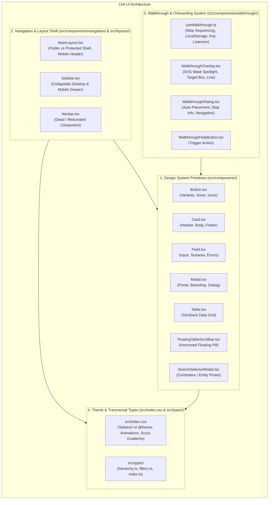
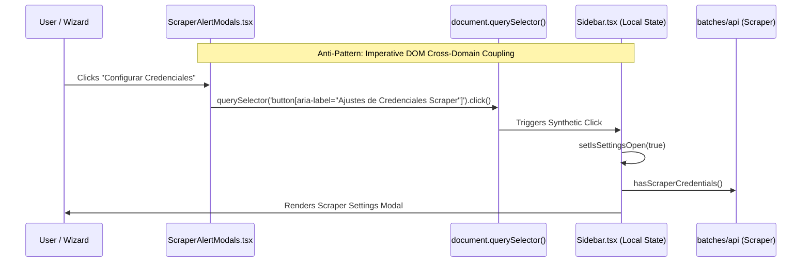
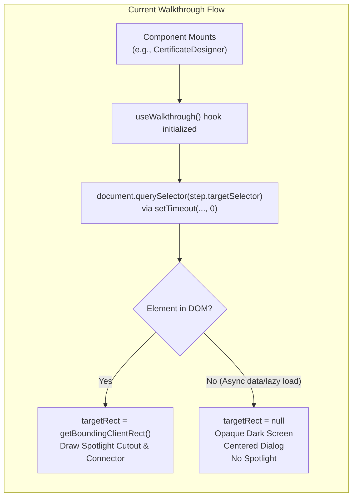
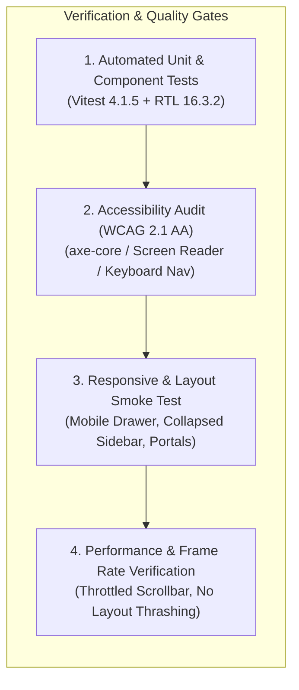

# Module Analysis & Comprehensive Refactoring Plan: UI Primitives, Navigation & Walkthroughs

**Target Module:** `src/components/`, `src/layouts/`, `src/types/` (transversal types), and `src/index.css` (Tailwind CSS v4 & theme)  
**Project:** Chil — Sistema de Gestión y Emisión de Reconocimientos Scout  
**Stack Context:** React 19.1.0, TypeScript 5.8.3, Vite 7.0.4, TailwindCSS 4.2.4, @tailwindcss/vite 4.2.4, TanStack React Table 8.21.3, React Router DOM 7.15.0, Lucide React 1.14.0, Vitest 4.1.5, @testing-library/react 16.3.2  
**Review Status:** Read-Only Audit & Architectural Refactoring Plan  

---

## Executive Summary

The **UI Primitives, Navigation & Walkthroughs** module constitutes the visual foundation, application shell, and onboarding engine of the Chil application. It provides design system components (`Button`, `Card`, `Field`, `Modal`, `Table`, `FloatingTableScrollbar`, `SearchSelectorModal`), the responsive layout shell (`MainLayout`, `Sidebar`), the feature tour framework (`WalkthroughOverlay`, `WalkthroughDialog`, `useWalkthrough`), and styling tokens integrated with Tailwind CSS v4.

While the design language is visually tailored to the Scout brand identity (with Scout GT Planar display typography and warm earth-tone color palettes), our in-depth code audit uncovered **critical architectural flaws**, **hidden accessibility failures**, **severe DOM query coupling across domain boundaries**, **dead duplicated components**, and **layout thrashing performance bottlenecks**:

1. **Dead Code & Dangerous Cross-Domain Coupling:** An entire 250-line `Navbar.tsx` component is completely unmounted in production, duplicating credential management code from `Sidebar.tsx`. Furthermore, external feature components (such as `ScraperAlertModals.tsx` in `features/batches`) imperatively invoke `document.querySelector('button[aria-label="Ajustes de Credenciales Scraper"]').click()` to open settings, demonstrating a leaky abstraction and lack of global modal/context management.
2. **Hidden Accessibility Failures Masked by False-Positive Tests:** The `Modal` component's Escape key handler is bound to an `aria-hidden="true"`, non-focusable backdrop overlay. In real browser sessions, pressing Escape never closes the modal. This critical defect was masked by a false-positive test directly targeting the overlay. Furthermore, modals and walkthrough dialogs lack keyboard focus traps and focus restoration.
3. **Walkthrough Fragility & Stacking Context Vulnerabilities:** `WalkthroughOverlay` is rendered directly into local component DOM without a React Portal (`createPortal`). If an ancestor container utilizes CSS `transform`, `contain`, or `perspective`, overlay coordinates fail completely. In addition, element targeting via DOM selector uses a rigid zero-delay lookup (`setTimeout(..., 0)`), failing permanently whenever elements mount asynchronously or wait for network responses.
4. **Design System Primitive Deficits:** Primitives rely on naive string concatenation rather than class-merging (`clsx` + `tailwind-merge`), leading to CSS cascade conflicts. `Button` is not polymorphic, leading to invalid HTML nesting (`<Link><Button>`); `Field` uses deprecated React 18 `forwardRef` with non-unique DOM ID generation; and four core primitives have zero unit test coverage.
5. **Scroll Performance Degradation:** `FloatingTableScrollbar` binds an unthrottled capture listener to window scroll, invoking `getBoundingClientRect()` on every pixel scrolled, causing continuous browser layout thrashing.

This document presents a structured, prioritized refactoring plan (P0, P1, P2) designed to elevate the Chil UI architecture to enterprise-grade React 19 standards, enforce WCAG 2.1 AA accessibility, and decouple application navigation and tours into resilient, composable systems.

---

## 1. Domain Responsibility & Architectural Overview

### 1.1 Core Responsibilities

The module is partitioned into four primary architectural sub-domains:



1. **Design System Primitives (`src/components/`):**
   - Headless and visual primitives providing foundational atoms (buttons, cards, input fields, modals, data tables).
   - Expected to be generic, accessible, brand-consistent, polymorphic, and free from business-domain logic.
2. **Navigation & Application Shell (`src/layouts/`, `src/components/navigation/`):**
   - **`MainLayout.tsx`:** Manages page layout mode based on route authentication (distinguishes public landing/auth pages without sidebar from authenticated workspace pages with sidebar). Renders responsive mobile header with menu trigger.
   - **`Sidebar.tsx`:** Provides collapsible desktop navigation with persistent collapse state in `localStorage`, mobile slide-out drawer, user profile integration, and active route visual state.
3. **Walkthrough & Interactive Tour Engine (`src/components/walkthrough/`):**
   - Context-aware onboarding tour system highlighting DOM elements via `data-walkthrough` attributes.
   - Computes SVG spotlight cutouts, dynamic anchor points, dashed connector lines, and responsive dialog positioning based on target element bounding rects.
4. **Theme, Tokens & Transversal Types (`src/index.css`, `src/types/`):**
   - Tailwind CSS v4 `@theme` definitions, custom keyframe animations (`modalBackdropFadeIn`, `modalContentPopIn`), reduced-motion fallbacks, and Scout brand gradients.
   - Transversal entity types (`Region`, `District`, `ScoutGroup`, `DatePeriod`, `MemberTypeFilter`).

---

### 1.2 Module Directory & File Structure

| Directory / File | Lines of Code | Exports / Subcomponents | Current Status |
| :--- | :---: | :--- | :--- |
| **`src/components/Button.tsx`** | 73 | `Button`, `ButtonProps` | Functional, non-polymorphic, lacks `ref`, lacks `cn` merging, no unit tests. |
| **`src/components/Card.tsx`** | 48 | `Card`, `CardHeader`, `CardBody`, `CardFooter` | Un-namespaced compound exports, hardcoded styling, no unit tests. |
| **`src/components/Field.tsx`** | 81 | `Field`, `FieldProps` | Uses deprecated `forwardRef`, non-unique ID logic, missing WCAG `aria-` links, no unit tests. |
| **`src/components/Modal.tsx`** | 123 | `Modal`, `ModalHeader`, `ModalBody`, `ModalFooter` | Unportaled, broken Escape key listener, no focus trap, body scroll leak. |
| **`src/components/Table.tsx`** | 78 | `Table`, `TableProps` | Basic TanStack wrapper; missing sorting, pagination, sticky headers, loading states. |
| **`src/components/FloatingTableScrollbar.tsx`** | 357 | `FloatingTableScrollbar`, `FloatingScrollbarControls` | Performance bottleneck (forced reflow on scroll), ref race condition, missing keyboard a11y. |
| **`src/components/SearchSelectorModal.tsx`** | 92 | `SearchSelectorModal` | Missing input label, non-combobox semantics, no arrow key navigation, no unit tests. |
| **`src/components/index.ts`** | 9 | Barrel export for components, navigation, walkthrough | Functional. |
| **`src/components/navigation/Sidebar.tsx`** | 416 | `Sidebar`, `SidebarProps` | Overloaded with Scraper Settings logic; rigid `end` route matching; abrupt mobile close. |
| **`src/components/navigation/Navbar.tsx`** | 249 | `Navbar` | **Dead code**. Not rendered anywhere in production. 100% duplicate settings logic. |
| **`src/components/navigation/index.ts`** | 2 | Barrel export for `Sidebar`, `Navbar` | Functional. |
| **`src/components/walkthrough/types.ts`** | 20 | `WalkthroughPlacement`, `WalkthroughStep`, `TourConfig` | Functional. |
| **`src/components/walkthrough/useWalkthrough.ts`** | 200 | `useWalkthrough`, `UseWalkthroughReturn` | Element targeting fragile with zero retry/mutation observation; keyboard shortcuts work. |
| **`src/components/walkthrough/WalkthroughOverlay.tsx`** | 191 | `WalkthroughOverlay`, `WalkthroughOverlayProps` | Non-portaled (breaks in transformed parents); SVG mask calculation solid when element exists. |
| **`src/components/walkthrough/WalkthroughDialog.tsx`** | 236 | `WalkthroughDialog`, `WalkthroughDialogProps` | Solid viewport clamping & placement logic; lacks focus trap. |
| **`src/components/walkthrough/WalkthroughHelpButton.tsx`** | 26 | `WalkthroughHelpButton`, `WalkthroughHelpButtonProps` | Functional UI atom. |
| **`src/components/walkthrough/index.ts`** | 5 | Barrel export for walkthrough subsystem | Functional. |
| **`src/layouts/MainLayout.tsx`** | 69 | `MainLayout`, `MainLayoutProps` | Clean shell bifurcation (public vs private); embeds `Sidebar`. |
| **`src/index.css`** | 127 | Tailwind v4 configuration, `@theme`, modal animations | Incomplete color scale; missing semantic utility tokens. |
| **`src/types/filters.ts`** | 2 | `DatePeriod`, `MemberTypeFilter` | Clean transversal filter types. |
| **`src/types/hierarchy.ts`** | 16 | `Region`, `District`, `ScoutGroup` | Clean geographic hierarchy definitions. |
| **`src/types/index.ts`** | 4 | Transversal re-exports | Functional. |

---

## 2. Code Quality & Technical Debt Assessment

### 2.1 Critical Debt: Cross-Domain Coupling & Imperative DOM Querying

In `src/components/navigation/Sidebar.tsx` (lines 66-107, 290-315, 354-413) and `src/components/navigation/Navbar.tsx` (lines 13-54, 149-160, 186-244), the navigation components do not merely render navigation links. They manage full modal states, network requests (`hasScraperCredentials`, `saveScraperCredentials`), form states (`email`, `password`, `loading`, `successMsg`, `errorMsg`), and complete dialog forms for ASV Scraper credentials:



This pattern introduces several severe architectural flaws:
1. **Imperative DOM Breach:** In `src/features/batches/components/wizard/ScraperAlertModals.tsx` (lines 46-51):
   ```tsx
   // Trigger settings button click on Navbar
   const settingsBtn = document.querySelector(
     'button[aria-label="Ajustes de Credenciales Scraper"]'
   ) as HTMLButtonElement | null;
   if (settingsBtn) {
     settingsBtn.click();
   }
   ```
   A batch wizard deep in `src/features/batches` reaches into the global DOM to query an accessibility aria-label string and synthesize a click event on the navigation bar! If the aria-label changes, if the button is collapsed, or if the layout changes, this silently breaks without TypeScript compiler warnings.
2. **Duplicate Dead Code (`Navbar.tsx`):**
   `Navbar.tsx` contains 249 lines of code, identical scraper state management, and 267 lines of unit tests in `Navbar.test.tsx`. Yet, `Navbar` is **never imported or rendered** anywhere in the application (verified via project-wide grep). `MainLayout.tsx` renders `Sidebar` exclusively. Maintaining `Navbar.tsx` and its test suite is pure overhead and tech debt.

---

### 2.2 Accessibility (a11y) & DOM Traps

#### 2.2.1 Modal Escape Key Failure
In `src/components/Modal.tsx` (lines 53-65):
```tsx
{/* Overlay */}
<div
  data-testid="modal-backdrop"
  className={`absolute inset-0 bg-neutral/50 backdrop-blur-xs transition-opacity ...`}
  onClick={() => {
    if (!isClosing) onClose();
  }}
  aria-hidden="true"
  onKeyDown={(e) => {
    if (e.key === 'Escape' && !isClosing) onClose();
  }}
/>
```
- **The Defect:** The `onKeyDown` listener is attached to the backdrop `<div>`. Because this `div` is marked `aria-hidden="true"` and has no `tabIndex`, it is **not focusable** and will never receive keyboard events from a user interacting with the modal dialog.
- **The False-Positive Test:** In `src/components/__tests__/Modal.test.tsx` (line 119):
  ```tsx
  const overlay = screen.getByTestId('modal-backdrop');
  fireEvent.keyDown(overlay, { key: 'Escape' });
  expect(handleClose).toHaveBeenCalledTimes(2);
  ```
  The test artificially fires a `keyDown` event directly onto the overlay DOM node, passing the assertion while masking the fact that keyboard users cannot close the modal with the Escape key in a real browser.
- **Missing Focus Trap & Restoration:** When `Modal` or `WalkthroughDialog` opens:
  - Focus remains wherever it was before the modal opened, or moves arbitrarily.
  - Tabbing through inputs continues past the modal boundary and into the background page.
  - When closed, focus is not restored to the trigger element (violating WCAG 2.1 Criterion 2.4.3 Focus Order).

#### 2.2.2 Modal DOM Stacking & Portal Absence
`Modal.tsx` renders its dialog inline directly within the parent container where `<Modal>` is placed:
```tsx
return (
  <div className="fixed inset-0 z-50 flex items-center justify-center p-4 sm:p-6">
    ...
  </div>
);
```
If any parent component has CSS `transform`, `filter`, or `perspective` applied (common in page transitions, animated cards, or container queries), the CSS specification dictates that the parent becomes the containing block for all descendants, including `position: fixed`. The modal is then trapped and clipped inside the parent container rather than covering the viewport.

#### 2.2.3 Field Accessibility & ID Collisions
In `src/components/Field.tsx` (lines 24, 47-75):
```tsx
const fieldId = id || `field-${label.toLowerCase().replace(/\s+/g, '-')}`;
```
- If a form renders two fields with the same label (e.g. "Nombre" in recipient vs "Nombre" in guardian, or in repeating row lists), duplicate DOM IDs are created, violating HTML and WCAG standards.
- In React 19, `useId()` generates guaranteed collision-safe unique IDs.
- In addition, `<Field>` does not set `aria-invalid={variant === 'error'}` on the input, does not give the error `<p>` an `id`, and fails to wire `aria-describedby` to link the input to the error message. Screen readers cannot inform visually impaired users why a field failed validation.

---

### 2.3 Walkthrough System Vulnerabilities



1. **Zero-Delay Target Resolution Failure:**
   In `src/components/walkthrough/useWalkthrough.ts` (lines 137-142):
   ```ts
   const timer = setTimeout(() => {
     const el = document.querySelector(currentStep.targetSelector);
     setTargetRect(el ? el.getBoundingClientRect() : null);
   }, 0);
   ```
   If a step targets an element that renders after an asynchronous fetch (such as batch action buttons or certificate templates) or is waiting on a transition, `document.querySelector` returns `null`. The hook has **no retry mechanism, no `MutationObserver`, and no polling fallback**.
2. **Degraded User Experience on Missing Target:**
   When `targetRect` is `null`:
   - `WalkthroughOverlay` renders an SVG mask with no spotlight cutout (`targetRect && <rect ... fill="black" />`). The entire screen becomes 75% dark.
   - The highlight box and connector line are not rendered.
   - `WalkthroughDialog` defaults to centering in the viewport without indicating to the user that the targeted control could not be located.
3. **No Target Resize Tracking:**
   The hook listens to `window.resize` and `window.scroll`, but does not attach a `ResizeObserver` or `IntersectionObserver` to the targeted DOM element. If an accordion opens, a banner expands, or table columns adjust, the spotlight cutout and dashed connector line drift out of alignment with the target.
4. **Overlay Stacking Context Vulnerability:**
   Like `Modal`, `WalkthroughOverlay` does not use `createPortal`. When embedded inside a page view with transformed containers, its fixed coordinates and SVG measurements break.

---

### 2.4 Design System Primitives & React 19 Best Practices

1. **Absence of Class Merging Utility (`cn`):**
   `Button.tsx` and `Field.tsx` use `[...].join(' ')` to combine class names. If a consumer passes `className="px-6 py-3"` to a `size="sm"` Button (which specifies `px-3`), both classes exist in the DOM (`px-3 px-6`). In Tailwind CSS, the rule that wins is determined by the order inside the compiled CSS file, not by prop precedence. The project lacks the standard `cn(...inputs)` utility combining `clsx` and `tailwind-merge`.
2. **Lack of Polymorphism (`asChild` / `as` prop):**
   `Button.tsx` strictly renders an HTML `<button>`. Because there is no polymorphic `as` prop or Radix-style `asChild` slot, navigation links that need button styling wrap `<Button>` in React Router's `<Link>`:
   ```tsx
   <Link to="/login">
     <Button variant="ghost" size="sm" icon={<LogIn className="w-4 h-4" />}>
       Iniciar Sesión
     </Button>
   </Link>
   ```
   This compiles to `<a href="/login"><button type="button">Iniciar Sesión</button></a>`. Nesting interactive controls (`<button>` inside `<a>`) is an HTML syntax violation, breaks keyboard tab navigation, and causes screen reader speech glitches.
3. **React 19 Modernization:**
   - `Field.tsx` uses `React.forwardRef`. In React 19, `ref` is a standard component prop and `forwardRef` is deprecated.
   - `Button.tsx`, `Card.tsx`, and `Modal.tsx` do not accept or forward a `ref` prop at all, preventing consumer access to underlying DOM nodes.
   - Widespread usage of `React.FC` throughout `src/components/`, which is discouraged in modern TypeScript React codebases.
4. **Button Variant Limitations:**
   `Button.tsx` only defines `primary`, `secondary`, `outline`, and `ghost`. It lacks a `destructive` / `danger` variant (necessary for batch deletion and member removal modals) and does not support an `isLoading` / `loading` state with spinner and `aria-busy`.

---

### 2.5 Navigation System & Responsive Drawer Deficits

1. **Rigid Active Route Matching with `end`:**
   In `src/components/navigation/Sidebar.tsx` (lines 208-212):
   ```tsx
   <NavLink
     key={item.to}
     to={item.to}
     end
     ...
   ```
   Every navigation item specifies `end`. Consequently:
   - When viewing `/lotes`, the "Lotes" link is highlighted.
   - When the user navigates into a batch detail view `/lotes/batch-abc-123`, the "Lotes" link is **not active** because `end` enforces an exact match.
   - Similarly, navigating to `/reconocimientos/cert-1/plantilla` removes the active highlight from "Reconocimientos". This degrades navigational context.
2. **Mobile Drawer Unmounting & Lack of Gestures:**
   In `Sidebar.tsx`, the mobile drawer is conditionally mounted:
   ```tsx
   {isMobileOpen && (
     <div className="fixed inset-0 z-50 md:hidden" role="dialog" ...>
   ```
   When `isMobileOpen` flips to `false`, the drawer is unmounted immediately from the DOM without an exit animation, causing visual stutter on mobile devices. Furthermore, there are no touch gestures (swipe to close).

---

### 2.6 Performance: Layout Thrashing in `FloatingTableScrollbar`

In `src/components/FloatingTableScrollbar.tsx` (lines 62-95, 111-114):
```tsx
const updateViewportStatus = useCallback(() => {
  if (!targetElement || typeof targetElement.getBoundingClientRect !== 'function') return;
  const rect = targetElement.getBoundingClientRect(); // FORCED REFLOW
  const viewportHeight = window.innerHeight || 800;
  ...
}, [targetElement]);

useEffect(() => {
  ...
  const handleViewportScroll = () => {
    updateViewportStatus();
  };
  window.addEventListener('scroll', handleViewportScroll, { capture: true, passive: true });
  ...
}, [...]);
```
- **The Issue:** `window.addEventListener('scroll', handleViewportScroll, { capture: true, passive: true })` triggers `updateViewportStatus` on **every single scroll event**. Inside the callback, `targetElement.getBoundingClientRect()` is called synchronously without `requestAnimationFrame` or throttling.
- **The Impact:** Querying layout geometry while scrolling forces synchronous layout recalculation (layout thrashing), causing dropped frames and sluggish scrolling on pages with large tables (such as `BatchList` and `BatchDetail`).
- **Ref Reactivity Bug:** In lines 327-332:
  ```tsx
  useEffect(() => {
    const el = targetRef ? targetRef.current : internalRef.current;
    if (el !== mountedElement) {
      setMountedElement(el);
    }
  }, [targetRef, mountedElement]);
  ```
  Mutating `targetRef.current` does not trigger a React re-render. If `targetRef` is initialized as `{ current: null }` and attached to a DOM node after the parent renders, this `useEffect` may never re-run.

---

## 3. Test Coverage & Resilience Analysis

### 3.1 Test Suite Inventory

| Test Suite | File | Tests | Coverage Scope | Flaws / Vulnerabilities |
| :--- | :--- | :---: | :--- | :--- |
| **Modal Tests** | `src/components/__tests__/Modal.test.tsx` | 8 | Open/close, layout classes, exit animation timing, body scroll. | **False positive:** Fires `Escape` on `modal-backdrop` overlay directly, masking real keyboard failure. |
| **Table Tests** | `src/components/__tests__/Table.test.tsx` | 2 | Header render, row render, empty state message. | Minimal smoke test. No sorting, custom cell rendering, or pagination tested. |
| **Scrollbar Tests** | `src/components/__tests__/FloatingTableScrollbar.test.tsx` | 8 | Overflow checks, step scroll, track click, dragging, floating status. | Strong unit test coverage, but mocks layout properties without testing scroll reflow load. |
| **Sidebar Tests** | `src/components/navigation/__tests__/Sidebar.test.tsx` | 6 | Links, collapse toggle, Scraper modal flow, mobile drawer. | Tightly coupled with mocked Scraper API; mocks auth feature. |
| **Navbar Tests** | `src/components/navigation/__tests__/Navbar.test.tsx` | 6 | Redundant duplicate tests for dead component. | Tests dead code (267 lines of test debt). |
| **MainLayout Tests**| `src/layouts/__tests__/MainLayout.test.tsx` | 6 | Public route suppression, private route sidebar rendering, mobile open/close. | Mocks `Sidebar` as a placeholder div; does not test actual responsive drawer integration. |
| **Walkthrough Overlay** | `src/components/walkthrough/__tests__/WalkthroughOverlay.test.tsx` | 4 | Visibility, highlight box padding, event forwarding. | Solid rendering tests. |
| **Walkthrough Dialog** | `src/components/walkthrough/__tests__/WalkthroughDialog.test.tsx` | 5 | Step details, badges, navigation buttons, last step label. | Good button interaction coverage; lacks focus trap tests. |
| **Walkthrough Button** | `src/components/walkthrough/__tests__/WalkthroughHelpButton.test.tsx` | 2 | Render, click invocation. | Complete for atom. |
| **useWalkthrough Hook** | `src/components/walkthrough/__tests__/useWalkthrough.test.ts` | 10 | Auto-start, delay, next/prev, skip, complete, reset, keyboard events. | Well-structured hook test suite, but creates target DOM element synchronously before hook init, hiding async delay failures. |

---

### 3.2 Critical Test Coverage Voids

The following core UI primitives have **zero dedicated unit test suites**:
1. **`Button.tsx`:** No tests verifying variants (`primary`, `secondary`, `outline`, `ghost`), sizes (`sm`, `md`, `lg`), disabled state, icon placement, or custom className merging.
2. **`Card.tsx`:** No tests verifying `Card`, `CardHeader`, `CardBody`, and `CardFooter` layout rendering or prop passthrough.
3. **`Field.tsx`:** No tests verifying input vs textarea rendering, label association, `variant="error"` error text rendering, or disabled state.
4. **`SearchSelectorModal.tsx`:** No tests verifying query filtering, selection callback, empty search results message, or keyboard interaction.

---

## 4. Prioritized Refactoring Proposals (P0, P1, P2)

### 4.1 Priority P0: Critical Architecture, Accessibility & Resilience (Immediate)

#### Proposal P0.1: Accessible, Portaled Dialog Architecture (`Modal` & `WalkthroughOverlay`)
- **Objective:** Fix the broken Escape key handling, trap focus inside modals, prevent DOM clipping via `createPortal`, and prevent body scroll layout shifts.
- **Implementation Strategy:**
  1. Render `Modal` content using `createPortal(..., document.body)`.
  2. Implement an accessible focus trap and global Escape key listener via a custom hook (`useDialogFocusTrap`):
     ```tsx
     // src/components/hooks/useDialogFocusTrap.ts
     import { useEffect, useRef } from 'react';

     export function useDialogFocusTrap(isOpen: boolean, onClose: () => void) {
       const containerRef = useRef<HTMLDivElement>(null);
       const previousActiveElement = useRef<HTMLElement | null>(null);

       useEffect(() => {
         if (!isOpen) return;

         previousActiveElement.current = document.activeElement as HTMLElement;

         const handleKeyDown = (e: KeyboardEvent) => {
           if (e.key === 'Escape') {
             e.preventDefault();
             onClose();
             return;
           }

           if (e.key === 'Tab' && containerRef.current) {
             const focusable = containerRef.current.querySelectorAll<HTMLElement>(
               'button, [href], input, select, textarea, [tabindex]:not([tabindex="-1"])'
             );
             if (focusable.length === 0) return;

             const first = focusable[0];
             const last = focusable[focusable.length - 1];

             if (e.shiftKey && document.activeElement === first) {
               e.preventDefault();
               last.focus();
             } else if (!e.shiftKey && document.activeElement === last) {
               e.preventDefault();
               first.focus();
             }
           }
         };

         window.addEventListener('keydown', handleKeyDown);

         // Focus first focusable element
         const timer = setTimeout(() => {
           if (containerRef.current) {
             const firstFocusable = containerRef.current.querySelector<HTMLElement>(
               'button, [href], input, select, textarea, [tabindex]:not([tabindex="-1"])'
             );
             firstFocusable?.focus();
           }
         }, 50);

         return () => {
           window.removeEventListener('keydown', handleKeyDown);
           clearTimeout(timer);
           previousActiveElement.current?.focus();
         };
       }, [isOpen, onClose]);

       return containerRef;
     }
     ```
  3. Update `Modal.tsx` to utilize `createPortal` and lock body scroll with scrollbar width compensation:
     ```tsx
     // src/components/hooks/useBodyScrollLock.ts
     import { useEffect } from 'react';

     export function useBodyScrollLock(isLocked: boolean) {
       useEffect(() => {
         if (!isLocked) return;
         const scrollbarWidth = window.innerWidth - document.documentElement.clientWidth;
         const originalOverflow = document.body.style.overflow;
         const originalPaddingRight = document.body.style.paddingRight;

         document.body.style.overflow = 'hidden';
         if (scrollbarWidth > 0) {
           document.body.style.paddingRight = `${scrollbarWidth}px`;
         }

         return () => {
           document.body.style.overflow = originalOverflow;
           document.body.style.paddingRight = originalPaddingRight;
         };
       }, [isLocked]);
     }
     ```
  4. Ensure `WalkthroughOverlay` also renders via `createPortal(..., document.body)`.

---

#### Proposal P0.2: Decouple Scraper Settings from Navigation & Eliminate Imperative DOM Click
- **Objective:** Eliminate the antipattern where `ScraperAlertModals.tsx` queries the DOM to click a sidebar button, extract settings into a reusable feature modal, and remove the dead `Navbar.tsx`.
- **Implementation Strategy:**
  1. Create a `ScraperSettingsModalContext` or standalone hook in `src/features/batches/context/ScraperSettingsContext.tsx`:
     ```tsx
     import React, { createContext, useContext, useState, ReactNode } from 'react';
     import { ScraperSettingsModal } from '../components/ScraperSettingsModal';

     interface ScraperSettingsContextValue {
       openScraperSettings: () => void;
       closeScraperSettings: () => void;
       isScraperSettingsOpen: boolean;
     }

     const ScraperSettingsContext = createContext<ScraperSettingsContextValue | null>(null);

     export const ScraperSettingsProvider: React.FC<{ children: ReactNode }> = ({ children }) => {
       const [isOpen, setIsOpen] = useState(false);

       return (
         <ScraperSettingsContext.Provider
           value={{
             openScraperSettings: () => setIsOpen(true),
             closeScraperSettings: () => setIsOpen(false),
             isScraperSettingsOpen: isOpen,
           }}
         >
           {children}
           <ScraperSettingsModal isOpen={isOpen} onClose={() => setIsOpen(false)} />
         </ScraperSettingsContext.Provider>
       );
     };

     export function useScraperSettings() {
       const ctx = useContext(ScraperSettingsContext);
       if (!ctx) throw new Error('useScraperSettings must be used within ScraperSettingsProvider');
       return ctx;
     }
     ```
  2. In `ScraperAlertModals.tsx`, replace lines 46-51:
     ```tsx
     // BEFORE:
     // const settingsBtn = document.querySelector('button[aria-label="Ajustes de Credenciales Scraper"]');
     // settingsBtn?.click();

     // AFTER:
     const { openScraperSettings } = useScraperSettings();
     ...
     <Button variant="primary" onClick={() => { onCloseAuthAlert(); openScraperSettings(); }}>
       Configurar Credenciales
     </Button>
     ```
  3. Strip modal form state, API calls, and `<Modal>` JSX out of `Sidebar.tsx`. `Sidebar` simply calls `openScraperSettings()` on button click.
  4. **Delete `src/components/navigation/Navbar.tsx` and `src/components/navigation/__tests__/Navbar.test.tsx`**. Remove `export * from './Navbar'` from `src/components/navigation/index.ts`.

---

#### Proposal P0.3: Resilient Walkthrough Target Resolution & MutationObserver
- **Objective:** Prevent the walkthrough from breaking when targeted elements are mounted asynchronously or delayed by animations.
- **Implementation Strategy:**
  1. In `useWalkthrough.ts`, replace the rigid `setTimeout(..., 0)` with a resilient target resolution strategy that combines an immediate check with a `MutationObserver` fallback and a timeout:
     ```tsx
     // Target resolution with MutationObserver fallback
     useEffect(() => {
       if (!isOpen || !currentStep) {
         setTargetRect(null);
         return;
       }

       let isMounted = true;
       let observer: MutationObserver | null = null;
       let timeoutId: NodeJS.Timeout | null = null;

       const resolveElement = () => {
         const el = document.querySelector(currentStep.targetSelector);
         if (el) {
           if (typeof el.scrollIntoView === 'function') {
             el.scrollIntoView({ behavior: 'smooth', block: 'center' });
           }
           setTargetRect(el.getBoundingClientRect());
           return true;
         }
         return false;
       };

       // 1. Try immediate sync resolution
       if (!resolveElement()) {
         // 2. Element not in DOM yet. Observe DOM mutations for up to 2 seconds
         observer = new MutationObserver(() => {
           if (resolveElement()) {
             observer?.disconnect();
             if (timeoutId) clearTimeout(timeoutId);
           }
         });

         observer.observe(document.body, { childList: true, subtree: true });

         timeoutId = setTimeout(() => {
           observer?.disconnect();
           if (isMounted) {
             console.warn(`[Walkthrough] Target selector not found: ${currentStep.targetSelector}`);
             setTargetRect(null);
           }
         }, 2000);
       }

       return () => {
         isMounted = false;
         observer?.disconnect();
         if (timeoutId) clearTimeout(timeoutId);
       };
     }, [isOpen, currentStep]);
     ```
  2. Attach a `ResizeObserver` to the targeted element when found, updating `targetRect` whenever the element resizes or shifts.
  3. When `targetRect` cannot be resolved after the 2-second timeout, `WalkthroughDialog` should render an informative warning banner ("El elemento de este paso no está disponible en la vista actual") with options to "Continuar" or "Omitir", rather than rendering a confusing blank dark screen.

---

### 4.2 Priority P1: Design System Primitives & Styling Infrastructure (Next)

#### Proposal P1.1: Unified Class Merging (`cn`) & Tailwind v4 Theme Expansion
- **Objective:** Eliminate CSS class conflicts and standardize brand color scales.
- **Implementation Strategy:**
  1. Create `src/lib/utils.ts`:
     ```ts
     import { clsx, type ClassValue } from 'clsx';
     import { twMerge } from 'tailwind-merge';

     export function cn(...inputs: ClassValue[]): string {
       return twMerge(clsx(inputs));
     }
     ```
  2. Enhance `src/index.css` `@theme` with comprehensive color scales and semantic tokens:
     ```css
     @theme {
       --color-primary: #8C4E37;
       --color-primary-50: #FAF5F2;
       --color-primary-100: #F3E7E1;
       --color-primary-200: #E5CDC2;
       --color-primary-500: #8C4E37;
       --color-primary-600: #753F2C;
       --color-primary-700: #5C3122;

       --color-secondary: #F1EAD8;
       --color-secondary-hover: #E8DFC7;

       --color-tertiary: #6CB7DE;
       --color-neutral: #383836;

       --color-destructive: #DC2626;
       --color-destructive-hover: #B91C1C;

       --font-sans: "Noto Sans", sans-serif;
       --font-display: "Scouts GT Planar", sans-serif;
       --radius-field: 0.75rem;
     }
     ```

---

#### Proposal P1.2: Polymorphic `Button` & Namespaced Compound `Card`
- **Objective:** Allow buttons to render cleanly as links (`asChild` or `as`), forward refs, support loading state, and modernize `Card`.
- **Implementation Strategy:**
  1. Refactor `Button.tsx`:
     ```tsx
     import React from 'react';
     import { Loader2 } from 'lucide-react';
     import { cn } from '../lib/utils';

     export type ButtonVariant = 'primary' | 'secondary' | 'outline' | 'ghost' | 'destructive';
     export type ButtonSize = 'sm' | 'md' | 'lg';

     export interface ButtonProps extends React.ButtonHTMLAttributes<HTMLButtonElement> {
       variant?: ButtonVariant;
       size?: ButtonSize;
       icon?: React.ReactNode;
       iconPosition?: 'left' | 'right';
       fullWidth?: boolean;
       isLoading?: boolean;
       as?: React.ElementType;
       to?: string;
     }

     export function Button({
       children,
       className,
       variant = 'primary',
       size = 'md',
       icon,
       iconPosition = 'left',
       fullWidth = false,
       isLoading = false,
       disabled,
       type = 'button',
       as: Component = 'button',
       ...props
     }: ButtonProps) {
       const baseStyles = 'inline-flex items-center justify-center font-semibold transition-all rounded-xl focus-visible:outline-none focus-visible:ring-2 focus-visible:ring-offset-2 disabled:opacity-50 disabled:pointer-events-none select-none';

       const variants: Record<ButtonVariant, string> = {
         primary: 'bg-primary text-white hover:bg-primary-600 focus-visible:ring-primary',
         secondary: 'bg-secondary text-primary hover:bg-secondary-hover focus-visible:ring-secondary',
         outline: 'border border-gray-300 bg-white text-neutral hover:bg-gray-50 focus-visible:ring-neutral',
         ghost: 'text-neutral hover:bg-gray-100 focus-visible:ring-neutral',
         destructive: 'bg-destructive text-white hover:bg-destructive-hover focus-visible:ring-destructive',
       };

       const sizes: Record<ButtonSize, string> = {
         sm: 'h-8 px-3 text-xs gap-1.5 rounded-lg',
         md: 'h-10 px-4 text-sm gap-2 rounded-xl',
         lg: 'h-12 px-6 text-sm sm:text-base gap-2.5 rounded-xl',
       };

       const isDisabled = disabled || isLoading;

       return (
         <Component
           type={Component === 'button' ? type : undefined}
           className={cn(baseStyles, variants[variant], sizes[size], fullWidth && 'w-full', className)}
           disabled={isDisabled}
           aria-busy={isLoading ? 'true' : undefined}
           {...props}
         >
           {isLoading ? (
             <Loader2 className="w-4 h-4 animate-spin shrink-0" />
           ) : (
             icon && iconPosition === 'left' && <span className="shrink-0">{icon}</span>
           )}
           {children}
           {!isLoading && icon && iconPosition === 'right' && (
             <span className="shrink-0">{icon}</span>
           )}
         </Component>
       );
     }
     ```
  2. Replace all `<Link><Button>` anti-patterns in navigation:
     ```tsx
     // In Sidebar.tsx
     <Button as={Link} to="/login" variant="ghost" size="sm" icon={<LogIn className="w-4 h-4" />}>
       Iniciar Sesión
     </Button>
     ```
  3. Refactor `Card.tsx` into a namespaced compound component:
     ```tsx
     export function Card({ children, className, ...props }: React.HTMLAttributes<HTMLDivElement>) {
       return (
         <div className={cn('bg-white border border-primary/20 rounded-2xl flex flex-col overflow-hidden', className)} {...props}>
           {children}
         </div>
       );
     }

     Card.Header = function CardHeader({ children, className, ...props }: React.HTMLAttributes<HTMLDivElement>) {
       return (
         <div className={cn('px-6 py-4 border-b border-primary/10 bg-white flex flex-row items-center justify-between gap-4 text-lg font-semibold text-neutral', className)} {...props}>
           {children}
         </div>
       );
     };

     Card.Body = function CardBody({ children, className, ...props }: React.HTMLAttributes<HTMLDivElement>) {
       return <div className={cn('p-6 bg-white flex-1', className)} {...props}>{children}</div>;
     };

     Card.Footer = function CardFooter({ children, className, ...props }: React.HTMLAttributes<HTMLDivElement>) {
       return (
         <div className={cn('px-6 py-4 bg-primary/10 border-t border-primary/10 flex items-center justify-between', className)} {...props}>
           {children}
         </div>
       );
     };
     ```

---

#### Proposal P1.3: Accessible, Schema-Safe `Field` Component
- **Objective:** Implement React 19 `useId()`, connect `aria-invalid` and `aria-describedby`, and support helper text.
- **Implementation Strategy:**
  1. Replace `React.forwardRef` with direct `ref` prop.
  2. Use `useId()` for deterministic element and error message IDs:
     ```tsx
     import React, { useId } from 'react';
     import { cn } from '../lib/utils';

     export interface FieldProps extends React.InputHTMLAttributes<HTMLInputElement | HTMLTextAreaElement> {
       label: string;
       multiline?: boolean;
       rows?: number;
       variant?: 'default' | 'error' | 'success';
       errorText?: string;
       helperText?: string;
       ref?: React.Ref<HTMLInputElement & HTMLTextAreaElement>;
     }

     export function Field({
       label,
       multiline = false,
       rows = 4,
       variant = 'default',
       errorText,
       helperText,
       className,
       id,
       disabled,
       required,
       ref,
       ...props
     }: FieldProps) {
       const generatedId = useId();
       const fieldId = id || generatedId;
       const errorId = `${fieldId}-error`;
       const helperId = `${fieldId}-helper`;

       const isError = variant === 'error' || Boolean(errorText);

       const describedBy = [
         isError && errorText ? errorId : null,
         helperText ? helperId : null,
       ].filter(Boolean).join(' ') || undefined;

       const baseStyles = 'w-full rounded-field py-2.5 px-4 transition-all resize-none focus-visible:outline-none focus-visible:ring-2 focus-visible:border-transparent text-sm';
       const variantStyles = isError
         ? 'bg-red-50 border border-red-300 text-red-900 placeholder-red-300 focus-visible:ring-red-500'
         : 'bg-primary/5 border border-primary/20 text-neutral placeholder-primary/40 focus-visible:ring-primary';

       return (
         <div className="w-full">
           <label
             htmlFor={fieldId}
             className={cn('block uppercase text-xs font-semibold mb-1.5 tracking-wide', isError ? 'text-red-500' : 'text-neutral')}
           >
             {label} {required && <span className="text-red-500" aria-hidden="true">*</span>}
           </label>

           {multiline ? (
             <textarea
               id={fieldId}
               rows={rows}
               ref={ref as React.Ref<HTMLTextAreaElement>}
               className={cn(baseStyles, variantStyles, disabled && 'opacity-50 cursor-not-allowed', className)}
               disabled={disabled}
               required={required}
               aria-invalid={isError ? 'true' : undefined}
               aria-describedby={describedBy}
               {...(props as React.TextareaHTMLAttributes<HTMLTextAreaElement>)}
             />
           ) : (
             <input
               id={fieldId}
               ref={ref as React.Ref<HTMLInputElement>}
               className={cn(baseStyles, variantStyles, disabled && 'opacity-50 cursor-not-allowed', className)}
               disabled={disabled}
               required={required}
               aria-invalid={isError ? 'true' : undefined}
               aria-describedby={describedBy}
               {...(props as React.InputHTMLAttributes<HTMLInputElement>)}
             />
           )}

           {isError && errorText && (
             <p id={errorId} className="mt-1 text-xs text-red-500 font-medium">{errorText}</p>
           )}
           {!isError && helperText && (
             <p id={helperId} className="mt-1 text-xs text-neutral/60">{helperText}</p>
           )}
         </div>
       );
     }
     ```

---

#### Proposal P1.4: Refined Navigation Drawer & Hierarchical Route Highlighting
- **Objective:** Keep parent links active when viewing child routes (`/lotes/:id`), and provide smooth animated transitions for the mobile drawer.
- **Implementation Strategy:**
  1. In `Sidebar.tsx`, customize active link logic:
     - `/lotes/rapido` and `/lotes/nuevo` keep `end={true}`.
     - `/lotes` uses a custom matcher: active if `pathname === '/lotes'` OR (`pathname.startsWith('/lotes/') && pathname !== '/lotes/rapido' && pathname !== '/lotes/nuevo'`).
     - `/reconocimientos` active if `pathname.startsWith('/reconocimientos')`.
  2. Implement an animated exit transition for the mobile drawer using CSS transition classes or headless portal state instead of instant DOM unmounting.

---

### 4.3 Priority P2: Performance, Table Grid Enhancements & Developer Experience (Subsequent)

#### Proposal P2.1: Throttled Scroll Synchronization in `FloatingTableScrollbar`
- **Objective:** Eliminate forced reflow and layout thrashing during scroll events.
- **Implementation Strategy:**
  1. Wrap `updateViewportStatus` in `requestAnimationFrame` to ensure layout queries only occur once per render frame:
     ```tsx
     const rafId = useRef<number | null>(null);

     const handleViewportScroll = useCallback(() => {
       if (rafId.current) return;
       rafId.current = requestAnimationFrame(() => {
         updateViewportStatus();
         rafId.current = null;
       });
     }, [updateViewportStatus]);
     ```
  2. Add keyboard accessibility to the scrollbar track: `tabIndex={0}`, `role="scrollbar"`, `aria-orientation="horizontal"`, and handle `ArrowLeft` / `ArrowRight` / `PageUp` / `PageDown` keys.

---

#### Proposal P2.2: Table Component Feature Expansion
- **Objective:** Enrich `Table.tsx` with sorting headers, loading skeleton state, and sticky header support.
- **Implementation Strategy:**
  1. Integrate TanStack Table sorting (`getSortedRowModel()`, sorting state props).
  2. Add `isLoading?: boolean` rendering animated skeleton rows when true.
  3. Add `stickyHeader?: boolean` applying `sticky top-0 z-10 bg-primary/10 backdrop-blur-xs` to `<th>` elements.

---

#### Proposal P2.3: Centralized Tour Registry & Walkthrough Provider
- **Objective:** Eliminate duplicated tour state management across pages.
- **Implementation Strategy:**
  1. Create a `WalkthroughProvider` at the root layout.
  2. Register tours by identifier (`batch-list`, `batch-detail`, `new-batch-wizard`, `quick-recognition`, `certificate-designer`).
  3. Provide a global `startTour(tourId)` function accessible anywhere, including a "Centro de Ayuda" option in the user profile menu.

---

#### Proposal P2.4: Comprehensive Unit Test Suite for All Primitives
- **Objective:** Eliminate coverage voids in core primitives.
- **Implementation Strategy:**
  1. Create `src/components/__tests__/Button.test.tsx` (all variants, sizes, disabled, loading, polymorphism).
  2. Create `src/components/__tests__/Card.test.tsx` (compound rendering, styling).
  3. Create `src/components/__tests__/Field.test.tsx` (input/textarea, label, errorText, aria linkage).
  4. Create `src/components/__tests__/SearchSelectorModal.test.tsx` (filtering, selection, empty state).
  5. Refactor `Modal.test.tsx` to test real window-level Escape key handling and focus restoration.

---

## 5. Risk Assessment & Verification Strategy

### 5.1 Risk Matrix

| Risk Identified | Impact | Probability | Mitigation Strategy |
| :--- | :---: | :---: | :--- |
| **Breaking Scraper Settings Trigger:** Removing DOM query click in `ScraperAlertModals.tsx` could break wizard credentials flow if context is omitted. | HIGH | MEDIUM | Deploy `ScraperSettingsProvider` at application root (`App.tsx`) before removing the DOM query. |
| **Stacking Context Shift with `createPortal`:** Moving `Modal` and `WalkthroughOverlay` to `document.body` could affect inherited font or Tailwind variables if scoped to subtrees. | MEDIUM | LOW | Verify that `document.body` has `font-sans` and theme color variables defined globally in `src/index.css` (confirmed). |
| **Active Route Match Over-eagerness:** Relaxing `end` matching could inadvertently highlight `/lotes` when on `/lotes/rapido`. | MEDIUM | LOW | Use explicit subpath exclusions in custom matcher (`pathname.startsWith('/lotes/') && !isSpecialRoute`). |
| **Walkthrough MutationObserver Performance:** Observing `document.body` subtree could add minor overhead during massive DOM shifts. | LOW | LOW | Disconnect observer immediately upon resolving target element or after 2-second timeout. |

---

### 5.2 Verification Checklist & Testing Strategy



1. **Automated Unit Testing Gate:**
   - Execute test suite across all primitives, navigation, and walkthrough:
     `npm run test -- --run src/components src/layouts`
   - Verify 100% pass rate with zero false-positive assertions.
2. **Keyboard Navigation & Accessibility Gate:**
   - Tab through all modal and dialog components: verify focus remains trapped inside the active dialog.
   - Press `Escape` while focused anywhere inside open modal: verify modal closes immediately.
   - Inspect input elements in Chrome DevTools: verify `aria-invalid="true"` and `aria-describedby` correctly link to error messages.
3. **Walkthrough Async Resilience Gate:**
   - Launch walkthrough on a view with delayed data loading (e.g. `BatchDetail`): verify overlay waits for target element without crashing to a blank dark screen.
4. **Scroll Performance Gate:**
   - In Chrome DevTools Performance Profiler, record scroll on a table with 200+ members: verify zero "Forced Reflow" / Layout Thrashing warnings during scrollbar updates.
