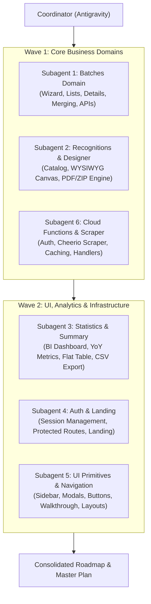

# Subagent Module Distribution & Refactoring Planning

## Goal Description

Establish an organized, distributed strategy to thoroughly analyze and plan refactoring for the entire **Chil** codebase. Six specialized subagents will be deployed to analyze dedicated, decoupled domains of the system. 

In this initial phase, all subagents will operate strictly in **Read-Only / Planning Mode**:
- Zero code modifications or destructive changes will be made to the repository.
- Each subagent will investigate its assigned domain, evaluate code health, React 19 compliance, architectural patterns, test coverage, and performance.
- Each subagent will produce a standardized, actionable **Module Analysis & Refactoring Plan** artifact (`refactor_plan_<module>.md`).
- A central synthesis report will consolidate all findings into a prioritized roadmap for subsequent implementation.

---

## User Review Required

> [!IMPORTANT]
> **Subagent Execution Model**:
> Subagents will run in read-only analysis mode, performing file inspections and static evaluations. They will **not** modify source files.
>
> We propose running the subagents in **two waves of 3 agents** (Wave 1: Core Business Domains; Wave 2: UI, Analytics & Backend) to optimize memory and process limits on the host environment.

> [!NOTE]
> Each subagent will write its findings directly to an artifact in `<Artifact Directory>/refactor_plan_<module>.md` and notify the coordinator upon completion.

---

## Open Questions

1. **Concurrency Preference**: Would you prefer all 6 subagents to be launched simultaneously, or staged in 2 batches (3 at a time) to avoid resource exhaustion in Termux? *(Recommended: 2 batches of 3)*.
2. **Priority Focus Areas**: Are there specific technical priorities you want emphasized across all modules? (e.g., Strict TypeScript typing, React 19 Hooks & Compiler optimization, Unit test coverage, or Bundle size reduction).

---

## Proposed Distribution & Strategy

### Architecture & Agent Distribution Overview



---

### Module Assignments & Boundaries

---

#### 1. Module: Batches Domain (`src/features/batches/` & shared batch types)
- **Assigned Subagent**: `Subagent 1: Batches Specialist`
- **Scope**:
  - Wizard creation flow: [`src/features/batches/components/wizard/`](file:///data/data/com.termux/files/home/chil/src/features/batches/components/wizard) (`WizardStepper`, `Step1Org`, `wizardHelpers`, `wizardSchema`, `ScraperAlertModals`).
  - Batch list & detail: [`src/features/batches/components/list/`](file:///data/data/com.termux/files/home/chil/src/features/batches/components/list), [`src/features/batches/components/detail/`](file:///data/data/com.termux/files/home/chil/src/features/batches/components/detail).
  - Quick emission: [`src/features/batches/components/QuickRecognition.tsx`](file:///data/data/com.termux/files/home/chil/src/features/batches/components/QuickRecognition.tsx), [`src/features/batches/hooks/useQuickRecognition.ts`](file:///data/data/com.termux/files/home/chil/src/features/batches/hooks/useQuickRecognition.ts).
  - API layers: [`src/features/batches/api/`](file:///data/data/com.termux/files/home/chil/src/features/batches/api) (`batchesCrud`, `membersCrud`, `batchReports`, `hierarchyApi`, `recognitionMetadata`, `scraperApi`).
  - Types: [`src/types/batch.ts`](file:///data/data/com.termux/files/home/chil/src/types/batch.ts), [`src/types/member.ts`](file:///data/data/com.termux/files/home/chil/src/types/member.ts).
- **Deliverable**: `refactor_plan_batches.md`

---

#### 2. Module: Recognitions & Certificate Designer (`src/features/recognitions/`)
- **Assigned Subagent**: `Subagent 2: Recognitions & Designer Specialist`
- **Scope**:
  - Catalog: [`src/features/recognitions/components/RecognitionCatalog.tsx`](file:///data/data/com.termux/files/home/chil/src/features/recognitions/components/RecognitionCatalog.tsx).
  - Visual Designer: [`src/features/recognitions/components/CertificateDesigner.tsx`](file:///data/data/com.termux/files/home/chil/src/features/recognitions/components/CertificateDesigner.tsx), [`src/features/recognitions/components/GuidelinesOverlay.tsx`](file:///data/data/com.termux/files/home/chil/src/features/recognitions/components/GuidelinesOverlay.tsx).
  - Document Engine: [`src/features/recognitions/services/certificatePdfGenerator.ts`](file:///data/data/com.termux/files/home/chil/src/features/recognitions/services/certificatePdfGenerator.ts) (jsPDF rendering, JSZip packing, font loading).
  - Types & Validation: [`src/features/recognitions/types/index.ts`](file:///data/data/com.termux/files/home/chil/src/features/recognitions/types/index.ts).
- **Deliverable**: `refactor_plan_recognitions.md`

---

#### 3. Module: Statistics Dashboard & Summary Audit (`src/features/statistics/` & `src/features/summary/`)
- **Assigned Subagent**: `Subagent 3: Analytics Specialist`
- **Scope**:
  - Statistics Dashboard: [`src/features/statistics/components/StatisticsDashboard.tsx`](file:///data/data/com.termux/files/home/chil/src/features/statistics/components/StatisticsDashboard.tsx), [`StatKpiGrid.tsx`](file:///data/data/com.termux/files/home/chil/src/features/statistics/components/StatKpiGrid.tsx), charts (`MonthlyTrendChart`, `DemographicsDonut`, `GeographicBarChart`).
  - Analytics Utilities: [`src/features/statistics/utils/statsCalculators.ts`](file:///data/data/com.termux/files/home/chil/src/features/statistics/utils/statsCalculators.ts) (YoY calculations, member deduplication, territory metrics), [`statsPdfExport.ts`](file:///data/data/com.termux/files/home/chil/src/features/statistics/utils/statsPdfExport.ts).
  - Summary View: [`src/features/summary/components/SummaryView.tsx`](file:///data/data/com.termux/files/home/chil/src/features/summary/components/SummaryView.tsx) and CSV export [`excelExport.ts`](file:///data/data/com.termux/files/home/chil/src/features/summary/utils/excelExport.ts).
- **Deliverable**: `refactor_plan_statistics_summary.md`

---

#### 4. Module: Authentication & Public Landing (`src/features/auth/` & `src/features/landing/`)
- **Assigned Subagent**: `Subagent 4: Auth & Landing Specialist`
- **Scope**:
  - Auth: [`src/features/auth/components/LoginPage.tsx`](file:///data/data/com.termux/files/home/chil/src/features/auth/components/LoginPage.tsx), [`RegisterPage.tsx`](file:///data/data/com.termux/files/home/chil/src/features/auth/components/RegisterPage.tsx), [`ForgotPasswordModal.tsx`](file:///data/data/com.termux/files/home/chil/src/features/auth/components/ForgotPasswordModal.tsx), [`ProtectedRoute.tsx`](file:///data/data/com.termux/files/home/chil/src/features/auth/components/ProtectedRoute.tsx).
  - Auth Context & State: [`src/features/auth/context/AuthContext.tsx`](file:///data/data/com.termux/files/home/chil/src/features/auth/context/AuthContext.tsx), [`useAuth.ts`](file:///data/data/com.termux/files/home/chil/src/features/auth/hooks/useAuth.ts).
  - Landing: [`src/features/landing/components/LandingPage.tsx`](file:///data/data/com.termux/files/home/chil/src/features/landing/components/LandingPage.tsx) (`HeroSection`, `FeatureGridSection`, `WorkflowSection`).
- **Deliverable**: `refactor_plan_auth_landing.md`

---

#### 5. Module: UI Primitives, Navigation & Walkthroughs (`src/components/`, `src/layouts/`)
- **Assigned Subagent**: `Subagent 5: UI & Design System Specialist`
- **Scope**:
  - UI Primitives: [`src/components/Button.tsx`](file:///data/data/com.termux/files/home/chil/src/components/Button.tsx), [`Card.tsx`](file:///data/data/com.termux/files/home/chil/src/components/Card.tsx), [`Field.tsx`](file:///data/data/com.termux/files/home/chil/src/components/Field.tsx), [`Modal.tsx`](file:///data/data/com.termux/files/home/chil/src/components/Modal.tsx), [`Table.tsx`](file:///data/data/com.termux/files/home/chil/src/components/Table.tsx), [`SearchSelectorModal.tsx`](file:///data/data/com.termux/files/home/chil/src/components/SearchSelectorModal.tsx).
  - Navigation: [`src/components/navigation/Sidebar.tsx`](file:///data/data/com.termux/files/home/chil/src/components/navigation/Sidebar.tsx), [`Navbar.tsx`](file:///data/data/com.termux/files/home/chil/src/components/navigation/Navbar.tsx).
  - Layouts: [`src/layouts/MainLayout.tsx`](file:///data/data/com.termux/files/home/chil/src/layouts/MainLayout.tsx).
  - Walkthrough: [`src/components/walkthrough/`](file:///data/data/com.termux/files/home/chil/src/components/walkthrough) (`WalkthroughOverlay`, `WalkthroughDialog`, `useWalkthrough`).
- **Deliverable**: `refactor_plan_ui_navigation.md`

---

#### 6. Module: Cloud Functions & Scraper Engine (`functions/`)
- **Assigned Subagent**: `Subagent 6: Backend & Scraper Specialist`
- **Scope**:
  - Functions index & entry point: [`functions/index.js`](file:///data/data/com.termux/files/home/chil/functions/index.js).
  - Callables: [`functions/handlers/loginScraper.js`](file:///data/data/com.termux/files/home/chil/functions/handlers/loginScraper.js), [`functions/handlers/getMemberStatus.js`](file:///data/data/com.termux/files/home/chil/functions/handlers/getMemberStatus.js).
  - Scraper core: [`functions/scraper/auth.js`](file:///data/data/com.termux/files/home/chil/functions/scraper/auth.js), [`lookup.js`](file:///data/data/com.termux/files/home/chil/functions/scraper/lookup.js), [`cookieHelper.js`](file:///data/data/com.termux/files/home/chil/functions/scraper/cookieHelper.js).
  - Tests & fixtures: [`functions/__tests__/`](file:///data/data/com.termux/files/home/chil/functions/__tests__).
- **Deliverable**: `refactor_plan_backend_scraper.md`

---

### Standardized Subagent Deliverable Template

Each subagent will be instructed to structure its output artifact according to this standard schema:

```markdown
# [Module Name] Analysis & Refactoring Plan

## 1. Domain Responsibility & Architectural Overview
- High-level role of the module in the Chil system
- Key dependencies (internal and external)

## 2. Code Quality & Technical Debt Assessment
- Anti-patterns (prop drilling, unnecessary re-renders, useEffect misuses)
- React 19 compatibility & Modern Composition Patterns
- Type safety evaluation (use of `any`, type assertions, Zod schemas)
- Performance bottlenecks (bundle size, heavy loops, DOM recalculations)

## 3. Test Coverage & Resilience Analysis
- Existing test suites vs untested critical paths
- Edge cases currently unaccounted for

## 4. Prioritized Refactoring Proposals
- **P0 (Critical / High Impact)**: Fixes for fragility, type safety, or security
- **P1 (Architecture & Performance)**: Modularity, state decoupling, memoization
- **P2 (Polish & DX)**: Code deduplication, naming, docstrings

## 5. Risk Assessment & Verification Strategy
- Potential regressions
- Required test cases and assertions
```

---

## Verification Plan

### Plan Quality Validation
1. **Scope Coverage**: Verify that every single module in the repository has a dedicated artifact without overlaps or omissions.
2. **Actionability**: Ensure each proposal specifies exact file targets and measurable improvements (e.g., eliminating `any`, decoupling side effects, component splitting).
3. **Non-Destructive Guarantee**: Confirm that no files in `src/`, `functions/`, or `scripts/` were modified during the planning phase.
